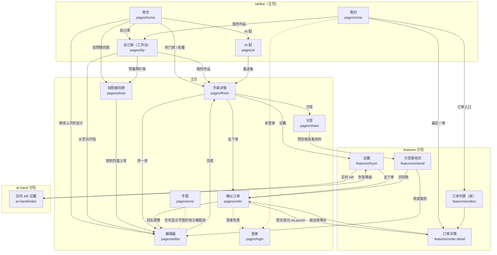

# 01 信息架构与页面清单

> 基线：分支 `design/ui-revamp`（`edd9fdf`）。文中“现状”都指这个提交里的代码。
> 本文只定“有哪些页面、各自管什么、怎么互相到达”。流程细节见 [02](02-core-flows.md)，每页长什么样见 [04](04-page-redesign.md)。

## 1. 现状盘点

`miniprogram/app.json` 现在登记了 16 个页面：主包 12 个，`ar-hand` 分包 1 个，`features` 分包 3 个。

| # | 路由 | 现在的标题 | 现在管什么 | 主要问题 |
|---|---|---|---|---|
| 1 | `pages/home/home`（tab） | 串个珠 | 轮播、四个圆形入口、热门款两列卡片 | 四个入口用字符 `⊕ ✧ ▣ ◎` 当图标；“拍照试戴”没有设计时只弹一句 toast，是个死入口（`home.js` 的 `tryLast`）；每张卡片塞了“试戴”“用这款”两个按钮 |
| 2 | `pages/diy/diy`（tab） | 自己串 | 手围行、继续上次设计、空白开始、照着照片串、**又一遍热门款** | 和首页用同一个 `ui.catalogCards` 渲染同一批模板，内容重复；首次进入会被强行推去手围页（`diy.js` 的 `onShow`） |
| 3 | `pages/ai/ai`（tab） | AI 配 | 对话、方案横滑卡片、追问筹码、输入框 | 语音按钮是 emoji `🎙`，点了只弹“暂不可用”；发送键是字符 `↑`；示例文案“送爸妈，保平安”含禁用词“保平安” |
| 4 | `pages/mine/mine`（tab） | 我的 | 手围、全部订单、全部作品、刷新云端按钮 | 订单和作品全量平铺在一页，越用越长；“待支付”等状态的 `status-pending` 样式在 `mine.wxss` 和 `order-detail.wxss` 里都没定义，显示成默认灰色 |
| 5 | `pages/editor/editor` | 设计手串 | 3D 托盘、工具列、尺寸提示、材料面板、材料清单、底栏 | “更多”打开的弹层叫“设计设置”，齿轮打开的弹层叫“个性选择”，两个设置入口；手围在摘要行、个性选择、手围页三处可改；尺寸只有一句文字，没有量尺 |
| 6 | `pages/finish/finish` | 设计完成 | 3D 预览、返回修改/试戴/保存、AI 评价、底栏分享和下单 | 只能从编辑器进来，热门款和 AI 方案想直接买也得先进编辑器绕一圈 |
| 7 | `pages/order/order` | 确认订单 | 材料明细、选项、收货信息、提交；提交成功后的结果区 | 收货信息排在最后；改价提示和离线提示用内联样式；提交成功后 `nav.orderComplete` 直接 `reLaunch` 到订单详情，页面里“订单已创建”那段（`order.wxml` 的 `wx:elif="{{order}}"`）实际走不到 |
| 8 | `pages/photo/photo` | 拍照做同款 | 选图、识别、认珠确认 | 图标是字符 `◎`；四种状态（初始、识别中、失败、结果）视觉上没有区分 |
| 9 | `pages/login/login` | 登录 | 一个微信登录按钮 | `utils/auth.js` 本来就会静默登录，这页只在登录失败时才有意义，但入口写得像“必须先登录” |
| 10 | `pages/wrist/wrist` | 手围 | 步进、预设、量法 | 没有“先跳过”的出口，首次被强推进来只能填 |
| 11 | `pages/share/share` | 分享 | 海报、准备分享、保存图片；内嵌一个“好友预览” | “好友预览”是 `features/shared` 的手写翻版，两份布局各自维护 |
| 12 | `pages/ar-tryon/ar-tryon` | AR 试戴 | 只做一次 `redirectTo('/ar-hand/index')` | 纯跳板页，白屏闪一下；目录里还留着没人引用的 `yuv.js` |
| 13 | `ar-hand/index`（分包） | 实时试戴 | 相机、模型进度、手串叠加 | “复制诊断信息”这类调试按钮和用户按钮混在一起 |
| 14 | `features/tryon/tryon`（分包） | 试戴 | 照片叠加、3D 模型手、AR 入口 | 第一个控件是“实时 AR 试戴（测试）”，把实验功能放在最显眼的位置 |
| 15 | `features/shared/shared`（分包） | 分享的设计 | 分享落地页 | 加载、错误都是一行裸文字 |
| 16 | `features/order-detail/order-detail`（分包） | 订单详情 | 状态、五组状态码、物流、材料、金额、地址、动作 | 把“订单 / 支付 / 制作履约 / 物流 / 售后”五组内部状态原样排成格子给用户看 |

全局问题（量化）：

- 各页 wxss 里一共出现 **98 种颜色值、19 种字号、13 种圆角**，没有一个 CSS 变量（`grep -rnoE '#[0-9a-fA-F]{3,8}' miniprogram --include='*.wxss'`）。
- “正在使用离线示例数据”这条提示用同一段内联 `style="..."` 复制在 10 个页面的 wxml 里。
- 状态标签样式在 `mine.wxss` 和 `order-detail.wxss` 各写一份，数值还不一样。
- tabBar 没有图标（`app.json` 的 `tabBar.list` 只有文字）。

## 2. 调整结论

### 2.1 tab 怎么定

**保留 4 个 tab，名字不变，职责重新划分。**

| tab | 新职责 | 和现在的差别 |
|---|---|---|
| 首页 | **逛**：轮播、三种做法的入口、继续上次的设计、热门款 | 入口从四个减到三个（去掉死入口“拍照试戴”）；加“继续上次的设计” |
| 自己串 | **工作台**：从空白开始、照着照片串、我的作品（本机和云端合一） | 去掉重复的热门款列表；作品从“我的”搬到这里 |
| AI 配 | **对话配珠**（不变） | 去掉不能用的语音按钮 |
| 我的 | **账号与订单**：登录状态、手围、订单入口、客服与说明 | 作品搬走；订单只留状态快捷入口和最近一单，全量进订单列表页 |

理由：

1. 首页和“自己串”现在是两个长得差不多的起点页。把模板只留在首页、把作品收进“自己串”，两个 tab 各有一件别处没有的事可做。
2. “回来接着改”是老用户最常做的事，现在作品藏在“我的”第二屏。放进“自己串”后，一个 tab 同时回答“从哪开始”和“上次做到哪”。
3. “我的”只剩账号、手围、订单，一屏看完。
4. AI 配是带输入框的对话页，放在 tab 里可以保留对话现场，不动。

备选（见 README“待负责人确认”第 1 条）：改成 3 个 tab（首页 / AI 配 / 我的），“自己串”并进首页。没选它，是因为“自己串”是产品名的本义，值得一个常驻入口。

tabBar 用原生的，不做自定义 tabBar（省一层兼容风险）。图标 8 张本地 png（4 个 tab × 未选中/选中），81×81px，规格见 [03 第 4.3 节](03-design-system.md)。

### 2.2 合并

| 合并什么 | 做法 | 理由 |
|---|---|---|
| “完成设计”页 → **手串详情页** | 路由不变（`pages/finish/finish`），标题改成“手串详情”。热门款、AI 方案、我的作品、编辑器“完成”都先到这一页 | 它本来就是“一条手串的全貌 + 试戴 / 分享 / 下单”的页面。让所有来源都经过它，想直接买的人少绕一次编辑器，想改的人点“改一改” |
| 分享页里的“好友预览” → 分享落地页 | 删掉 `share.wxml` 里 `wx:if="{{preview && design}}"` 那一段，改成跳 `features/shared/shared?preview=1`，由落地页读本机当前设计渲染 | 两份布局只留一份 |
| 编辑器的“设计设置”和“个性选择” → 一个“手串设置”弹层 + 一个“筛选”弹层 | 名称、按颗数串、按手围重排、保存同步归“手串设置”；尺寸、色系、寓意归“筛选”；手围只走手围页 | 现在两个弹层都叫“设置”，手围有三个修改入口 |
| 下单页的“订单已创建”结果区 → 订单详情 | 删掉 `order.wxml` 里 `wx:elif="{{order}}"` 那一段；订单详情收到 `created=1` 时在顶部显示“订单已提交”提示 | 那段代码现在走不到，而且和订单详情重复 |
| AR 跳板页 → 直接进分包 | 删掉 `pages/ar-tryon/`，入口直接 `navigateTo('/ar-hand/index')` | 少一次白屏跳转；主包少一个页面 |
| 10 处内联的离线提示 → `ui-notice` 组件 | 见 [03](03-design-system.md) | 一处改全站变 |

### 2.3 拆分 / 新增

| 新增什么 | 路由 | 理由 |
|---|---|---|
| **订单列表页** | `features/orders/orders`（进 `features` 分包） | “我的”不再平铺全部订单；列表页按状态筛选（全部 / 待支付 / 制作中 / 待收货 / 售后） |

只新增这一个页面。其余都是在现有页面里重排。

### 2.4 改版后的页面清单（16 → 16）

删 1 个（`pages/ar-tryon`），加 1 个（`features/orders`），总数不变。主包 11 个，`ar-hand` 分包 1 个，`features` 分包 4 个。

## 3. 站点地图

外部入口：微信分享卡片 → `features/shared/shared?id=…`（唯一的外部落地页）。`sitemap.json` 只放开首页和分享落地页的索引，其余页面不索引（现在是全放开）。

## 4. 页面清单

每页写：目的、入口、出口、内容区块（从上到下）、状态。“状态”里没列出的情况一律不出现空白屏：加载用骨架屏，失败用 `ui-empty` 的错误变体加“重试”。

### 4.1 首页 `pages/home/home`（tab）

- **目的**：让第一次来的人 10 秒内明白“这里能做什么”，让回来的人一步接上次的事。
- **入口**：启动默认页；tabBar；下单页不再有“回首页”按钮（那段删了）。
- **出口**：手串详情（热门款、轮播）、编辑器（继续上次的设计）、自己串 tab、AI 配 tab、拍照做同款、手围页。
- **区块**：① 离线数据提示条（有才显示）② 轮播大图 ③ 继续上次的设计（本机有草稿才显示）④ 三种做法入口 ⑤ “热门款”标题 + 手围说明 ⑥ 热门款两列。
- **状态**：加载＝轮播和 4 张卡片的骨架；目录请求失败且没有离线快照＝错误空状态“热门款没加载出来”+ 重试；目录为空＝空状态“热门款正在准备”，三种做法入口照常可用；离线快照＝顶部琥珀色提示条。

### 4.2 自己串（工作台）`pages/diy/diy`（tab）

- **目的**：开始一条新的，或者接着改一条旧的。
- **入口**：tabBar；首页“自己串”入口；“我的”里的“我的作品”。
- **出口**：编辑器（从空白开始）、拍照做同款、手串详情（点作品）、手围页、首页（“去看热门款”）。
- **区块**：① 手围说明行 ② 两个起点：从空白开始、照着照片串 ③ “我的作品”标题 + 同步状态 ④ 作品列表（最近改的在前，本机和云端合一，每条带“仅本机 / 已同步”标记）⑤ 底部一行文字链“想从现成的款式改？去看热门款”。
- **状态**：没有作品＝空状态“还没有作品”，说明“做好的手串会自动存在这里”；云端读取失败＝列表上方提示条“云端作品没读到，本机作品可以照常用”+ 重试，本机作品照常显示；未登录＝只显示本机作品，不催登录。
- **不再做的事**：不再首次强推手围页；不再列热门款。

### 4.3 AI 配 `pages/ai/ai`（tab）

- **目的**：说一句心愿，拿到三条能直接用的方案。
- **入口**：tabBar；首页“AI 配”入口。
- **出口**：手串详情（看这条）、手围页（顶部手围行）。
- **区块**：① 手围说明行 + 清空对话 ② 欢迎区（没有对话时）：一句引导 + 3 个示例 ③ 对话流：我的话、回复、方案横滑卡片 ④ 底部：追问筹码（有结果后出现）+ 输入框 + 发送键。
- **状态**：等待＝回复气泡里三个点的呼吸动画 + “正在配，通常要十几秒”；AI 不可用降级到方案库＝回复上方一个中性标记“方案库推荐”；请求失败＝输入框上方错误条，原话放回输入框；方案里没有可用珠子＝该卡片显示“这条暂时配不齐”，不能点。

### 4.4 我的 `pages/mine/mine`（tab）

- **目的**：看订单、管手围、找到客服。
- **入口**：tabBar；下单失败提示里的“查看我的订单”。
- **出口**：订单列表（带筛选参数）、订单详情（最近一单）、手围页、自己串 tab、登录页（登录失败时）。
- **区块**：① 账号卡：已登录显示“微信用户 · 已登录”，未登录显示“登录后可以查看订单、同步作品”+ 登录按钮 ② 订单卡：标题行“我的订单 · 全部 ›”，四个状态入口（待支付 / 制作中 / 待收货 / 售后，带数量角标），下面是最近一单的摘要 ③ 列表：我的手围、我的作品、联系客服、隐私与说明。
- **状态**：未登录＝订单卡显示空状态“登录后查看订单”；订单读取中＝订单卡骨架；读取失败＝卡内错误提示 + 重试；没有订单＝“还没有订单”。
- **不做**：不显示头像昵称（没有采集），不放积分、优惠券这类没有的功能。

### 4.5 编辑器 `pages/editor/editor`

- **目的**：一颗一颗把手串串出来，随时知道长度合不合适、多少钱。
- **入口**：自己串“从空白开始”；首页“继续上次的设计”；手串详情“改一改”；拍照做同款“放到托盘上改”；分享落地页“改成我的”；下单页“回去调整”。
- **出口**：手串详情（完成）、手围页；系统返回键回到来源页，草稿自动保存。
- **区块**：① 托盘（3D 预览，左上手围筹码，右侧工具列：撤销、翻转、音效、垃圾桶）② 尺寸量尺行（平时显示量尺和“补齐 N 颗”；选中珠子时换成“前移 / 后移 / 删除 / 完成”）③ 材料面板（珠子 / 配饰 / 绳子 三段切换，筛选键，左侧分类栏，三列珠子格）④ 底栏（价格、材料清单入口、手串设置键、“完成”主按钮）。
- **弹层**：材料清单、珠子详情（长按）、筛选、手串设置。
- **状态**：空托盘＝托盘中央提示“点下面的珠子，开始串”；目录加载中＝材料面板骨架，“完成”禁用；3D 不可用＝平面圆环降级（现有逻辑）；有下架材料＝量尺行换成红色提示“有材料已下架，点它替换”，“完成”禁用；筛选无结果＝面板内空状态 + “清除筛选”。

### 4.6 手串详情 `pages/finish/finish`

- **目的**：一条手串的全貌和下一步：试戴、分享、改、买。
- **入口**：首页热门款和轮播、AI 方案、我的作品、编辑器“完成”。
- **出口**：编辑器（改一改）、试戴、分享、确认订单；系统返回回到来源。
- **区块**：① 托盘大图（3D，可拖动旋转）② 名称、寓意标签、规格行（颗数 · 总长 · 手围，手围可点）③ 尺寸状态条（合适 / 偏差 / 多圈）④ 三个次要动作：试戴、分享、保存 ⑤ 材料清单（每种一行，含安全提示条）⑥ “AI 帮你看看”（默认收起成一行，点了才请求）⑦ 底栏：价格 + “改一改” + “去下单”。
- **状态**：材料加载中＝托盘和清单骨架，价格显示“—”；有下架材料＝顶部红色提示条 +“去下单”禁用 +“改一改”变主按钮；AI 评价失败＝卡内错误 + 重试；少于 6 颗＝“去下单”禁用，说明“至少 6 颗才能下单”。

### 4.7 确认订单 `pages/order/order`

- **目的**：核对东西、尺寸、安全提示、地址和钱，提交。
- **入口**：手串详情、试戴、分享页、分享落地页“买同款”、订单详情“按这款再买”。
- **出口**：订单详情（提交成功，`reLaunch`）、编辑器（回去调整）、手围页、登录页（登录失败）。
- **区块**：① 改价提示条（有才显示，没确认前常驻）② 收货信息（“用微信地址”+ 三个输入框）③ 手串摘要（缩略图、名称、颗数、手围 / 总长，尺寸偏差提示）④ 材料明细（默认前 3 种，可展开）⑤ **材料安全提示条 + 勾选“我已阅读”**（有才显示）⑥ 选项（穿绳、礼盒）⑦ 金额明细 ⑧ 支付说明条 ⑨ 底栏：合计 + 提交订单。
- **弹层**：改价确认、提交确认（尺寸 + 安全 + 金额）。
- **状态**：价格刷新中＝金额处骨架，提交键“正在核对价格…”；改价未确认＝提交键“先确认新价格”且禁用；有下架材料＝红色提示条 + 提交键禁用 + “返回修改设计”；提交中＝按钮 loading；登录失败＝错误条 + “去登录”；提交失败＝错误条，说明下一步该做什么。

### 4.8 拍照做同款 `pages/photo/photo`

- **目的**：一张照片变成一条能改能买的手串。
- **入口**：首页、自己串。
- **出口**：编辑器（放到托盘上改）；系统返回。
- **区块（四种状态各一屏）**：初始＝取景框插画 + 三步说明 + 隐私说明 + 底部“拍照或从相册选”；识别中＝照片 + 进度文案；失败＝照片 + 原因 + “换一张”和“改成自己串”；结果＝照片与识别说明、托盘预览、三个角色的备选珠子、间隔选择、底栏价格 + “放到托盘上改”。
- **状态**：拒绝隐私授权＝留在初始屏，提示条说明“没有照片也可以自己串”；AI 不可用＝结果屏顶部中性标记“按照片颜色估算的”。

### 4.9 手围 `pages/wrist/wrist`

- **目的**：量一次手围，全站通用。
- **入口**：任何显示手围的地方（首页、自己串、AI 配、编辑器、手串详情、下单页、我的）；下单前手围没确认过时自动进。
- **出口**：返回来源页。
- **区块**：① 一句说明 ② 大号数字 + 加减键 + 刻度条 ③ 常用值筹码 ④ “怎么量”三步 ⑤ 底栏“确定”；从非下单来源进入且从没确认过时，多一个文字按钮“先按 15cm，稍后再量”。
- **状态**：输入越界＝输入框下红字“请输入 8–30 cm”。

### 4.10 分享 `pages/share/share`

- **目的**：生成一张海报，发给朋友或存到相册。
- **入口**：手串详情、试戴、编辑器的手串设置。
- **出口**：分享落地页（预览模式）、确认订单；系统返回。
- **区块**：① 海报预览 ② 一句说明 ③ 两个并排动作：发给微信好友（主）、保存图片 ④ 文字链“看看朋友打开是什么样”⑤ 底栏：价格 + 去下单。
- **状态**：海报生成中＝海报位置骨架；3D 快照失败＝错误提示 + 重试，仍然可以“发给微信好友”（卡片不依赖海报）；分享链接生成失败＝按钮下红字 + 重试；相册权限被拒＝提示 + “打开权限设置”。

### 4.11 登录 `pages/login/login`

- **目的**：静默登录失败时的兜底。平时用户不会看到它。
- **入口**：“我的”未登录时的登录按钮（先原地尝试，失败才进这页）；下单 401。
- **出口**：登录成功返回来源页并继续刚才的动作。
- **区块**：① 标志 + 一句话说明登录后能做什么 ② 微信登录按钮 ③ 错误提示 ④ “暂不登录”文字按钮（返回）⑤ 开发版小字。

### 4.12 试戴 `features/tryon/tryon`

- **目的**：下单前看看戴在手上的样子。
- **入口**：手串详情、首页热门款卡片上的试戴角标。
- **出口**：实时 AR、分享、确认订单。
- **区块**：① 三段切换：照片试戴 / 3D 模型手 / 实时 AR（标“实验”）② 舞台区 ③ 调节控件（照片：大小、旋转、倾斜、隐藏后侧；模型手：肤色）④ 尺寸说明 ⑤ 底栏：价格 + 分享 + 去下单。
- **状态**：没照片＝舞台里空状态 + “拍照 / 选照片”主按钮；3D 不可用＝自动切到照片模式并提示；拒绝授权＝提示条 + 仍可用 3D 模型手。

### 4.13 实时 AR 试戴 `ar-hand/index`

- **目的**：相机里实时看手串跟着手腕。
- **入口**：试戴页的“实时 AR”。
- **出口**：返回试戴页；失败时“改用照片试戴”。
- **区块**：① 全屏相机画面 ② 顶部状态胶囊 ③ 底部控制条：定格、大小滑杆、切换摄像头 ④ 一行说明（仅本机处理、示意效果）。“复制诊断信息”收进右上角“···”，只在开发版和体验版显示。
- **状态**：模型下载＝进度条 + 百分比 + 体积说明；超时或失败＝错误面板：改用照片试戴（主）、重新尝试、打开权限设置。

### 4.14 分享落地页 `features/shared/shared`

- **目的**：朋友点开分享卡片后看到的页面；也是分享者的预览。
- **入口**：微信分享卡片（`?id=`）；分享页“看看朋友打开是什么样”（`?preview=1`）。
- **出口**：编辑器（改成我的）、确认订单（买同款）、首页（“我也串一条”）。
- **区块**：① 托盘大图 ② 名称、寓意、“已按你的 X cm 手围重新排好”③ 每种珠子的寓意 ④ 安全提示条（有才显示）⑤ 底栏：价格 + 改成我的 + 买同款。
- **状态**：加载＝骨架；链接失效＝错误空状态“这条分享打不开了”+ “去首页看看”；预览模式＝顶部提示条“这是朋友看到的样子”，底栏按钮禁用。

### 4.15 订单列表（新）`features/orders/orders`

- **目的**：按状态找订单。
- **入口**：“我的”的“全部”和四个状态入口（带 `?tab=`）。
- **出口**：订单详情。
- **区块**：① 状态筛选条：全部 / 待支付 / 制作中 / 待收货 / 售后 ② 订单卡列表（缩略图、名称、状态标签、订单号、金额、一句状态说明）。
- **状态**：加载＝3 张卡片骨架；空＝按筛选给不同文案；失败＝错误空状态 + 重试；未登录＝先尝试静默登录，失败显示“登录后查看订单”+ 登录按钮。

### 4.16 订单详情 `features/order-detail/order-detail`

- **目的**：一笔订单现在到哪了、我能做什么。
- **入口**：订单列表、“我的”最近一单、下单成功（`?created=1`）。
- **出口**：确认订单（按这款再买）；系统返回（下单成功进来时返回键回“我的”）。
- **区块**：① 状态头（大号状态词 + 一句说明 + 进度条或异常说明）② 支付说明条（待支付且支付未开放时）③ 物流卡（发货后）④ 售后卡（有售后时）⑤ 手串摘要 ⑥ 材料明细（含安全提示条）⑦ 金额明细 ⑧ 收货信息 ⑨ 订单信息（订单号可复制、下单时间）⑩ 底部动作栏（只渲染 `allowedActions` 里有的）。
- **状态**：加载＝骨架；失败＝错误空状态 + 重试；动作提交中＝按钮 loading，其余禁用。
- **和状态契约的对应**见 [02 第 9 节](02-core-flows.md) 和 [04 第 16 节](04-page-redesign.md)。

## 5. 全局规则

1. **手围不拦路**：浏览、设计、试戴都不强制量手围，没量过就按 15cm 并明说；只有“去下单”这一步强制确认一次。
2. **登录不拦路**：`utils/auth.js` 静默登录；只有登录失败才出现登录页。
3. **一条手串只有一个详情页**：不管来自模板、AI、作品还是编辑器，都是 `pages/finish/finish`。
4. **打开编辑器、详情、下单页一律走 `utils/nav.js`**，不直接写 `navigateTo`，避免页面栈越压越深（现在 `mine.js`、`share.js` 里还有直接 `navigateTo('/pages/editor/editor')`）。
5. **底栏统一**：凡是有价格和主动作的页面（编辑器、详情、试戴、分享、落地页、下单、拍照结果），底栏都是同一个组件，价格在左、主按钮在右。
6. **提示条统一**：离线数据、改价、材料下架、支付未开放、安全提示，都用提示条组件，按语义取色，不再手写内联样式。
