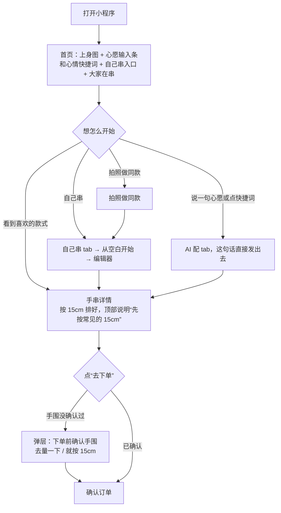
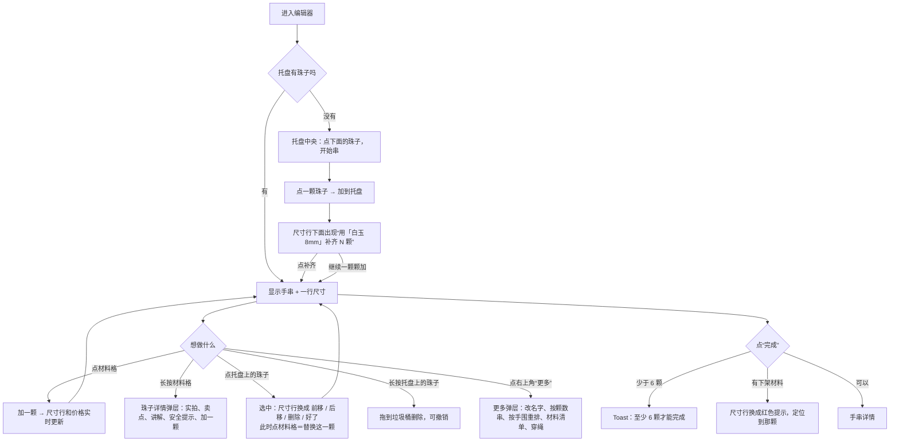
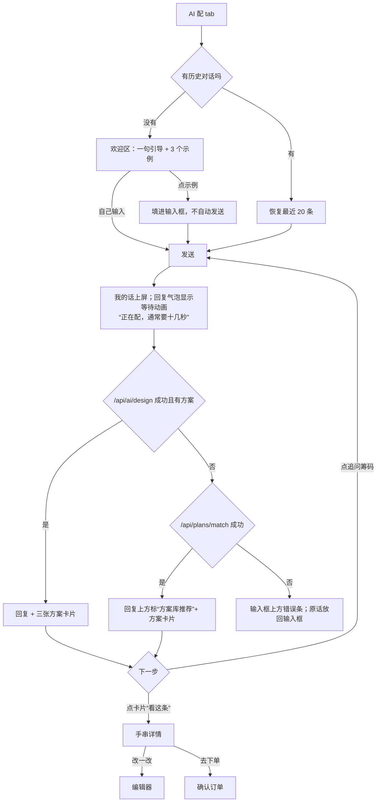
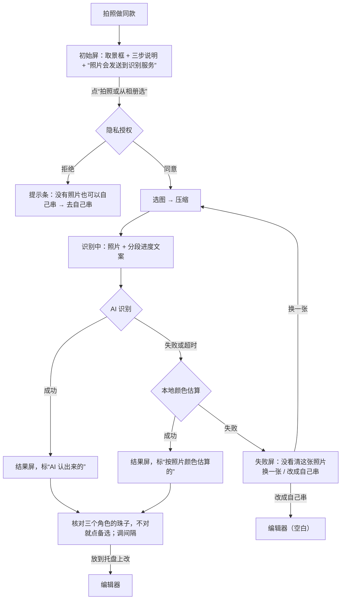
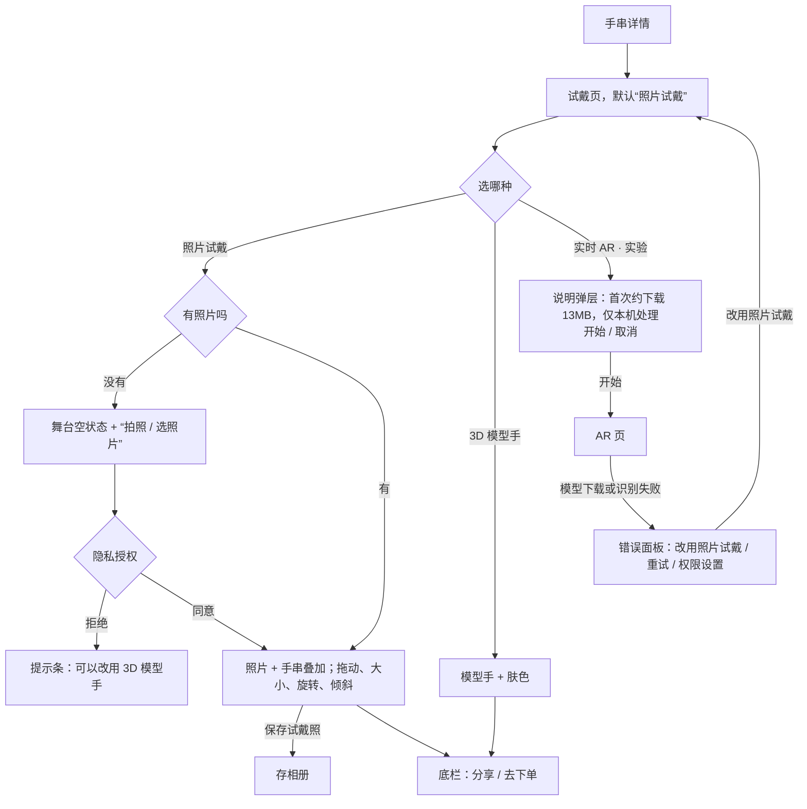
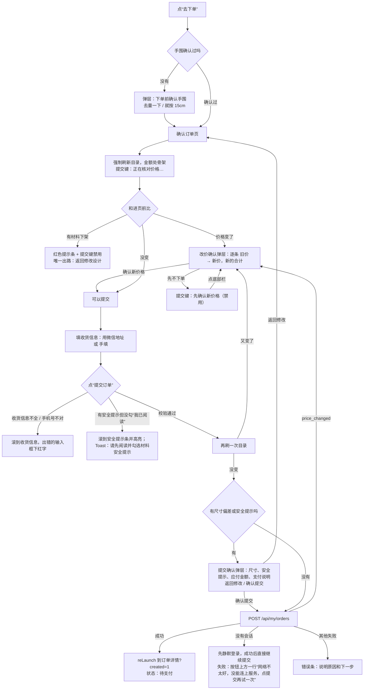
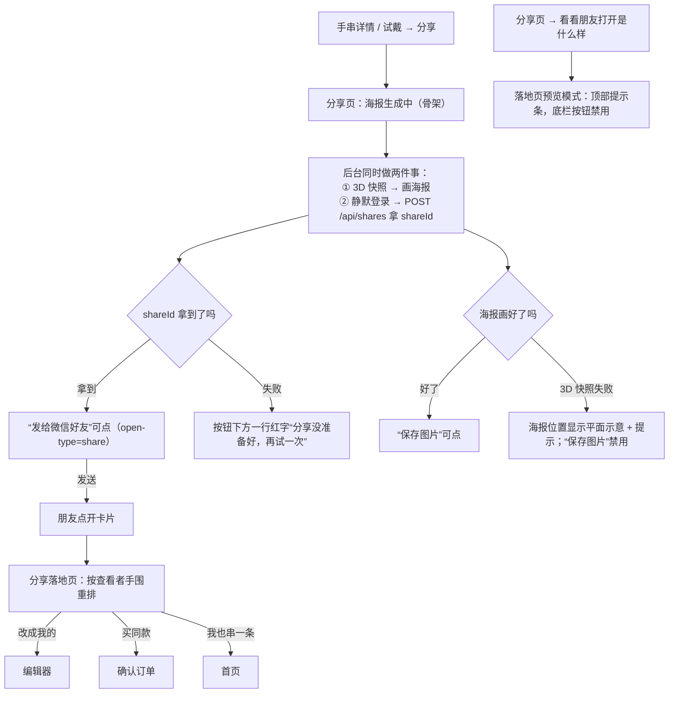

# 02 核心流程调整方案

> 每条流程写四件事：现状问题（指到文件）、调整后的步骤（流程图）、关键决策点、异常路径。
> 页面长什么样见 [04](04-page-redesign.md)；对应的开发任务编号见 [05](05-dev-tasks.md)。
> **2026-11-12 修订**：按 [00](00-users-and-direction.md)（全站白盒）和 [06](06-order-logistics-login.md) 改了冲突的地方。第 7 节（登录）和第 8 节（订单与售后）**整节由 06 替代**；第 1、2、6、9 节里涉及首页布局、量尺颜色、登录、提示条颜色、海报视觉的句子已改。其余没动。文中凡是提到“提示条”“错误条”的颜色和样子，一律以 03 的提示组件为准（只有普通和安全/错误两种语气）。

通用约定（下面各节不再重复）：

- **手围默认 15cm**，没量过时凡是用到手围的地方都明说“先按常见的 15cm”，并给入口去量。
- **金额**一律用“分”的整数算，显示时再除以 100 保留两位。
- **跳转**打开编辑器、手串详情、下单页都走 `miniprogram/utils/nav.js`。本次给它加一个 `openDetail()`（打开 `pages/finish/finish`，规则和 `openEditor` 一样：栈里有就退回去，栈深 ≥8 用 `redirectTo`）。
- **对外文字只讲寓意**。流程里出现的文案都过了 `kb/data/attributes.json` 的 banned 词表。

---

## 1. 首次进入

### 现状问题

- 第一次点“自己串”tab，`pages/diy/diy.js` 的 `onShow` 直接把人推到手围页，还没看到任何东西就被要求量手腕，手围页也没有“跳过”。
- 首页的 `requireWrist` 只拦了“AI 配”“拍照做同款”“用这款”，但卡片上的“试戴”和“自己 DIY”不拦，同一件事有的拦有的不拦。
- 首页四个入口里，“拍照试戴”在没有设计时只弹 toast“先挑一款，点卡片上的试戴”（`home.js` 的 `tryLast`），新用户点了等于没反应。

### 调整后

### 关键决策点

1. **手围什么时候问**：只在“去下单”时强制确认一次。之前一律不拦，按 15cm 并明说。理由：手围决定的是成品尺寸，和“逛”“试着串”无关；提前拦只会让人走掉。
2. **首页直接给心愿输入条**：AI 配和自己串同等重要。输入条下面是心情快捷词，再下面是自己串入口；拍照做同款是一行文字链接。试戴需要先有一条手串，入口只放在手串详情里。
3. **“接着串上次那条”放首页**：本机有草稿（`store.current()` 有珠子）时，首页多一行，一步回编辑器。

### 异常路径

- 目录加载失败且没有离线快照：首页显示错误空状态，三个入口里“自己串”“拍照做同款”会进到同样加载不出材料的页面，所以入口保持可点，但目标页各自显示加载失败和重试。
- 微信隐私授权未同意：浏览不受影响；用到相机、相册的页面由 `privacy-popup` 处理（见第 4、5 节）。
- 环境配置错误（`app.js` 的 `configError`）：保留现有的 `wx.showModal`，这是给开发者看的。

---

## 2. 自己串（选珠、编辑、尺寸、完成）

### 现状问题

- **尺寸反馈弱**：`editor.wxml` 第 7 行只有一句 `{{fit}}`（如“还差约 12mm”），颜色固定 `#8f632d`，合适和不合适长得一样。`editor.js` 的 data 里有 `meterFill / meterZoneLeft / meterZoneWidth / fitOK`，没有渲染。
- **两个“设置”**：摘要行右侧“更多 ···”打开“设计设置”（名称、按颗数、重排、保存、分享），托盘右侧齿轮打开“个性选择”（对象、珠径、手围、色系、寓意）。
- **手围三处可改**：摘要行（去手围页）、个性选择里的 `prefWrists:[14.5,15,16,17.5]`（四个固定值）、手围页。
- **安全提示不醒目**：材料清单入口那行把 `safetyNotice` 塞进一个 `max-height:72rpx;overflow:auto` 的小滚动区；选珠格子上看不出哪颗有提示，加完了才知道。
- **长按详情信息少**：只有照片、单价、`meaning`，没有卖点、讲解、安全提示。
- **字太小**：材料面板提示 20rpx，珠子名 22rpx 且单行截断。
- **“完成设计”之后**才到完成页，完成页的“返回修改”用 `wx.navigateBack()`，只有从编辑器进来才对。

### 调整后

尺寸提示的四种状态（数据全部来自现有的 `logic.stats()`，不改规则）。**不画量尺**，只用一行文字，全部是主字色，有偏差时加粗：

| 状态 | 条件（`logic.js` 现有判断） | 尺寸行右侧的文字 |
|---|---|---|
| 合适 | 差值在 −4 到 +6mm | 手围 15cm · 合适 |
| 偏短 | 差值 < −4mm | 手围 15cm · 还差约 N mm（加粗）；下面一行文字链接“用「海蓝宝 8mm」补齐 N 颗” |
| 偏长 | 差值 > +6mm | 手围 15cm · 超出约 N mm（加粗） |
| 多圈 | 颗数 ≥ 54 | 多圈串，长度以实际佩戴为准 |

### 关键决策点

1. **尺寸行常驻**：尺寸是这款产品最容易出错的地方，不折叠；但只用一行文字，不画量尺。
2. **名称和按颗数串继续收起**，放进舞台右上角“更多”打开的弹层。它们是低频操作。
3. **“个性选择”拆掉**：珠径、色系、寓意并入“筛选”弹层（它们的作用本来就是筛选和排序材料）；“手围”删掉（走手围页）；“佩戴对象”只是存进 `design.preferences.recipient`，不影响任何筛选，移到“手串设置”里。
4. **有安全提示的珠子在格子上就标出来**：格子右上角一个红点。用户加之前就知道，不是加完才看到。
5. **“完成”不因尺寸偏差拦人**：偏差在详情页继续提示，在下单时强制确认（第 6 节）。理由：有人就是要做偏松的，或者先存着。
6. **“分享设计”从编辑器弹层里拿掉**：分享入口统一在手串详情。

### 异常路径

- 3D 渲染不可用：沿用 `renderFallback` 的平面圆环，尺寸行不变。
- 目录加载失败：材料面板显示错误空状态 + 重试；托盘里已有的珠子按草稿显示，“完成”禁用。
- 材料下架：尺寸行整行换成红色提示“「紫檀 8mm」已下架，点它换一颗”，并自动选中第一颗下架珠。
- 草稿保存：沿用自动保存，不再写提示文字。
- 54 颗以上：尺寸行写“多圈串，长度以实际佩戴为准”，不显示补齐。

---

## 3. AI 配

### 现状问题

- `ai.wxml` 的语音按钮是 emoji `🎙`，`ai.js` 的 `voice()` 只弹“语音识别暂不可用”。发送键是字符 `↑`。
- 欢迎区示例“送爸妈，保平安”含禁用词“保平安”（`attributes.json` 的 banned）。
- 等待只有一个气泡“正在配…”，而请求超时设的是 180 秒（`ai.js` 的 `timeout:180000`），用户不知道要等多久。
- “用这条”直接进编辑器（`ai.js` 的 `use`），只想买的人要多走一步。
- 方案卡片的来源标记“方案库兜底”是内部说法。

### 调整后

### 关键决策点

1. **语音按钮删掉**，等真有语音识别再加。不能用的控件不摆出来。
2. **“用这条”改叫“看这条”，去手串详情**。详情里“改一改”进编辑器、“去下单”直接买。
3. **示例文案**换成情绪短句：`想要清冷一点`、`送闺蜜，生日`、`考前定心，100 以内`。
4. **来源标记**：AI 生成的不标；降级到方案库的，在回复开头加一句“这次是从现成的方案里挑的。”，不用标签。
5. **等待文案分段**：0–8 秒“正在配…”，8 秒后“还在挑珠子，通常要十几秒”，30 秒后“比平时慢，再等一下或者换个说法”。

### 异常路径

- 方案里的珠子在目录里找不到（`decorate` 算不出 `beads`）：卡片显示占位缩略图和“这条暂时配不齐”，按钮禁用。
- `overBudget`：价格后面加“· 比预算多一点”（文字，不用标签）；`swapped` 非空：卡片底部一行“已换珠：…”。
- 请求失败：错误条显示在输入框上方（不是对话流末尾，避免被键盘盖住），原话回填。
- 手围没确认：顶部手围行写“先按常见的 15cm 配 · 去量手围”。

---

## 4. 拍照做同款

### 现状问题

- `photo.wxml` 四种状态（初始、识别中、失败、结果）共用同样的白底和裸文字，失败和等待长得几乎一样。
- 初始屏的图标是字符 `◎`。
- 失败后只有“换一张”，没有别的出路。
- 结果屏底栏按钮“放到托盘上改”进编辑器（合理，保留）。

### 调整后

### 关键决策点

1. **隐私说明前置**：初始屏就写“选择照片后会发送到识别服务”，不等到弹窗。
2. **失败给两条出路**：换一张、改成自己串。
3. **结果屏的落点还是编辑器**，不是详情页。理由：识别结果需要人核对，核对完大概率还要微调。
4. **来源标记**说人话：“AI 认出来的” / “按照片颜色估算的”，后者用中性色，不用警示色。

### 异常路径

- 压缩后仍超过体积、上传超时：走本地估算，结果屏顶部提示条“网络慢，先按颜色估算了一版”。
- 料包里没有接近的珠子：对应角色显示“没找到接近的”，可选“不加”。
- 中途返回：不保留半成品，下次进来回到初始屏。

---

## 5. 试戴

### 现状问题

- `tryon.wxml` 的第一个控件是按钮“实时 AR 试戴（测试）”，排在模式切换上面。实验功能占了最显眼的位置，而它首次要下载约 12.7MB 模型。
- `pages/ar-tryon` 只是个跳板。
- AR 页（`ar-hand/index.wxml`）把“复制诊断信息”和用户按钮并排。
- 滑杆、开关的颜色写死 `#c8302e`。

### 调整后

### 关键决策点

1. **三种方式并列成一个三段切换**：照片试戴 / 3D 模型手 / 实时 AR。AR 标“实验”小标签，放最后。
2. **进 AR 前先说体积**：首次进入弹说明弹层（已缓存过就不弹）。
3. **诊断信息**收进 AR 页右上角“···”，只在开发版和体验版显示。
4. **删掉 `pages/ar-tryon`**，入口直接去 `/ar-hand/index`。

### 异常路径

- 3D 模型手不可用（`modelUnavailable`）：自动切回照片模式，提示条“这台设备不支持 3D 模型，已切到照片试戴”。
- 照片叠加不可用（`photoFallback`）：用平面叠加，说明文字不变。
- 相册保存被拒：错误条 + “打开权限设置”。
- 当前没有设计（直接打开试戴页）：空状态“先挑一条手串再来试戴”+ “去首页看看”。

---

## 6. 下单（材料与安全确认、地址、价格刷新确认）

### 现状问题

- **顺序**：`order.wxml` 是 材料 → 选项 → 收货信息，地址在最下面，要滚到底才能填。
- **安全确认是系统弹窗**：`order.js` 用 `wx.showModal` 把尺寸说明和安全提示拼成一段纯文本，没法标红、没法分条，内容长了会被截断。
- **取消后再提交不再确认**：`order.js` 注释写着“每次进入页面最多弹一次；取消后再次提交视为已知情”（`confirmationsDone`）。也就是点了“返回修改”再点提交，就直接下单了。
- **改价提示**：进页面先弹一个 `wx.showModal`，页面顶部同时有一块内联样式的黄条，两处说同一件事。
- **手围没确认也能下单**：只在手围行给了个“修改”。
- **支付说明**在收货信息卡片最底下的一行灰色小字。
- 提交成功后的结果区走不到（见 01）。
- 没有 `wx.chooseAddress`，三项全靠手打。

### 调整后

### 关键决策点

1. **收货信息提到最上面**，和通常的下单页一致。
2. **安全提示两道关**（硬约束“提交前确认”）：
   - 页面里：材料明细下面一块红色安全提示条，逐条列出有提示的材料，下面一个勾选框“我已阅读以上安全提示”。不勾不能进入提交。
   - 提交时：提交确认弹层里再列一次。
   - **取消后再提交，必须重新确认**。这是行为变更，要改 `order.js` 里的 `confirmationsDone` 逻辑和 `miniprogram/tests/order.test.js` 里对应的用例（见 README“待负责人确认”第 4 条）。
3. **提交确认弹层取代 `wx.showModal`**：触发条件不变（有尺寸偏差或安全提示才出现），改成自绘的底部弹层，安全提示用红色、分条。
4. **改价只说一次**：进页面发现改价，直接出改价确认弹层；没确认时提交键是“先确认新价格”（禁用），点底部栏再打开弹层。删掉 `wx.showModal`。
5. **手围强制确认**：`cgz_wrist_confirmed` 不为真时，“去下单”先出手围确认弹层。选“就按 15cm”也算确认过（写入 `cgz_wrist_confirmed`）。
6. **地址**：加“用微信地址”按钮（`wx.chooseAddress`），选完回填三个输入框，仍然可以手改。这需要负责人在公众平台开通接口权限并更新隐私指引（README“待负责人确认”第 5 条）；没开通时按钮不显示，只有手填。地址仍然不落本机存储（`order.js` 现有注释的做法）。
7. **支付说明**常驻在金额明细下面，是一段辅助字（不是彩色提示条）：“在线支付还没开通。提交后订单会停在‘待支付’，现在不用付款，也不会开始制作。”
8. **提交成功**：不出现任何“成功”“已付款”的图形（对勾、绿色）。直接到订单详情，主状态是“待支付”。
9. **无感提交**：点提交时没有会话，先静默登录，成功后直接继续提交，不跳页、不让用户再点一次（06 第 2 节）。

### 异常路径

| 情况 | 现有代码里的来源 | 界面 |
|---|---|---|
| 目录刷新失败 | `onShow` 的 `catch` | 错误条“材料信息没加载出来”+ 重试按钮（现在要求用户“返回后重试”，改成原地重试）；提交键禁用 |
| 填写过程中设计或选项变了 | `before !== JSON.stringify(...)` | 错误条“订单信息刚刚有变化，请核对后再提交” |
| 幂等冲突 | `e.code==='idempotency_conflict'` | 错误条“这笔订单可能已经提交过了，请先到我的订单查看”+ “查看我的订单” |
| 没连上服务 | `e.status===401` 且静默登录失败 | 按钮上方一行“网络不太好，没能连上服务，点提交再试一次”；表单内容还在 |
| 网络失败 | 其他 | 错误条“没提交成功，请检查网络后重试。如果不确定是否已提交，可以先到我的订单查看” |
| 少于 6 颗、没有设计 | `!design` | 错误空状态“没找到要下单的手串”+ “去首页看看” |

---

## 7. 登录时机（由 06 替代）

这一节整节作废，以 [06 第 2 节](06-order-logistics-login.md) 为准：启动时静默登录，删掉登录页，下单时没有会话就先静默登录再继续提交，全站不出现“登录”二字，“我的”页用可选的头像昵称代替登录状态。

---

## 8. 订单与售后（由 06 替代）

这一节整节作废，以 [06 第 3 节](06-order-logistics-login.md) 为准：只给用户看一个主状态、一句说明、一行四步进度（下单 · 制作 · 运输 · 签收）、一个主按钮；物流常驻、单号可复制；订单列表拆成独立的“我的订单”页；售后有独立的“申请售后”页（需后端）。样子见 [04 第 10–12 节](04-page-redesign.md)，后端需求见 [05 第 5 节](05-dev-tasks.md) 的 B1–B7。

---

## 9. 分享

### 现状问题

- **两段式**：`share.wxml` 先显示“准备分享到微信”，点了等接口返回，按钮才变成“分享给微信好友”。用户要点两次，第一次点完没有明显反馈。
- “保存图片”在底栏里和“去下单”并排，“分享给微信好友”却在页面中部，主次颠倒。
- 内嵌的“好友预览”和落地页是两份布局。
- 海报画布的颜色写死在 `share.js` 的 `renderCard()` 里（`#fff`、`#f5f4f2`、`#c8302e` 等）。
- 落地页“每颗珠子的寓意”没有安全提示。

### 调整后

### 关键决策点

1. **进页面就自动准备分享链接**，去掉“准备分享到微信”这一步。设计没变就复用上次的 `shareId`（沿用现有的 `shareKey` 判断）。
2. **主次**：页面中部并排两个按钮，“发给微信好友”是主按钮，“保存图片”是次按钮；底栏只留价格和“去下单”。
3. **好友预览复用落地页**（`?preview=1`）。
4. **海报换新视觉**：白底、上身图或圆环贴边、黑字的名字和一行说明、小程序码；不放价格，不加装饰。颜色从 `utils/theme.js` 读（画布里用不了 CSS 变量）。
5. **落地页加安全提示条**：分享的设计里有带安全提示的材料时，寓意列表下面显示。
6. **分享卡片标题**沿用“看看我设计的手串”，有名称时用“看看我串的「名称」”。

### 异常路径

- 设计在分享页打开期间被改了：沿用 `keyOf` 比对，提示“设计改过了，正在重新准备”，自动重做。
- 相册权限被拒：错误条 + “打开权限设置”。
- 落地页链接失效或网络失败：错误空状态 + “去首页看看” / “重试”。
- 落地页材料下架：提示条“有材料暂时缺货，改成我的之后可以换一颗”，“买同款”禁用。
- 查看者没量过手围：落地页写“先按常见的 15cm 排好，可以改手围”，手围可点。
