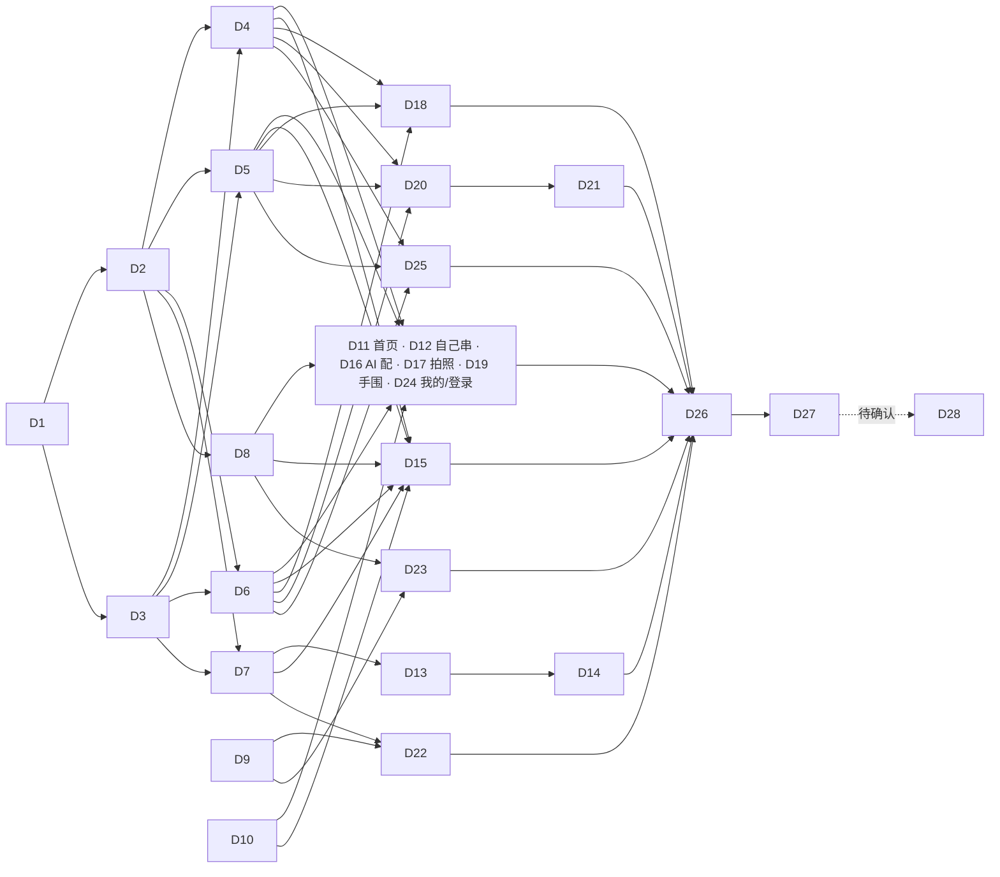

# 05 开发任务与验收标准

> 给执行 agent 的任务清单。格式照 `docs/codex-tasks.md` 第 4 节，编号 D1–D28。
> 开工前先读 `docs/codex-tasks.md` 第 2 节（工作守则），再读本目录的 [03](03-design-system.md) 和对应页面在 [04](04-page-redesign.md) 的那一节，对照 [mockups.html](mockups.html) 里标的稿号。

## 0. 通用要求（每条任务都适用）

1. **只改界面和交互，不改规则**：尺寸规则（`pages/editor/logic.js`、`utils/template.js`）、计价（按分的整数）、订单状态契约（`docs/order-state-contract.md`）、下单幂等和价格复核逻辑都不许动。任务里明说要改逻辑的地方（D9、D21）除外。
2. **不改后端**。需要后端配合的列在第 5 节，前端按“没有这个字段”也能正常显示来写。
3. 每条任务做完跑三条测试：
   ```bash
   python3 -m unittest discover -s server/tests
   node --test miniprogram/tests/*.test.js
   python3 kb/validate.py
   ```
   改了行为就改对应测试并在汇报里说明；不删测试。
4. **样式纪律**：页面和组件的 wxss 不出现颜色、字号、圆角字面量，一律用 `tokens.wxss` 的变量；wxml 不写内联颜色；不用 emoji 和字符当图标；间距取 8rpx 的整数倍。
5. **文案**照 04 里的表格逐字写；对外文字过 `kb/data/attributes.json` 的 banned 词表。
6. 小程序代码不依赖 `URL` 等浏览器对象；地址走 `config.js`；跳转编辑器、详情、下单页走 `utils/nav.js`。
7. **汇报**按 `codex-tasks.md` 第 2.6 节。每条验收项写“怎么验证的”。界面类验收需要在微信开发者工具（iPhone 12/13 模拟器，375 宽）里截图，截图放 `docs/reports/design/D<编号>/`，文件名对应验收项序号。没在开发者工具或真机上看过的，写“未验证”，不要写“已通过”。
8. 新组件统一：`options: { styleIsolation: 'apply-shared' }`；在 `app.json` 的 `usingComponents` 全局注册；每个组件配一个最小的 Node 测试（属性到视图数据的纯函数部分）。
9. 分支：从 `design/ui-revamp` 拉 `agent/d<编号>-<短名>`，不往 main 提交。

## 1. 依赖与派活顺序



| 波次 | 任务 | 能否并行 |
|---|---|---|
| 第一波（地基） | D1 → D2、D3 | D1 先做完；D2、D3 并行。D9、D10 不依赖任何任务，可以和 D1 同时开 |
| 第二波（组件） | D4、D5、D6、D7、D8 | 五条并行（各自新建目录；D8 只动 `app.json`、`utils/nav.js`、`sitemap.json`） |
| 第三波（页面） | D11、D12、D13、D15、D16、D17、D18、D19、D20、D22、D23、D24、D25 | 各改各的页面目录，可并行。同一页面的两条要串行：D13 → D14，D20 → D21 |
| 第四波（收尾） | D26 → D27 →（D28） | 串行 |

多条任务都要往 `app.json` 的 `usingComponents` 加一行（D2、D4–D7），合并时两边都保留。

建议一个人串行做的最短路径：D1 → D3 → D2 → D4 → D5 → D6 → D8 → D10 → D11 → D15 → D7 → D13 → D14 → D20 → D21 → D9 → D22 → D23 → D24 → D12 → D16 → D17 → D18 → D19 → D25 → D26 → D27。理由：先让首页、详情、编辑器、下单这条主线换完，负责人能尽早看到整体效果。

---

## 2. 基础任务

#### D1 设计 token 与全局样式
- **依赖**：无。
- **改动文件**：新建 `miniprogram/styles/tokens.wxss`、`miniprogram/utils/theme.js`、`miniprogram/tests/theme-tokens.test.js`；改 `miniprogram/app.wxss`、`miniprogram/app.json`（只改 `window` 和 `tabBar` 的颜色）。
- **要做**：
  1. 把 `docs/design/tokens.wxss` 原样复制到 `miniprogram/styles/tokens.wxss`；`app.wxss` 第一行 `@import "styles/tokens.wxss";`。
  2. `app.wxss` 现有 12 个类（`.wrap .card .title .sub .row .primary .muted .chips .chip .active .actions .error`）保留类名，取值全部换成变量：`.card` 去掉边框、底 `--c-surface`、圆角 `--r-md`；`.primary` 底 `--c-brand`；`.error` 色 `--c-danger`；`.active` 用 `--c-brand-tint / --c-brand-ink / --c-brand`；`.sub .muted` 色 `--c-ink-3`。加 `button::after{border:0}`。再加文字类 `.t-display .t-h1 .t-h2 .t-h3 .t-body .t-caption .t-micro .t-serif` 和 `.u-num`（03 第 2.2 节）。
  3. `utils/theme.js` 导出浅色那组十六进制值（`bg surface sunken trayA trayB line lineStrong ink ink2 ink3 ink4 brand brandPress brandTint brandInk onBrand gold goldTint ok okTint warn warnTint info infoTint danger dangerTint dangerLine`）。
  4. 测试：解析 `styles/tokens.wxss` 里第一个 `page{}` 的 `--c-*`，和 `theme.js` 逐项相等。
  5. `app.json`：`window.navigationBarBackgroundColor` 和 `window.backgroundColor` 改 `#f5f1ea`；`tabBar.backgroundColor` `#fffdfa`、`color` `#736a61`、`selectedColor` `#b73a2b`、`borderStyle` `white`。
- **验收**：
  1. 开发者工具打开首页：页面底是米色不是纯白，导航栏和页面同色，卡片没有灰色描边。截图。
  2. 依次打开 4 个 tab、编辑器、下单页：没有页面错位或文字看不见（这一步页面还没逐页改，只要求不坏）。各截一张。
  3. `grep -c 'var(--' miniprogram/app.wxss` 大于 15；`app.wxss` 里除 `@import` 外搜不到 `#` 开头的颜色。
  4. 新测试通过；三条测试通过。

#### D2 图标组件与 tabBar 图标
- **依赖**：D1。
- **改动文件**：新建 `miniprogram/components/icon/{index.js,index.json,index.wxml,index.wxss,icons.js}`、`miniprogram/assets/tab/*.png`（8 张）、`miniprogram/tests/icon.test.js`；改 `miniprogram/app.json`（注册 `ui-icon`，tabBar 四项加 `iconPath / selectedIconPath`）。
- **要做**：
  1. `icons.js`：把 `docs/design/mockups.html` 顶部 `<symbol id="i-名称">` 里的内容抄成 `{名称: '<path …/>…'}`，50 个（03 第 4.2 节的清单；`chevron-left` 和 `tab-home` 不用抄进组件）。
  2. 组件属性 `name`、`size`（rpx，默认 48）、`tone`（默认 `ink`，取值见 03 第 4.3 节）。js 里拼 `<svg xmlns="http://www.w3.org/2000/svg" viewBox="0 0 24 24" fill="none" stroke="颜色" stroke-width="1.5" stroke-linecap="round" stroke-linejoin="round">…</svg>`，输出 `data:image/svg+xml;charset=utf-8,` + `encodeURIComponent(svg)` 给 `<image>`。颜色从 `utils/theme.js` 取。`name` 不存在时渲染空白并 `console.warn`。
  3. tab 图标：用任意本地工具把 `tab-home / bead / sparkle / user` 四个图形导出成 81×81 png，未选中描边 `#736a61`，选中描边 `#b73a2b` 且轮廓内填 `#f7e6e1`。每张 ≤ 3KB。汇报里写清用什么工具导出的。
  4. 测试：每个图标名都能生成合法的 data URI；`tone` 映射到 `theme.js` 的值；未知名字不抛错。
- **验收**：
  1. 临时在首页放一排 `<ui-icon>`（10 个不同名字、3 种 tone、2 种尺寸），开发者工具里都能显示、颜色对。截图后删掉这段临时代码。
  2. tabBar 四项都有图标，切换时选中项变朱砂色。四个 tab 各截一张。
  3. **需真机**：iOS 和安卓各一台确认 `ui-icon` 能显示（写清步骤；没条件就标“未验证”）。真机不显示时按 03 第 4.3 节的退回方案改，组件接口不变。
  4. 开发者工具“详情 → 本地代码”主包体积比改前增加不超过 30KB。截图。

#### D3 通用样式类
- **依赖**：D1。
- **改动文件**：新建 `miniprogram/styles/components.wxss`；改 `miniprogram/app.wxss`（加一行 `@import`）。
- **要做**：按 03 第 5 节写这些类：`.c-btn`（含 `--primary --secondary --tonal --text --danger --danger-solid --lg --sm --block --icon`、`.is-disabled`）、`.c-card`（`--tap --sunken --group`）、`.c-tray`（`--stage --square --thumb --bead`）、`.c-price`（`--lg --md --sm`）、`.c-tag`（`--gold --warn --info --ok`）、`.c-chip`（`.is-on`）、`.c-seg`、`.c-cell`（`--tap --kv --total`）、`.c-field`（`.is-focus .is-error`、`__label __input __ph __error`）、`.c-stepper`、`.c-check`、`.c-skeleton`（含 `@keyframes`）、`.c-bubble`、`.c-bead-cell`。取值照 03 的表；拿不准的量 `mockups.html` 里同名类（px × 2 = rpx）。加 `@media (prefers-reduced-motion: reduce)` 把动画时长设 0。
- **验收**：
  1. 新建一个只在开发版能进的临时页面 `pages/_kit/_kit`（做完验收后从 `app.json` 删掉，目录也删），把上面每个类各摆一个，和 `mockups.html` 的“组件与 token”一节并排截图对比：颜色、圆角、高度一致。
  2. `.c-btn` 套在原生 `<button>` 上：没有默认边框，宽度随内容，两个按钮并排不换行。截图。
  3. `components.wxss` 里搜不到颜色字面量和 `px`。

#### D4 反馈类组件
- **依赖**：D2、D3。
- **改动文件**：新建 `miniprogram/components/{notice,safety,empty,status-tag}/*`、`miniprogram/tests/ui-feedback.test.js`；改 `app.json`（注册 `ui-notice ui-safety ui-empty ui-status-tag`）。
- **要做**：按 03 第 5.16、5.17、5.18、5.20 节实现。`ui-notice`：属性 `tone text action full icon`，事件 `action`。`ui-safety`：属性 `items`（`[{name,text}]`）、`mode`（`full confirm inline summary`）、`checked`、`error`；事件 `change`（勾选）、`tap`（summary）；`items` 为空时什么都不渲染；`role="alert"`。`ui-empty`：属性 `type title desc action compact`，事件 `action`。`ui-status-tag`：属性 `label tone`。另在 `pages/editor/materials.js` 加一个纯函数 `safetyItems(items)`，把现有材料行转成 `[{name:'朱砂 8mm', text}]`（只取有 `safety` 的），供各页给 `ui-safety` 传值；现有 `safetyLines` 不动。
- **验收**：
  1. 在 D3 的临时页（或同样方式新建）摆出：四种 `ui-notice`、四种 `ui-safety`、三种 `ui-empty`、五种 `ui-status-tag`，和 `mockups.html` 对应部分并排截图。
  2. `ui-safety`：红字、红边、警示图标三样都在；正文完整显示不截断（用 `kb/data/beads/bodhi.json` 里元宝菩提那条长文本测）；`confirm` 模式点整行能勾选并触发 `change`。录屏或两张截图。
  3. `ui-safety` 传空数组不占位。
  4. 测试覆盖 `safetyItems`（有 / 无 `safety`、多种材料）。

#### D5 容器类组件
- **依赖**：D2、D3。
- **改动文件**：新建 `miniprogram/components/{sheet,confirm,bottom-bar}/*`；改 `miniprogram/components/privacy-popup/*`（只改 wxml 结构和 wxss）；改 `app.json`（注册 `ui-sheet ui-confirm ui-bottom-bar`）。
- **要做**：按 03 第 5.12、5.13、5.14、5.22 节。`ui-sheet`：属性 `show title closable`，插槽默认 + `footer`，事件 `close`；遮罩 `catchtouchmove`；进出动画 320ms；最大高 80vh，内容区 `scroll-view`；底部含安全区。`ui-confirm`：属性 `show title tone icon confirmText cancelText`，默认插槽放正文，事件 `confirm cancel`；点遮罩不关。`ui-bottom-bar`：插槽 `left` 和默认；固定底部，含安全区和 `--sh-bar`；提供一个同高的占位 `view`（属性 `placeholder` 默认 true），页面不用自己算底部留白。`privacy-popup`：外观换成 `ui-confirm` 的样子（`shield` 图标），按钮的 `open-type="agreePrivacyAuthorization"` 和事件不动。
- **验收**：
  1. 临时页上：打开 `ui-sheet`（内容超过一屏）能内部滚动，背后页面不滚，点遮罩和关闭键能关。录屏或截图两张。
  2. `ui-confirm` 两种 tone 各截一张；点遮罩不关闭。
  3. `ui-bottom-bar`：左侧放价格、右侧放两个按钮，切到 iPhone SE（320 宽）模拟器，价格不换行、按钮不被挤扁。截图。切到有底部安全区的机型，按钮不贴底。截图。
  4. 清除授权后进“拍照做同款”点选图：隐私弹窗是新样式，“同意并继续”仍然能继续。截图。`miniprogram/tests/privacy.test.js` 通过。

#### D6 手串展示组件
- **依赖**：D2、D3。
- **改动文件**：改 `miniprogram/components/bracelet-thumb/*`、`miniprogram/utils/thumb-cache.js`（只改画法）、`miniprogram/components/bracelet3d/index.wxss`；新建 `miniprogram/components/design-card/*`、`miniprogram/utils/money.js`、`miniprogram/tests/money.test.js`；改 `app.json`（注册 `design-card`，全局注册 `bracelet-thumb`）。
- **要做**：
  1. `bracelet-thumb`：图片底透明；珠子用径向渐变（`c[0]` → `c[1]`，高光在左上）加淡投影；穿绳线用 `theme.lineStrong`；`placeholder.svg` 换成纸色底虚线圆环；加载中显示 `.c-skeleton`。缓存 key 加一个版本号，避免读到旧图。
  2. `bracelet3d/index.wxss`：`.viewer` 去掉 `background:#faf9f8`（由外层 `.c-tray` 提供底）；`.tip` 的字号颜色换成变量。
  3. `design-card`：按 03 第 5.5 节，三种 `layout`（`grid row slide`），属性 `name beads catalog cover tags price spec note badge disabled loading`，插槽 `extra action`，事件 `tap`。
  4. `utils/money.js`：`split(fen)` → `{int:'128', dec:'00'}`；`format(fen)` → `'128.00'`；`fromYuan(str)` → 分的整数（`Math.round(Number(str)*100)`）。只做格式化，不做计价。
- **验收**：
  1. 临时页上三种 `design-card` 各摆两张（一张有 `cover`、一张没有），和 `mockups.html` 稿 01、04、19 里的卡片并排截图。
  2. 缩略图里的珠子有明暗、不是纯色圆片；托盘是暖色渐变。截图。
  3. “我的”页（还是旧布局）缩略图照常显示，滚动不卡。`miniprogram/tests/thumb-cache.test.js` 通过（画法变了导致断言要改的，说明原因）。
  4. `money.test.js`：`split(12800)`、`split(5)`、`split(0)`、`fromYuan('4.5')`、`fromYuan('0.1')+fromYuan('0.2')===30`。

#### D7 尺寸量尺与步骤条
- **依赖**：D2、D3。
- **改动文件**：新建 `miniprogram/components/{size-meter,steps}/*`、`miniprogram/tests/size-meter.test.js`；改 `app.json`（注册 `size-meter ui-steps`）。
- **要做**：
  1. `size-meter`（03 第 5.21 节、02 第 2 节的状态表）：属性 `length target count fit compact`。状态由 `fit` 字符串和 `count` 推出（`长度基本合适`→ok；`还差约`/`超出约`→warn；`count>=54`→info；`还没有珠子`→muted；`部分材料已下架`→danger）。游标位置 `clamp((length-target+30)/60,0,1)`；合适区间固定画在 `(−4+30)/60` 到 `(6+30)/60`。把“推状态”和“算位置”写成组件目录下的纯函数文件 `logic.js` 并测试。显示文案：ok 时显示“长度合适”（不是原字符串“长度基本合适”），其余用原字符串。**不改 `pages/editor/logic.js`。**
  2. `ui-steps`（03 第 5.11 节）：属性 `type`（`progress guide`）、`steps`。
- **验收**：
  1. 临时页摆四种量尺状态 + 两种步骤条，和 `mockups.html`“组件与 token”里的量尺、步骤条并排截图。
  2. 测试：`length=target` 游标在 50%；`length=target-4` 和 `target+6` 刚好压在合适区间两端；`count=54` 为 info；越界 clamp 到 0 和 1。
  3. `miniprogram/tests/size-rule.test.js` 不改且通过。

#### D8 app.json、导航工具、页面增删
- **依赖**：D2（tab 图标）。
- **改动文件**：`miniprogram/app.json`、`miniprogram/utils/nav.js`、`miniprogram/sitemap.json`、`miniprogram/tests/{nav,package-config,navigation-works}.test.js`；删除 `miniprogram/pages/ar-tryon/`；新建 `miniprogram/features/orders/orders.{js,json,wxml,wxss}`（只放一个能打开的空壳页，内容归 D23）；改 `miniprogram/features/tryon/tryon.js`（`openAR` 的跳转地址）。
- **要做**：
  1. `nav.js` 加 `openDetail()`（打开 `pages/finish/finish`，规则同 `openEditor`）和 `openOrders(tab)`（`navigateTo` 到 `/features/orders/orders?tab=`）。
  2. 全仓库搜 `ar-tryon`，把入口改成 `/ar-hand/index`；确认 `pages/ar-tryon/yuv.js` 没人引用后整个目录删掉，`app.json` 的 `pages` 去掉这一项。
  3. `app.json` 的 `subPackages` 里 `features` 加 `orders/orders`。
  4. 各页 json 的 `navigationBarTitleText` 按 04 第 17 节统一。
  5. `sitemap.json`：只允许索引 `pages/home/home` 和 `features/shared/shared`，其余 `disallow`。
  6. 把 `pages/mine/mine.js`、`pages/share/share.js`、`features/shared/shared.js`、`features/order-detail/order-detail.js` 里直接 `wx.navigateTo('/pages/editor/editor')`、`'/pages/order/order'` 的地方换成 `nav.openEditor()` / `nav.openOrder()`（只换这几处调用）。
- **验收**：
  1. `grep -rn "ar-tryon" miniprogram` 没有结果；试戴页点 AR 入口能进 `ar-hand/index`（模拟器里进到页面即可）。截图。
  2. `grep -rnE "navigateTo\(\{url:'/pages/(editor/editor|order/order)" miniprogram --include='*.js'` 只剩 `utils/nav.js`。
  3. 开发者工具里编译无报错，16 个页面路径都能在“编译模式”里单独打开。
  4. 测试：`openDetail` 在栈里已有详情页时 `navigateBack`、栈深 ≥8 时 `redirectTo`；`package-config.test.js` 按新页面清单更新并通过。

#### D9 订单状态展示逻辑
- **依赖**：无。**会改逻辑**（只改展示映射）。
- **改动文件**：`miniprogram/utils/order-state.js`、`miniprogram/tests/order-state.test.js`。
- **要做**（02 第 8.1 节、04 第 11 节）：
  1. `STATUS` 表里把 `order.pending_confirmation`、`payment.unpaid`、`payment.paying` 的 tone 改成 `warning`。
  2. `primaryState()` 的判断顺序不动，`description` 换成 04 第 11 节“状态词和说明”表里的文案；待支付那条要看订单的 `paymentAvailable`（为假用“在线支付暂未开放…”）。`decorate()` 把 `paymentAvailable` 传进去。
  3. 新增并导出纯函数 `progress(states)` → `{mode:'normal'|'exception'|'ended', steps:[{label,state}]}`，五步为“下单 支付 制作 发货 完成”，规则照 02 第 8.1 节的表。`decorate()` 的返回值里加 `progressView`。旧订单没有 `state` 时 `progressView` 为 `null`。
  4. 新增并导出 `bucket(order)` → 数组，取值 `unpaid producing shipping aftersale`，规则照 02 第 8.1 节。
  5. `ACTIONS` 的顺序和样式：`cancel_order` → `danger`，`view_logistics`、`reorder` → `secondary`，`confirm_receipt` → `primary`；`decorate()` 输出的 `actionViews` 按这个顺序排。
- **验收**：测试覆盖：8 种支付状态各自的主状态词、tone、说明；`progress` 在“待支付 / 已支付待制作 / 制作中 / 运输中 / 已签收未完成 / 已完成 / 已取消 / 已退款 / 支付失败 / 物流异常”下的 `mode` 和每一步的 `state`；`bucket` 的四种归类和“已取消的不进待支付”；`allowedActions` 里没有 `pay_order` 时 `actionViews` 里也没有、有也不渲染（未知动作忽略）。原有用例里因为 tone 和文案变化要改的，逐条说明。

#### D10 手围工具
- **依赖**：无。
- **改动文件**：新建 `miniprogram/utils/wrist.js`、`miniprogram/tests/wrist.test.js`；改 `miniprogram/pages/home/data.js`（`wrist()` 改成转调）。
- **要做**：`utils/wrist.js` 导出 `get()`（8–30 之间的已存值，否则 15）、`confirmed()`（读 `cgz_wrist_confirmed`）、`confirmDefault()`（把当前值写入并标记已确认）、`label()`（确认过：“已按你的 15.5cm 手围排好”；没确认：“先按常见的 15cm 排”）、`open(source)`（`navigateTo` 手围页，带 `source`）。存储键名不变。
- **验收**：测试覆盖越界值回落 15、`confirmDefault` 后 `confirmed()` 为真、两种 `label`。现有用到 `ui.wrist()` 的测试不改且通过。

---

## 3. 页面任务

页面任务的共同验收（每条都要做，下面不再重复写）：

- **A**：这一页的 wxss 里搜不到颜色字面量；wxml 里搜不到 `style="…color…#`、emoji、`⊕ ✧ ▣ ◎ ↶`；旧的全局类（`.wrap .card .title .sub .row .primary .muted .chips .chip .active .actions .error`）在这一页不再使用。贴 grep 结果。
- **B**：在开发者工具 375 宽下，把这一页和 `mockups.html` 对应稿号并排截图，逐稿一张。布局顺序、颜色、文案一致（示意图形除外）。
- **C**：切到 320 宽（iPhone SE）没有横向滚动、文字不重叠；切到有底部安全区的机型，底栏不贴底。各截一张。

#### D11 首页
- **依赖**：D4、D5、D6、D8、D10。
- **改动文件**：`miniprogram/pages/home/{home.wxml,home.wxss,home.js,home.json,data.js}`。
- **要做**（04 第 1 节，稿 01–03）：重排成 提示条 → 轮播 → 继续上次的设计 → 三个入口 → 热门款。删 `tryLast`、`requireWrist` 和第四个入口；热门款卡片用 `design-card layout="grid"`，点卡片 `ui.selectCard(card)` 后 `nav.openDetail()`，图右下角 `hand` 图标钮走原 `tryCard`；轮播点了带 `tpl` 的同样进详情；“继续上次的设计”读 `store.current()`，规格行用 `logic.stats().fit`；手围链用 `wrist.label()`；加载骨架、失败空状态、离线提示条。卡片价格由 `data.js` 多给一个 `priceFen`（整数分），显示用 `money.split`。
- **验收**：
  1. 首次打开（清缓存）：看到轮播、三个入口、热门款；**不会被带去手围页**。
  2. 点任意热门款 → 到手串详情（标题“手串详情”），返回 → 回首页。
  3. 进编辑器加 3 颗珠子后回首页 → 出现“上次做到一半”卡片，点“继续”→ 回到那条草稿。
  4. 停掉本地后端后重新编译：顶部出现琥珀色离线提示条；热门款来自快照仍可点。把 `utils/catalog-preview.js` 临时改成空模板再试：看到“热门款没加载出来”和“重试”（验证后恢复）。
  5. 页面上没有任何红色价格、红底标签；搜不到“首单”。

#### D12 自己串（工作台）
- **依赖**：D4、D5、D6、D8、D10。
- **改动文件**：`miniprogram/pages/diy/*`；`miniprogram/pages/mine/mine.js`（把 `mergeWorks` 挪成可复用）；新建 `miniprogram/utils/works.js`、`miniprogram/tests/works.test.js`。
- **要做**（04 第 2 节，稿 04–05）：`utils/works.js` 导出 `merge(local, cloudRows)`（就是现在 `mine.js` 的 `mergeWorks` 逻辑，按 `cloudId` 去重，结果按最后修改时间倒序）。页面：手围行、两个起点、作品列表、底部文字链；删掉模板列表和首次强推手围。进页面：先显示本机作品；`auth.hasSession()` 或静默登录成功后拉 `/designs` 合并；失败显示提示条 + 重试。下拉刷新。点作品：`remoteOnly` 的先 `store.save`，再 `store.selected`，≥6 颗 `nav.openDetail()`，否则 `nav.openEditor()`。长按：`ui-confirm tone="danger"` 删除本机这条（云端删除见第 5 节 B4，没有接口时只删本机，并在确认正文里写“只会从这台手机上删除”）。
- **验收**：
  1. 页面上没有模板卡片；第一次进不跳手围页。
  2. 编辑器做一条 ≥6 颗的 → 回到本页列表第一条是它，带“仅本机”或“已同步”标签；点它进详情。
  3. 做一条 3 颗的 → 列表里显示“还没串完”，点它直接进编辑器。
  4. 停掉后端：本机作品照常显示，上方红色提示条“云端作品没读到…”，点“重试”恢复后提示条消失。
  5. 清空本机设计后：看到空状态“还没有作品”。
  6. 测试覆盖 `works.merge`（云端重复不重复加、本机修改不被覆盖、排序）。`miniprogram/tests/navigation-works.test.js` 按新位置调整并通过。

#### D13 编辑器：布局与量尺
- **依赖**：D4、D5、D6、D7、D8。
- **改动文件**：`miniprogram/pages/editor/{editor.wxml,editor.wxss,editor.js}`。
- **要做**（04 第 3 节“布局”，稿 06–09）：删顶部摘要行；托盘用 `.c-tray--stage`（400rpx），左上手围筹码、右侧工具列（撤销、翻转、音效、垃圾桶）、底部提示；量尺行用 `size-meter`（`length`、`target` 来自 `logic.stats()`），右侧“补齐 N 颗”；选中时换成选中工具行；材料面板：`.c-seg`、筛选键、分类栏、`.c-bead-cell` 三列（有 `safety` 的加红色角标）；底栏 `ui-bottom-bar`：设置键、价格 + 材料入口（有安全提示时红色）、“完成”。**事件处理函数名和拖拽、撤销、音效逻辑不动**，只换结构和类名；`finish()` 最后的跳转改成 `nav.openDetail()`。价格显示含编织绳（`design.cord===1` 时加 `pricing.cordFen`，和下单页一致）。这一步弹层先保持能用（旧结构），D14 再换。
- **验收**：
  1. 空白进入：托盘中央“点下面的珠子，开始串”；“完成”禁用；量尺显示“还没有珠子”。
  2. 点一颗 8mm 珠子 → 量尺游标出现在左侧、琥珀色“还差约 N mm”，右侧出现“补齐 N 颗”；点补齐 → 游标进绿色区间，文字变“长度合适”，按钮消失。
  3. 继续加到超出 → 琥珀色“超出约 N mm”。记下三次的颗数和 mm，和改版前同样操作的数值一致（证明规则没动）。
  4. 点托盘上一颗珠子 → 量尺行变成“第 N 颗 · 点珠子替换 / 前移 / 后移 / 删除 / 完成”；点材料格 → 替换成功；点“完成”退出选中。
  5. 长按珠子拖到垃圾桶 → 删除；点撤销 → 恢复。`miniprogram/tests/editor-gestures.test.js` 不改且通过。
  6. 朱砂、元宝菩提的格子右上角有红色三角；底栏材料入口在加了朱砂后变红色“含安全提示”。（本地后端要先有带 `safety` 的珠子，见 `docs/reports/wave1-verify.md` 的准备步骤。）
  7. 选编织绳 → 底栏价格 +¥5.00。
  8. 点“完成”→ 到手串详情。

#### D14 编辑器：弹层
- **依赖**：D13。
- **改动文件**：`miniprogram/pages/editor/{editor.wxml,editor.wxss,editor.js}`。
- **要做**（04 第 3 节“弹层”，稿 10–13）：5 处 `sheet-mask` 换成 `ui-sheet`。材料清单：每行 + `ui-safety mode="inline"`。珠子详情：加卖点、讲解、安全提示、“加一颗”。“设计设置”+“个性选择”合并重排成“手串设置”（名称、寓意标签、按颗数串、送给、按手围重排、保存并同步）和“筛选”（尺寸、色系、寓意、重置、“看 N 种珠子”）；删掉 `prefWrists` 和弹层里的手围；删掉“分享设计”按钮和 `share()`；`applyPreferences` 不再写 `d.wrist`。垃圾桶清空用 `ui-confirm tone="danger"`。
- **验收**：
  1. 含朱砂的设计点底栏材料入口 → 弹层里朱砂那行下面有红底红字的安全提示，文字完整。
  2. 长按朱砂格 → 详情里有卖点、讲解、安全提示；点“加一颗”→ 托盘多一颗，弹层关闭。
  3. 点设置键 → “手串设置”：改名称后关闭再打开还在；选“18 颗”→ 托盘按颗数重排（不满足时的提示沿用现有文案）。
  4. 点筛选 → 选 8mm → 按钮文字显示数量 → 确认后面板只剩 8mm，筛选图标右上角有小圆点；“重置”后恢复。
  5. 全页搜不到“个性选择”“设计设置”字样；齿轮图标不在托盘工具列里。
  6. 打开任一弹层时，背后的托盘不能被拖动。
  7. `miniprogram/tests/material-picker.test.js`、`material-safety.test.js` 通过（因合并改了数据结构的，说明原因）。

#### D15 手串详情
- **依赖**：D4、D5、D6、D7、D8、D10。
- **改动文件**：`miniprogram/pages/finish/{finish.wxml,finish.wxss,finish.js,finish.json}`。
- **要做**（04 第 4 节，稿 14–17）：按新布局重排；材料清单用 `materials.fromCatalog` + `ui-safety`；尺寸提示条用 `logic.stats()`；`edit()` 改 `nav.openEditor()`；“保存”沿用 `saveDesign`，保存后按钮变“已保存”；AI 评价收成一行，点了再请求，展开结果（逻辑不动）；“去下单”：`wrist.confirmed()` 为假时先开“下单前确认手围”弹层（“就按 15cm”→ `wrist.confirmDefault()` 后 `nav.openOrder()`；“去量一下”→ `wrist.open('order')`，回来后留在详情）；缺货和少于 6 颗的禁用态。从模板、AI 方案进来的设计（`store.selected` 了但没 `store.save`）不自动保存。
- **验收**：
  1. 从首页热门款进来：看到托盘、宋体名称、寓意标签、规格行、尺寸提示条、材料清单；“我的作品”里**没有**多出这一条。点“保存”后才有。
  2. 含朱砂的设计：材料清单下有完整的红色安全提示条。
  3. 点“改一改”→ 编辑器；编辑器点“完成”→ 回到详情且内容是改后的；连续来回 10 次后 `getCurrentPages().length` 不超过 4（在调试器里打印，贴结果）。
  4. 清掉 `cgz_wrist_confirmed` 后点“去下单”→ 出“下单前确认手围”；点“就按 15cm”→ 进下单页；再回来点“去下单”不再弹。
  5. 后台下架设计里的一颗珠子后进详情 → 顶部红色提示条、价格“—”、“去下单”禁用、“改一改”是主按钮。
  6. 点“AI 帮你看看”才发请求（Network 面板里进页面时没有 `/ai/review`）。
  7. `miniprogram/tests/creation-flows.test.js` 通过。

#### D16 AI 配
- **依赖**：D4、D5、D6、D8、D10。
- **改动文件**：`miniprogram/pages/ai/*`。
- **要做**（04 第 5 节，稿 18–20）：删语音按钮和 `voice()`；示例和文案照表；气泡用 `.c-bubble`；方案用 `design-card layout="slide"`，按钮“看这条”→ `store.fromTemplate` + `store.selected` + `nav.openDetail()`；`beads` 为空的方案禁用并显示“这条暂时配不齐”；来源标记只在降级时显示“方案库推荐”，存进历史的 `source` 字段同步改（读旧历史时把“方案库兜底”映射成“方案库推荐”、“AI 生成”不显示）；等待文案按 0 / 8 / 30 秒分段；错误用输入框上方的 `ui-notice`；“清空对话”加 `ui-confirm`；发送键用 `send` 图标，没字时灰。
- **验收**：
  1. 欢迎区三个示例是 04 表里的三句；全页搜不到“保平安”和 `🎙`。
  2. 点示例 → 文字进输入框、不自动发送；发送 → 出现等待气泡，超过 8 秒文案变化（可在调试器里把接口延迟调大）。
  3. 有方案后点“看这条”→ 手串详情；返回 → 对话还在。
  4. 停掉 AI（后端不配 Key 即走方案库）：回复上方有黛蓝色“方案库推荐”标签。
  5. 断网发送：输入框上方红色提示条，原话回到输入框。
  6. “清空对话”有确认弹窗。
  7. `miniprogram/tests/ai-request-timeout.test.js`、`design-reflow.test.js` 通过。

#### D17 拍照做同款
- **依赖**：D4、D5、D6、D7、D8、D10。
- **改动文件**：`miniprogram/pages/photo/{photo.wxml,photo.wxss,photo.js}`。
- **要做**（04 第 6 节，稿 21–25）：四种状态各自的版式；`ui-steps type="guide"`；失败屏加“改成自己串”（`ui.openEditor()` 空白）；结果屏备选珠用 `.c-bead-cell`，来源标签、间隔筹码、底栏照稿；拒绝授权显示提示条。识别、压缩、降级逻辑不动。
- **验收**：
  1. 初始屏有取景框、三步、隐私提示条、底部整行按钮。
  2. 选一张手串照片 → 识别中屏（照片 + 进度）→ 结果屏；选一张纯色图 → 失败屏，有“换一张”和“改成自己串”两个按钮，后者进空白编辑器。
  3. 结果屏点别的备选珠 → 选中态（朱砂描边 + 勾）切换，托盘预览和价格跟着变。
  4. 拒绝隐私授权 → 留在初始屏并出现提示条。
  5. `miniprogram/tests/photo-*.test.js` 不改且通过。

#### D18 试戴与实时 AR
- **依赖**：D4、D5、D6、D8。
- **改动文件**：`miniprogram/features/tryon/{tryon.wxml,tryon.wxss,tryon.js}`、`miniprogram/ar-hand/{index.wxml,index.wxss,index.js}`。
- **要做**（04 第 7、8 节，稿 26–29）：试戴页三段切换（第三段点了：模型没缓存过先出 `ui-confirm` 说明体积，确认后进 `/ar-hand/index`；是否已缓存用 `ar-hand/model-cache.js` 现有能力判断，判断不了就每次都提示）；滑杆、开关颜色读 `theme`；提示和错误换 `ui-notice`；底栏换 `ui-bottom-bar`。AR 页：底部一张面板承载进度、控制、错误三种内容；“复制诊断信息”和 `diag` 文字只在 `envVersion !== 'release'` 时显示，收进一个“···”图标钮。相机、识别、缓存逻辑不动（`ar-hand/runtime.js` 不碰）。
- **验收**：
  1. 试戴页顶部是三段切换，第三段带“实验”标签；页面上没有单独的“实时 AR 试戴（测试）”按钮。
  2. 照片模式选图后：三个滑杆和开关是朱砂色，拖动有效；“保存试戴照”可用。
  3. 点“实时 AR”→ 先出体积说明弹窗 →“开始”进 AR 页。
  4. AR 页：开发者工具里模拟模型地址不可达（停后端）→ 面板显示失败说明和三个按钮，“改用照片试戴”回试戴页。
  5. **需真机**：AR 下载进度、跟随效果；照片叠加。写清步骤，没验证标“未验证”。
  6. `miniprogram/tests/ar-*.test.js` 不改且通过。

#### D19 手围页
- **依赖**：D3、D5、D7、D10。
- **改动文件**：`miniprogram/pages/wrist/*`。
- **要做**（04 第 9 节，稿 30）：步进器、刻度条、筹码、`ui-steps type="guide"`、底栏；“先按 15cm，稍后再量”只在 `!wrist.confirmed()` 且 `options.source !== 'order'` 时显示，点了**不写** `cgz_wrist_confirmed`，直接返回；“确定”逻辑不变。越界提示改成输入区下方红字。
- **验收**：
  1. 加减键每次 0.5，到 8 和 30 时对应键禁用；点筹码数值跟着变；刻度条位置跟着变。
  2. 输入 40 点确定 → 红字“请输入 8–30 cm”，不返回。
  3. 清掉确认标记后从首页手围链进来：有“先按 15cm，稍后再量”；从详情页的“去量一下”进来：没有。
  4. 确定后回到来源页，来源页的手围文字更新。

#### D20 确认订单：布局
- **依赖**：D4、D5、D6、D8。
- **改动文件**：`miniprogram/pages/order/{order.wxml,order.wxss,order.js}`。
- **要做**（04 第 10 节“布局”，稿 31、35）：按新顺序重排七个区块 + 底栏；`.c-field` 三个输入框，字段级错误（`error` 拆成 `fieldErrors` 和页面级 `error`）；材料明细超过 3 种折叠；金额明细卡片（手工费读 `pricing.handworkFen`，不再写死 `¥15`）；支付说明提示条；金额处在 `catalogReady` 为假时显示骨架，提交键文字按状态切换；目录加载失败给“重试”（重跑 `onShow` 里的刷新）；删掉 `wx:elif="{{order}}"` 结果区和 `home()`、`mine()` 里不再用到的部分；礼盒开关颜色读 `theme`。“用微信地址”按钮：`wx.chooseAddress` 成功后回填三个字段（地址拼 `provinceName+cityName+countyName+detailInfo`），失败或接口不可用时隐藏按钮；**这个按钮受配置开关 `config.js` 的 `enableChooseAddress` 控制，默认关**（等负责人确认，README 第 5 条）。这一步安全提示先用 `ui-safety mode="full"` 展示、提交确认仍走现有 `wx.showModal`，D21 再换。**`calculate()`、`submit()` 里的计价、幂等、复核逻辑不动。**
- **验收**：
  1. 进下单页第一屏就能看到收货信息的三个输入框。
  2. 不填直接提交 → 第一个空字段下出红字，页面滚到收货信息；手机号填 `138` → “请输入有效的 11 位手机号”。
  3. 金额明细各行相加等于合计；切换编织绳、礼盒，明细行和合计、底栏同步变化；材料小计 + 手工费 < ¥99.00 时运费 ¥8.00，≥ 时“免运费”。拿改版前同一条设计的合计对比，数值一致。
  4. 金额明细下方有琥珀色支付说明条，文字照 04。
  5. 停后端进页面 → 金额骨架、提交键禁用、红色提示条带“重试”；恢复后端点重试 → 正常。
  6. `enableChooseAddress` 关闭时看不到“用微信地址”；打开后模拟器里点它能回填。
  7. `miniprogram/tests/order.test.js`、`catalog-refresh.test.js` 通过。

#### D21 确认订单：安全勾选、改价确认、提交确认
- **依赖**：D20。**会改逻辑**（确认流程）。
- **改动文件**：`miniprogram/pages/order/{order.wxml,order.wxss,order.js}`、`miniprogram/tests/order.test.js`。
- **要做**（02 第 6 节，04 第 10 节“弹层”，稿 32–34）：
  1. 安全提示条换成 `ui-safety mode="confirm"`；data 加 `safetyChecked`；`onShow` 和设计变化时重置为 false。提交时有安全提示且没勾 → 不继续，滚到安全提示条，`error` 态，Toast“请先阅读并勾选材料安全提示”。
  2. 改价：删掉 `onShow` 里的 `wx.showModal`；有变化时打开“材料价格有变化”弹层（`ui-sheet`）；关闭未确认则顶部留 `ui-notice`（点“查看”再开）；`confirmQuote()` 不变。有缺货时弹层只有“返回修改设计”。`submit` 里遇到 `price_changed` 也走这个弹层。
  3. 提交确认：把 `submit()` 里那段 `wx.showModal` 换成打开“提交前再确认一下”弹层并等待用户选择（用 Promise 包一层，保持后面的代码路径不变）。触发条件不变（有尺寸说明或安全提示）。**删掉 `confirmationsDone`：每次提交都要确认**；点“返回修改”只关闭弹层并保留已勾选状态，不再把它当作“已知情”。
  4. 尺寸说明文案照 04 表里的三种。
- **验收**：
  1. 含朱砂的设计：不勾选点提交 → 不弹确认、不发请求（Network 面板无 `/my/orders`），页面滚到安全提示条且勾选框变红框。
  2. 勾选后提交 → 出“提交前再确认一下”，里面有红色安全提示条和应付金额；点“返回修改”→ 弹层关闭；**再点提交 → 弹层再次出现**（这是和改版前不同的地方）。
  3. 点“确认提交”→ 跳到订单详情，状态“待支付”。
  4. 不含安全提示且长度合适的设计：提交不出确认弹层，直接创建订单。
  5. 长度偏短的设计：确认弹层里有琥珀色尺寸提示。
  6. 进下单页前在后台把某颗珠子改价 → 进页面出“材料价格有变化”弹层，旧价有删除线；关闭弹层 → 顶部琥珀提示条，提交键“先确认新价格”禁用；点“查看”→ 再开；“确认新价格”后可提交。
  7. 测试：把原来“取消后再次提交视为已知情”的用例改成“取消后再次提交仍需确认”；新增“未勾选安全提示不提交”“改价未确认不提交”。其余用例不动且通过。

#### D22 订单详情
- **依赖**：D4、D5、D6、D7、D9。
- **改动文件**：`miniprogram/features/order-detail/*`。
- **要做**（04 第 11 节，稿 36–41）：状态头 + `ui-steps`（用 D9 的 `progressView`，`ended` 或为空时不显示）；`created=1` 的提示条；这时页面是 `reLaunch` 进来的，原生导航栏左上角自带回首页的小房子，保留它，不做自定义导航栏，另在订单信息卡片下面放一个文字按钮“回到我的”（`wx.switchTab`）；物流卡片常驻、运单号复制；售后卡片；材料明细 + `ui-safety`；金额明细（订单里有分项字段就显示分项，没有就保持现在的三行）；收货信息（手机号打码）；订单信息（订单号复制、下单时间 `createdAt` 格式化成 `YYYY-MM-DD HH:mm`）；底部动作栏按 04 的表渲染，`cancel_order` 和 `confirm_receipt` 先过 `ui-confirm`；“联系客服”`open-type="contact"`，受 `config.js` 的 `enableContact` 开关控制，默认关（README 第 6 条）。删掉 `state-groups`；开发版底部加折叠的“状态明细（调试）”。动作提交、重新读取的逻辑不动。
- **验收**：
  1. 下单成功后进来：顶部黛蓝提示条“订单已提交，现在停在‘待支付’”；状态词“待支付”是琥珀色；进度条停在“支付”；页面上**没有**对勾大图、没有“支付成功”“去支付”字样。
  2. 待支付订单底部有“取消订单”（红色描边）和“按这款再买”；点“取消订单”→ 确认弹窗 → 确认后状态变“已取消”、进度条消失、动作只剩“按这款再买”。
  3. 用后台把一笔订单推进到已发货并填运单号 → 状态词“已发货/运输中”黛蓝或松绿，进度条到“发货”，物流卡片显示承运方和运单号，点“复制”有 Toast。
  4. 后台把售后状态改成审核中 → 出现售后卡片，状态头是售后状态。
  5. 含朱砂的订单：材料明细下有红色安全提示条（来自订单快照，后台下架该珠子后仍然显示）。
  6. 体验版 / 正式版配置下（把 `envVersion` 判断临时改掉验证后恢复）看不到“状态明细（调试）”。
  7. 页面上搜不到“制作履约”“无售后”。

#### D23 订单列表（新页面）
- **依赖**：D4、D6、D8、D9。
- **改动文件**：`miniprogram/features/orders/*`、新建 `miniprogram/tests/orders-list.test.js`。
- **要做**（04 第 12 节，稿 42–44）：`onLoad` 读 `options.tab`；`auth.authorized('/my/orders')` → `orderState.decorate` → 用 `bucket()` 算每个筛选的数量和当前列表；筛选条吸顶；订单卡；空、加载、失败、未登录四种状态；下拉刷新；点卡片进订单详情。筛选逻辑写成页面目录下的纯函数并测试。
- **验收**：
  1. 从“我的”点“待支付”进来 → 筛选条选中“待支付”，只显示待支付订单，数量和角标一致。
  2. 切到没有订单的筛选 → 对应文案的空状态 + “看全部订单”。
  3. 状态标签颜色：待支付琥珀、制作中黛蓝、已取消灰。
  4. 停后端 → 错误空状态 + 重试。
  5. 测试覆盖筛选和计数（含“一笔订单同时在待收货和售后”）。

#### D24 我的与登录
- **依赖**：D4、D5、D6、D8、D9、D10。
- **改动文件**：`miniprogram/pages/mine/*`、`miniprogram/pages/login/*`。
- **要做**（04 第 13、14 节，稿 45–47）：账号卡；订单卡（四个入口用 `bucket()` 计数，点了 `nav.openOrders(tab)`；最近一单取列表第一条）；列表卡（手围、作品件数 = `store.list().length`、联系客服受 `enableContact` 控制、隐私与说明弹层）。`onShow` 直接 `loadOrders()`（内部静默登录）；失败且 `!auth.hasSession()` 显示未登录态；“微信登录”按钮先原地 `auth.login()`，失败再 `navigateTo` 登录页。删掉作品列表、`loadCloud`、`reorder`、`openCloud`、`mergeWorks`（已挪到 D12 的 `utils/works.js`；D12 没合并时先保留）。登录页按稿 47；错误文案统一成“暂时登录不上，请稍后再试”（开发版在后面附原始报错）。
- **验收**：
  1. 清掉 `cgz_token` 后进“我的”：不用点任何按钮，订单卡自己加载出来（静默登录成功）。
  2. 停后端后清 token 进“我的”：账号卡“还没登录”，订单卡空状态“登录后查看订单”；点“微信登录”→ 进登录页并显示红色提示条。
  3. 四个状态入口的角标数字和订单列表页对应筛选的数量一致；角标是深色底不是红色。
  4. 页面上没有作品列表和“刷新云端作品”按钮；点“我的作品”切到“自己串”tab。
  5. “隐私与说明”能打开，四段文字照 04。
  6. `miniprogram/tests/auth.test.js`、`dev-login.test.js` 不改且通过。

#### D25 分享与分享落地页
- **依赖**：D4、D5、D6、D8。
- **改动文件**：`miniprogram/pages/share/*`、`miniprogram/features/shared/*`。
- **要做**（04 第 15、16 节，稿 48–51）：分享页：`onShow` 里设计就绪后自动调 `prepareShare()`（已有 `shareId` 且 `shareKey` 没变就不重复请求）；主按钮 `open-type="share"` 在 `shareId` 就绪前是 loading 文案“正在准备…”，失败变“重试”；“保存图片”移到页面中部；删掉内嵌预览（`preview` 相关 data、`use`、`buySame`、`closePreview`），文字链改成 `navigateTo('/features/shared/shared?preview=1')`；`renderCard()` 的颜色全部换成 `theme.*`，版式照 04；`onShareAppMessage` 标题带名称。落地页：新布局；`preview=1` 时读 `store.current()` 渲染、顶部提示条、底栏按钮禁用；加 `ui-safety`；加载骨架、失效空状态；按钮走 `nav`。按查看者手围重排的逻辑不动。
- **验收**：
  1. 进分享页不用点“准备分享”，1–2 秒后“发给微信好友”可点（Network 面板有一次 `/shares`）；返回再进同一条设计不重复请求。
  2. 海报：米白底、暖色托盘、宋体名称、右上朱砂小印、价格是深色不是红色。截图；点“保存图片”后把相册里的图也贴进汇报（模拟器里用“保存到本地”）。
  3. 停后端进分享页 → 主按钮变“重试”，下方红字；海报仍能生成和保存。
  4. 点“看看朋友打开是什么样”→ 落地页顶部有“这是朋友看到的样子”，底部两个按钮点不动；返回回到分享页。
  5. 用开发者工具“分享”拿到带 `id` 的路径重新打开落地页：显示“已按你的 X cm 手围重新排好”；含朱砂的有红色安全提示条；“改成我的”进编辑器，“买同款”进下单页。
  6. 把 `id` 改成乱码打开 → “这条分享打不开了”+“去首页看看”。
  7. 搜不到 `canvas` 绘制代码里的颜色字面量：`grep -nE "#[0-9a-fA-F]{3,6}" miniprogram/pages/share/share.js` 无结果。

---

## 4. 收尾任务

#### D26 文案禁用词检查
- **依赖**：全部页面任务。
- **改动文件**：新建 `miniprogram/tests/copy-banned.test.js`；按检查结果改各页 wxml / js 里的文案。
- **要做**：测试读 `kb/data/attributes.json` 的 `banned`，扫 `miniprogram/` 下所有 `.wxml` 的文本节点和属性里的中文、以及页面和组件 `.js` 里的中文字符串字面量（排除 `utils/catalog-preview.js` 这类数据快照和 `tests/`），命中即失败并打印文件和行。白名单：“转运珠”“本命年”。同时检查不出现“支付成功”“立即支付”“去支付”“首单”。
- **验收**：新测试通过；汇报里列出改掉的每一处文案（改前 / 改后）。已知至少一处：`pages/ai/ai.wxml` 的“送爸妈，保平安”（D16 应该已经改掉）。

#### D27 清理与全量截图
- **依赖**：D26。
- **改动文件**：`miniprogram/app.wxss`（删旧类）、各页残留；`docs/reports/design/final/`。
- **要做**：删掉 `app.wxss` 里 12 个旧全局类；删掉 `assets/editor-icons/`（确认没人引用后）；删掉 D3、D4 的临时页面；跑 03 第 6 节的三条 grep 并清零；把 16 个页面在浅色下按 `mockups.html` 的 51 个稿号各截一张，放 `docs/reports/design/final/NN-名称.png`，截不到的状态（需要真机或特殊数据）列出原因。
- **验收**：
  1. 三条 grep 结果为空（`styles/tokens.wxss` 除外），贴输出。
  2. `grep -rnE "class=\"[^\"]*\b(wrap|card|title|sub|row|primary|muted|chips|chip|active|actions|error)\b" miniprogram --include='*.wxml'` 为空。
  3. 开发者工具“详情 → 本地代码”：主包体积 < 1.2MB（改版前约 0.9MB），截图。
  4. 51 张截图齐（或列明缺哪几张、为什么）。
  5. 三条测试通过，贴最后几行。

#### D28 深色模式（负责人确认后再做）
- **依赖**：D27；README“待负责人确认”第 9 条选了“做”。
- **改动文件**：`miniprogram/app.json`（`"darkmode": true`、`"themeLocation": "theme.json"`）、新建 `miniprogram/theme.json`、`miniprogram/utils/theme.js`（加深色那组值和 `current()`）、`components/icon`、`utils/thumb-cache.js`、`pages/share/share.js`、原生 `switch / slider` 传色的地方。
- **要做**：`theme.json` 给导航栏、tabBar、窗口背景配浅深两组；`theme.js` 的 `current()` 按 `wx.getSystemInfoSync().theme` 返回对应一组，并在 `wx.onThemeChange` 时通知图标和缩略图重画（缩略图缓存 key 带主题）；tab 图标再出一套深色用的 png。
- **验收**：开发者工具切到深色：16 个页面没有白块、没有看不清的文字；安全提示条仍然是红字红边；和 `mockups.html` 深色下并排截图（首页、编辑器、详情、下单、订单详情五页）。**需真机**确认 iOS 和安卓的切换。

---

## 5. 需后端 / 数据（本轮不做，单独排期）

前端都按“没有也能用”实现，下面每条写了没有时的表现。

| 编号 | 需要什么 | 用在 | 没有时 |
|---|---|---|---|
| B1（数据） | 删掉轮播里“首单立减 ¥10”这条（`server/seed.py` 第 91 行的 `b2`，以及 `miniprogram/utils/catalog-preview.js` 里的同一条，用 `tools/refresh-catalog-preview.js` 重新生成）。没接支付前不能有兑现不了的宣传（`docs/frontend-interaction-audit-2026-11-03.md` 第 8 条） | 首页轮播 | 轮播照后台数据显示，这条还在。**建议和 D11 同时处理** |
| B2（需后端） | 用户动作 `request_after_sale`（进 `allowedActions`，`POST /api/my/orders/{no}/actions`），带原因和说明 | 订单详情“申请售后”按钮 | 只有“联系客服”；售后状态由后台推进，前端只展示 |
| B3（需后端） | `public_order` 输出金额分项（`handworkFen cordFen giftFen shipFen goodsFen totalFen`）和状态时间（`statusHistory` 里对 C 端安全的部分：各步的时间） | 订单详情金额明细、进度条每步下的时间 | 金额明细保持“材料 / 运费 / 订单总额”三行；进度条不显示时间 |
| B4（需后端） | `DELETE /api/designs/{id}` | 自己串里删除已同步的作品 | 只删本机，确认弹窗里写明“只会从这台手机上删除” |
| B5（需后端） | 物流轨迹（节点列表） | 订单详情物流卡片 | 只显示承运方和运单号 + “请用运单号到承运方查询” |
| B6（需后端） | `/api/catalog` 的模板带 `tags`（现在由前端从珠子的 `tags` 拼）和 `soldOut` | 首页卡片、详情 | 沿用前端拼的标签 |
| B7（负责人） | 公众平台：开通 `wx.chooseAddress` 接口权限并更新隐私指引；开通客服 | D20 的“用微信地址”、D22 / D24 的“联系客服” | 两个开关默认关，按钮不显示 |
