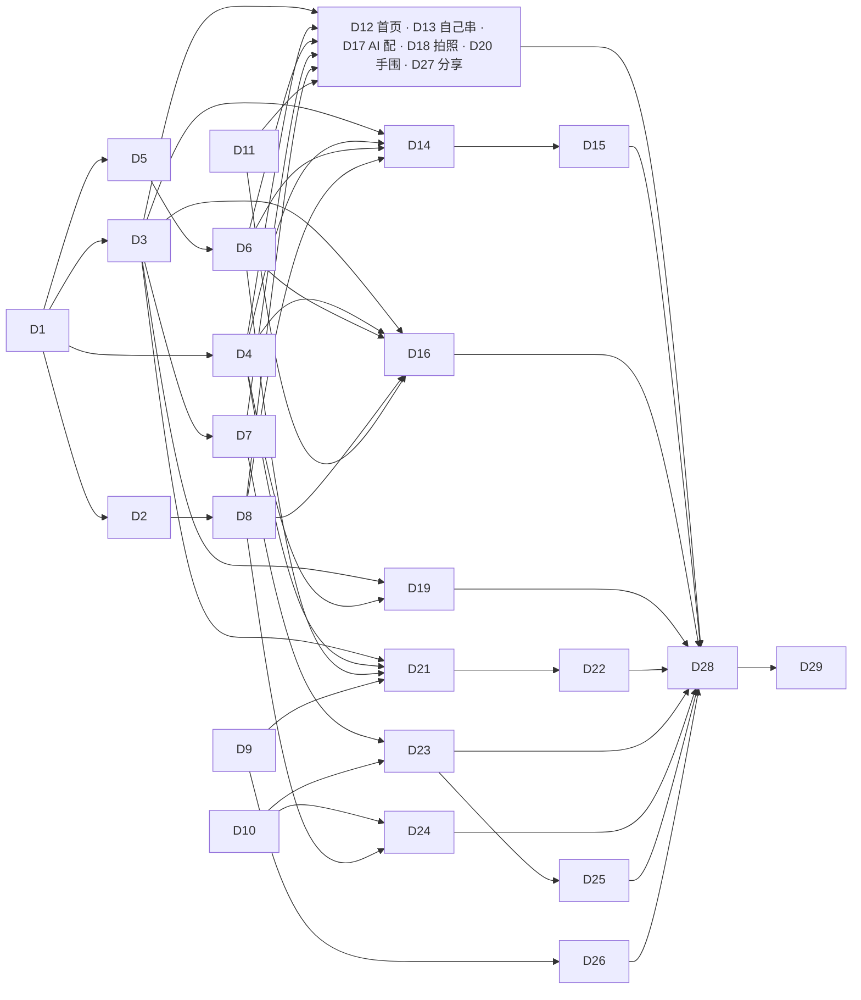

# 05 开发任务与验收标准（2026-11-12 重写）

> 给执行 agent 的任务清单，编号 D1–D29；需要后端或负责人的单独列 B1–B12（第 5 节）。
> 开工前先读 `docs/codex-tasks.md` 第 2 节（工作守则），再读 [03](03-design-system.md) 全文、[04](04-page-redesign.md) 里对应页面那一节、[06](06-order-logistics-login.md)，对照 [mockups.html](mockups.html) 的稿号。
> 方向：**全站白盒，首页也是**。旧的 D1–D28（素纸朱砂）全部作废，不要照旧编号做。

## 0. 通用要求（每条任务都适用）

1. **只改界面和交互，不改规则**。下面这些不许动：
   - 尺寸规则（`pages/editor/logic.js`、`utils/template.js`）：总长目标 = 手围×10 + max(8, 2.5×主珠直径 − 5) mm，合适区间 −4 到 +6mm，54 颗及以上按念珠（多圈）处理。
   - 计价：金额按“分”的整数计算。
   - 订单状态契约（`docs/order-state-contract.md`）：只按 `state` 和 `allowedActions` 展示，状态变更一律走服务端。
   - 下单幂等和价格复核逻辑（`pages/order/order.js` 里的请求 ID、`confirmedQuote`、提交前二次刷新目录）。
   任务里明说要改逻辑的地方（D9、D10、D22）除外，改了要同步改测试并在汇报里逐条说明。
2. **不改后端**。需要后端的列在第 5 节；前端按“没有这个字段、这个接口”也能正常显示来写。
3. **不接真实支付**。待支付就是待支付：不出现“去支付”“支付成功”，不画对勾。不写任何真实密钥、令牌、手机号、地址。
4. 每条任务做完跑三条测试，改了行为就改对应测试，不删测试：
   ```bash
   python3 -m unittest discover -s server/tests
   node --test miniprogram/tests/*.test.js
   python3 kb/validate.py
   ```
5. **预算纪律**（03 第 10 节的检查清单）：页面和组件的 wxss 不出现颜色、字号、字重、圆角、阴影的字面量，一律用 `styles/tokens.wxss` 的变量；wxml 不写内联颜色和字号；没有边框（1rpx 分隔线除外）；不用 emoji 和字符当图标；不新增变量、不新增组件。确实要加，先停下来问。
6. **文案**照 04 的表格逐字写；对外文字只讲寓意不讲功效，过 `kb/data/attributes.json` 的 banned 词表（“转运珠”“本命年”除外）；全站不出现“登录”二字。
7. 小程序限制：单位用 rpx；tabBar 用原生的、图标用本地 png；不做自定义导航栏；图片放服务器按需下载缓存，不进包（主包 2MB 上限）；代码不依赖 `URL` 等浏览器对象；地址走 `config.js`；跳转编辑器、详情、下单页走 `utils/nav.js`。
8. **验收方式**：界面类验收在微信开发者工具里做（iPhone 12/13 模拟器，375 宽）。每一屏截图，按 03 第 10 节数颜色（≤4）和按钮（≤2 种），把数出来的结果写在汇报里。截图放 `docs/reports/design/D<编号>/`，文件名对应验收项序号。没在开发者工具或真机上看过的写“未验证”，不要写“已通过”。
9. 新组件：`options: { styleIsolation: 'apply-shared' }`；在 `app.json` 的 `usingComponents` 全局注册；能抽成纯函数的逻辑单独放文件并配 Node 测试。
10. 分支：从 `design/ui-revamp` 拉 `agent/d<编号>-<短名>`，不往 main 提交。汇报按 `codex-tasks.md` 第 2.6 节。
11. 拿不准产品意图时停下来问，不要猜。

## 1. 依赖与派活顺序



| 波次 | 任务 | 能否并行 |
|---|---|---|
| 第一波（基础） | D1 → D2、D3、D4、D5 → D6、D7、D8 | D1 先做完；D2–D5 并行；D6 等 D5，D7 等 D3，D8 等 D2。D9、D10、D11 不依赖任何任务，可以和 D1 同时开 |
| 第二波（主线页面） | D12 首页、D16 手串详情、D14 → D15 编辑器、D21 → D22 下单 | 各改各的目录，可并行；同一页的两条串行 |
| 第三波（订单与我的） | D23 订单详情、D24 我的订单、D26 我的、D25 申请售后 | D25 等 D23，且要等后端 B4；其余并行 |
| 第四波（其余页面） | D13、D17、D18、D19、D20、D27 | 并行 |
| 第五波（收尾） | D28 → D29 | 串行 |

一个人串行做的建议顺序：D1 → D3 → D4 → D2 → D5 → D6 → D7 → D8 → D9 → D11 → D12 → D16 → D14 → D15 → D21 → D22 → D10 → D23 → D24 → D26 → D13 → D17 → D20 → D18 → D19 → D27 → D25 → D28 → D29。先把“首页 → 详情 → 编辑器 → 下单”这条主线换完，负责人能尽早在开发者工具里看到整体。

后端建议顺序：B1、B2、B3（订单详情和列表要用）→ B5、B6、B7 → B4（售后）→ B10、B11（图片和首页配置）。B8 和 D12 同时处理。

多条任务都要往 `app.json` 的 `usingComponents` 加行，合并时两边都保留。

---

## 2. 基础任务

#### D1 变量与全局样式
- **依赖**：无。
- **改动文件**：新建 `miniprogram/styles/tokens.wxss`、`miniprogram/utils/theme.js`、`miniprogram/tests/theme-tokens.test.js`；改 `miniprogram/app.wxss`、`miniprogram/app.json`（只改 `window` 和 `tabBar` 的颜色）。
- **要做**：
  1. 把 `docs/design/tokens.wxss` 原样复制到 `miniprogram/styles/tokens.wxss`；`app.wxss` 第一行 `@import "styles/tokens.wxss";`。
  2. `app.wxss` 现有的类（`.wrap .card .title .sub .row .primary .muted .chips .chip .active .actions .error`）先保留类名，取值全部换成变量：`.card` 去掉边框和圆角；`.primary` 底 `--c-text`、字 `--c-bg`、圆角 `--r-panel`；`.error` 色 `--c-danger`；`.active` 改成加粗、不带底色和边框；`.chip` 去掉边框，底 `--c-surface`。这些旧类在页面任务里逐页替换，D29 删除。
  3. 加四个文字类：`.t-display .t-title .t-body .t-caption`（03 第 3.2 节），和 `.t-2`（次要字色）、`.t-bold`、`.t-num`（等宽数字）。
  4. `utils/theme.js` 导出 8 个颜色的值（`bg surface line text2 text accent danger mask`），给画布、原生 `switch`、`slider` 用。测试：解析 `tokens.wxss` 里的 `--c-*`，和 `theme.js` 逐项相等；变量总数不超过 30。
  5. `app.json`：`window.navigationBarBackgroundColor` 和 `backgroundColor` `#ffffff`；`tabBar.backgroundColor` `#ffffff`、`color` `#6e6e6e`、`selectedColor` `#111111`、`borderStyle` `white`。
- **验收**：
  1. 开发者工具打开首页：页面底是纯白，主按钮是黑底白字的胶囊，照片和列表是直角，卡片没有边框。截图。
  2. 依次打开 4 个 tab、编辑器、下单页：没有文字看不见、没有页面错位（这一步页面还没逐页改，只要求不坏）。各截一张。
  3. `grep -nE '#[0-9a-fA-F]{3,8}' miniprogram/app.wxss` 没有结果。
  4. 新测试通过；三条测试通过。

#### D2 图标与 tabBar 图标
- **依赖**：D1。
- **改动文件**：新建 `miniprogram/assets/icons/*.svg`（16 个，加 `arrow-right-on.svg`、`check-on.svg` 两个白色版本）、`miniprogram/assets/tab/*.png`（8 张）；改 `miniprogram/app.json`（tabBar 四项加 `iconPath / selectedIconPath`）；`miniprogram/tests/package-config.test.js`。
- **要做**：
  1. 按 03 第 6 节的清单，把 `docs/design/mockups.html` 顶部同名 `<symbol>` 的路径存成独立 SVG 文件：`viewBox="0 0 24 24"`，`fill="none"`，`stroke="#111111"`，`stroke-width="1.5"`，圆头圆角。
  2. tab 图标：`t-home t-diy t-ai t-mine` 四个图形各导出两张 81×81 png（未选中 `#6e6e6e`，选中 `#111111`），每张不超过 3KB。汇报里写清用什么工具导出的。
  3. 测试：`app.json` 里引用的图标文件都存在。
- **验收**：
  1. tabBar 四项都有图标，选中项变黑。四个 tab 各截一张。
  2. 临时在首页放一排 `<image src="/assets/icons/xxx.svg">`（16 个），都能显示、粗细一致。截图后删掉临时代码。
  3. **需真机**：iOS 和安卓各一台确认 SVG 图标能显示；没条件就写“未验证”。真机不显示时改成同名 png（@2x），用法不变。
  4. 开发者工具“详情 → 本地代码”主包体积比改前增加不超过 30KB。截图。

#### D3 基础组件一：按钮、列表行、提示、文字分段、状态占位
- **依赖**：D1。
- **改动文件**：新建 `miniprogram/styles/components.wxss`、`miniprogram/components/{notice,state}/*`、`miniprogram/tests/ui-basic.test.js`；改 `miniprogram/app.wxss`（加一行 `@import`）、`miniprogram/pages/editor/materials.js`（加一个纯函数）、`app.json`（注册 `c-notice c-state`）。
- **要做**（03 第 7.1、7.2、7.3、7.6、7.11 节）：
  1. 样式类：`.c-btn`（默认主按钮；`--sec` 次按钮；`--s` 小号；`.is-disabled`）、`.c-go`（圆形发送键）、`.c-link`（文字链接）、`.c-row`（`__label __value __desc __error`；`--tap`）、`.c-tabs`（`.is-on`）、`.c-skeleton`。`.c-btn` 套在原生 `<button>` 上要去掉默认边框和最小宽度。
  2. `c-notice`：属性 `tone`（`normal` / `danger`）、`title`、`items`（`[{name,text}]`）或默认插槽、`checkable`、`checked`、`error`；事件 `change`。`danger` 时带 `alert` 图标，标题和正文用警示红，`role="alert"`；正文完整显示不截断；`items` 为空且没有插槽内容时不渲染。
  3. `c-state`：属性 `type`（`empty` / `error`）、`title`、`desc`、`action`；事件 `action`。
  4. `materials.js` 加纯函数 `safetyItems(rows)`：只取有 `safety` 的材料，返回 `[{name:'朱砂 8mm', text}]`。现有的 `safetyLines` 不动。
- **验收**：
  1. 新建一个只在开发版能进的临时页 `pages/_kit/_kit`（D29 删除），把上面每个类和组件各摆一个，和 `mockups.html` 并排截图：按钮高 104rpx、胶囊；小号 64rpx、胶囊；行高不小于 112rpx；分隔线 1rpx。
  2. 两个按钮并排不换行；主按钮禁用时变淡。截图。
  3. `c-notice` 的 `danger`：用 `kb/data/beads/bodhi.json` 里最长的一条安全提示测，正文完整显示；带勾选时点整行能勾上并触发 `change`。两张截图。
  4. `components.wxss` 里 `grep -nE '#[0-9a-fA-F]{3,8}|[0-9]px'` 没有结果；测试覆盖 `safetyItems`（有、无、多种）。

#### D4 基础组件二：弹层、底部操作栏
- **依赖**：D1。
- **改动文件**：新建 `miniprogram/components/{sheet,bar}/*`；改 `miniprogram/components/privacy-popup/*`（只改结构和样式）；`app.json`（注册 `c-sheet c-bar`）。
- **要做**（03 第 7.4、7.5 节）：
  1. `c-sheet`：属性 `show`、`title`、`maskClose`（默认 true）；默认插槽和 `footer` 插槽；事件 `close`。从底部升起 200ms；最高 80vh，内容区内部滚动；遮罩 `catchtouchmove`；底部含安全区；直角；带 `--shadow-float`。
  2. `c-bar`：`left` 插槽（金额和一行辅助字）和默认插槽（按钮）；固定在底部，白底，带 `--shadow-float` 和安全区；自带一个同高的占位，页面不用自己算底部留白。没有 `left` 时按钮通栏。
  3. `privacy-popup` 改用 `c-sheet` 的外观，文案照 04 第 17 节；`open-type="agreePrivacyAuthorization"` 和事件不动。
- **验收**：
  1. 临时页上打开 `c-sheet`（内容超过一屏）：内部能滚，背后页面不滚；点遮罩和关闭图标能关；`maskClose=false` 时点遮罩不关。截图两张。
  2. `c-bar`：左边金额、右边主按钮；切到 iPhone SE（320 宽）金额不换行、按钮不被挤扁；切到有底部安全区的机型按钮不贴底。各截一张。
  3. 清除授权后进“拍照做同款”点选图：隐私弹窗是新样子，“同意并继续”能继续。截图。`miniprogram/tests/privacy.test.js` 通过。
  4. 全站只有这两处用了阴影：`grep -rn 'box-shadow' miniprogram --include='*.wxss'` 只出现在 `sheet` 和 `bar`（旧页面里的在各页面任务里删）。

#### D5 珠子：实拍图缓存和过渡图
- **依赖**：D1。
- **改动文件**：新建 `miniprogram/utils/bead-image.js`、`miniprogram/utils/bead-paint.js`、`miniprogram/components/bead/*`、`miniprogram/tests/{bead-image,bead-paint}.test.js`；`app.json`（注册 `c-bead`）。
- **要做**（03 第 8 节）：
  1. `bead-image.js`：`get(url)` 返回本地路径的 Promise。先查本地索引（存储键 `cgz_bead_images`：`{url: {path, size, usedAt}}`），没有就 `wx.downloadFile` 再 `saveFile` 到 `wx.env.USER_DATA_PATH/beads/`；总量超过 20MB 按 `usedAt` 从旧到新删；同一个地址并发只下一次；失败返回 `null`，不抛错、不提示。地址前缀走 `config.js`。把“选哪些删”的部分写成纯函数并测试。
  2. `bead-paint.js`：纯函数 `spec(bead)`，由目录里的 `c[0]`、`c[1]`、`mat` 算出过渡图的参数（三段色、透光透明度：水晶 .6、玉石 .35、其余 0）；`draw(ctx, x, y, r, spec)` 在 2D canvas 上按 03 第 8.3 节画。
  3. `c-bead`：属性 `bead`（目录里的一项）、`size`（`cell` 108rpx / `row` 72rpx / `detail` 320rpx）、`dot`（有安全提示时的红点，默认按 `bead.safety` 判断）、`disabled`。有 `photo` 就走 `bead-image`（`detail` 用 `@480`，其余用 `@160`），下好之前和失败时显示过渡图。
- **验收**：
  1. 临时页上摆 10 颗：水晶、玉石、木、菩提、金属各两颗，都没有实拍图。每颗有高光和暗部，水晶看得出透光，没有平涂色块。截图。
  2. 给其中一颗配一个本地后端能访问的测试 PNG 地址：先显示过渡图，下载完换成实拍图；关掉小程序再进，不再发下载请求（开发者工具 Network 面板确认）。两张截图。
  3. 断网后进同一页：没有报错提示，全部显示过渡图。截图。
  4. 测试：超过 20MB 时删最久没用的；同一地址并发只下载一次；`spec()` 对五种材质的透光值。

#### D6 手串图和款式格
- **依赖**：D5。
- **改动文件**：改 `miniprogram/components/bracelet-thumb/*`、`miniprogram/utils/thumb-cache.js`（只改画法和缓存键）、`miniprogram/components/bracelet3d/index.wxss`；新建 `miniprogram/components/cell/*`、`miniprogram/utils/money.js`、`miniprogram/tests/money.test.js`；`app.json`（注册 `c-cell`，全局注册 `bracelet-thumb`）。
- **要做**（03 第 7.9、7.10、8.4 节）：
  1. `bracelet-thumb`：透明底；每颗珠子用 `bead-image` 的本地图画，没有就用 `bead-paint`；任何一颗的图后来下好了，重画一次。缓存键加版本号，避免读到旧图。加属性 `ghost`（数组，叠戴预览用：在当前这条的上下各画一条，透明度 .45）。
  2. `bracelet3d/index.wxss`：底色改成 `--c-bg`，提示文字用变量。3D 逻辑不动。
  3. `c-cell`：属性 `name`、`price`（分）、`note`、`cover`、`beads`、`catalog`、`disabled`；事件 `tap`。图片正方形，有 `cover` 用封面，没有用 `bracelet-thumb`。
  4. `utils/money.js`：`browse(fen)`（整数元不带小数：`'128'`；有零头：`'128.50'`）、`exact(fen)`（一律两位：`'128.00'`）、`fromYuan(str)`（`Math.round(Number(str)*100)`）。只做格式化，不做计价。
- **验收**：
  1. 临时页上摆 4 个 `c-cell`（两个有封面、两个没有），两列贴边，中间只有一条细缝，没有圆角和阴影。和稿 02 并排截图。
  2. “我的”页（还是旧布局）缩略图照常显示，滚动不卡。`thumb-cache.test.js` 通过（画法变了要改断言的，说明原因）。
  3. `ghost` 传两条作品：三条叠在一起，上下两条变淡。截图。
  4. `money.test.js`：`browse(12800)==='128'`、`browse(12850)==='128.50'`、`exact(12800)==='128.00'`、`exact(5)==='0.05'`、`fromYuan('0.1')+fromYuan('0.2')===30`。

#### D7 输入条和订单进度
- **依赖**：D3。
- **改动文件**：新建 `miniprogram/components/{ask,progress}/*`、`miniprogram/tests/ui-ask-progress.test.js`；`app.json`（注册 `c-ask c-progress`）。
- **要做**（03 第 7.7、7.12 节）：
  1. `c-ask`：属性 `value`、`placeholder`、`busy`、`error`；事件 `input`、`send`。空内容时发送键禁用；`error` 显示在输入条下方（警示红辅助字）。
  2. `c-progress`：属性 `steps`（`[{label, state:'done'|'now'|'todo', at}]`）。只有文字，没有点和线；`steps` 为空不渲染。
- **验收**：
  1. 临时页：输入条空、有字、发送中、带错误四种各截一张；键盘弹起时输入条不被盖住。
  2. 订单进度三种（第一步是当前、第三步是当前、全部完成）各截一张：当前步是灰蓝加粗，没有任何圆点和连线。
  3. 测试：空内容不触发 `send`；`steps` 为空不渲染。

#### D8 app.json、导航、页面增删
- **依赖**：D2。
- **改动文件**：`miniprogram/app.json`、`miniprogram/utils/nav.js`、`miniprogram/sitemap.json`、`miniprogram/tests/{nav,package-config,navigation-works}.test.js`；删除 `miniprogram/pages/ar-tryon/`；新建 `miniprogram/features/orders/orders.*`、`miniprogram/features/after-sale/after-sale.*`（先放能打开的空壳，内容归 D24、D25）；改 `miniprogram/features/tryon/tryon.js`（AR 的跳转地址）。
- **要做**：
  1. `nav.js` 加 `openDetail()`（打开 `pages/finish/finish`，规则同 `openEditor`）、`openOrders(tab)`、`openAfterSale(no)`。
  2. 全仓库搜 `ar-tryon`，入口改成 `/ar-hand/index`；确认 `pages/ar-tryon/yuv.js` 没人引用后删掉整个目录，`app.json` 去掉这一项。
  3. `subPackages` 的 `features` 加 `orders/orders`、`after-sale/after-sale`。
  4. 各页 json 的标题按 04 第 17 节。
  5. `sitemap.json` 只允许索引 `pages/home/home` 和 `features/shared/shared`。
  6. 把 `mine.js`、`share.js`、`shared.js`、`order-detail.js` 里直接 `wx.navigateTo` 到编辑器、下单页的地方换成 `nav.openEditor()` / `nav.openOrder()`。
  7. **登录页先不删**，归 D9。
- **验收**：
  1. `grep -rn "ar-tryon" miniprogram` 没有结果；试戴页点实时 AR 能进 `ar-hand/index`。截图。
  2. `grep -rnE "navigateTo\(\{url:'/pages/(editor/editor|order/order)" miniprogram --include='*.js'` 只剩 `utils/nav.js`。
  3. 开发者工具编译无报错；用“编译模式”逐个打开每个页面路径都能进。
  4. 测试：`openDetail` 在栈里已有详情页时 `navigateBack`、栈深 ≥8 时 `redirectTo`；`package-config.test.js` 按新清单更新并通过。

#### D9 无感登录，删掉登录页
- **依赖**：无。**会改逻辑**（06 第 2 节）。
- **改动文件**：`miniprogram/app.js`、`miniprogram/utils/auth.js`、`miniprogram/utils/design.js`、`miniprogram/app.json`、`miniprogram/tests/{auth,dev-login,design-sync,package-config}.test.js`；删除 `miniprogram/pages/login/`；改所有调用 `goLogin` 的页面（`pages/order/order.js`、`pages/mine/mine.js` 等，只改这一处调用）。
- **要做**：
  1. `app.js` 的 `onLaunch` 里调用 `auth.login()`，失败不提示、不拦截。
  2. 删除 `pages/login/login`，从 `app.json` 移除；所有 `goLogin` 改成直接 `auth.login()`，失败时由各页显示 04 里写的那一行字。
  3. 开发测试登录保持在 `auth.login()` 内部自动降级（现有逻辑），不再有独立入口。
  4. 第一次拿到会话后，把本机保存但没同步的作品逐条 `design.sync()`；全部成功给一次轻提示“作品已同步”（用一个本地标记保证只提示一次）；失败的留在本机，下次启动再试，不提示。
  5. 全仓库的界面文字去掉“登录”二字。
- **验收**：
  1. 开发者工具“清缓存 → 全部清除”后重新编译：直接进首页，没有任何提示；Storage 面板里出现 `cgz_token`。截图。
  2. 清缓存后，从首页进编辑器串 6 颗 → 串好了 → 去下单 → 填收货信息 → 提交：全程没有出现“登录”二字，没有跳到别的页面，订单创建成功并进入订单详情（待支付）。逐步截图。
  3. 本地后端停掉再点提交：按钮上方出现“网络不太好，没能连上服务，点提交再试一次”；启动后端再点一次，提交成功。两张截图。
  4. 清缓存 → 断网串一条并保存 → 联网重启：出现一次“作品已同步”，再重启不再出现。截图。
  5. `grep -rn "登录" miniprogram --include='*.wxml' --include='*.js' --include='*.json'` 只剩注释和测试文件。测试更新并通过。

#### D10 订单主状态、进度和归类
- **依赖**：无。**会改逻辑**（只改展示映射，06 第 3.1、3.2、3.5 节）。
- **改动文件**：`miniprogram/utils/order-state.js`、`miniprogram/tests/order-state.test.js`。
- **要做**：
  1. `primaryState()` 按 06 第 3.1 节的 10 行顺序取第一个命中的，返回 `{label, description, tone, mainAction}`。`tone` 只有三种：`normal`（黑）、`action`（灰蓝：待支付、已签收）、`danger`（警示红：物流有点问题、退款遇到问题、售后未通过）。说明文字照 06；里面的金额、时间、时限来自订单字段，字段没有就用不带数字的那句。
  2. 新增纯函数 `progress(order)`：返回四步 `[{label, state, at}]`（下单、制作、运输、签收）；取消、退款、售后时返回 `[]`。时间来自后端的 `progress` 字段（B3），没有就不带时间。旧订单没有 `state` 时返回 `[]`。
  3. 新增纯函数 `bucket(order)`：返回 `unpaid / making / shipping / aftersale` 中的若干个；待收货 = 运输中 + 已签收；已取消的不进待支付。
  4. `decorate()` 输出里加 `progressView`、`buckets`；`actionViews` 只保留 `allowedActions` 里有且认识的动作，未知动作忽略。物流已签收而 `allowedActions` 里没有 `confirm_receipt` 时（B1 没上线），不自己加按钮。
- **验收**：测试覆盖：06 第 3.1 节表里的 10 行各至少一个用例（主状态词、`tone`、`mainAction`）；`progress` 在 待支付、制作中、运输中、已签收、已完成、已取消、退款中、售后中 下的结果；`bucket` 的四种归类和“已取消的不进待支付”；`allowedActions` 里没有的动作不出现。原有用例因文案和 `tone` 变化要改的，逐条说明。三条测试通过。

#### D11 手围工具
- **依赖**：无。
- **改动文件**：新建 `miniprogram/utils/wrist.js`、`miniprogram/tests/wrist.test.js`。
- **要做**：导出 `get()`（没量过返回 15）、`confirmed()`、`set(v)`（写 `cgz_wrist` 和 `cgz_wrist_confirmed`，并更新当前设计的手围）、`label()`（“按你的 15cm 手围”／“先按常见的 15cm 手围”）、`valid(v)`（8–30）。各页面任务用它替换各自读写存储的代码。不改尺寸规则。
- **验收**：测试覆盖默认值、确认前后的 `label()`、越界、`set` 后当前设计的手围同步。

---

## 3. 页面任务

每条页面任务的固定验收（下面不再重复写）：
- **A**：这一页每个状态各截一屏，按 03 第 10 节数颜色（≤4）和按钮（≤2 种），结果写进汇报。
- **B**：这一页的 wxss 里 `grep -nE '#[0-9a-fA-F]{3,8}|rgba?\(|border:|box-shadow'` 没有结果（1rpx 分隔线用 `.c-row` 自带的）；wxml 里没有 `style="…color` 和 `font-size`。
- **C**：文案和 04 对应小节的表格逐字一致。
- **D**：三条测试通过。

#### D12 首页
- **依赖**：D3、D4、D6、D7、D8、D11。
- **改动文件**：`miniprogram/pages/home/*`。
- **要做**：按 04 第 1 节（稿 01–03）重排。删掉轮播、四个圆形入口、卡片上的按钮。快捷词先用页面里的常量（示例四个），后端 B11 上线后改读接口；上身图读目录接口里的首页封面，没有就用第一条款式的圆环。点发送键或快捷词：把话存进全局，`switchTab` 到 AI 配并直接发送。
- **验收**：
  1. 第一屏从上到下：贴边大图、大标题、输入条、一排快捷词、一行“或者，从一颗珠子开始自己串”。和稿 01 并排截图。
  2. 点快捷词“清冷一点”：切到 AI 配，这句话已经发出去。截图。
  3. 往下滑：“大家在串”是两列贴边的款式格，点一格进手串详情。截图。
  4. 本机有草稿时出现“接着串上次那条”，点了进编辑器；清缓存后这一行不出现。两张截图。
  5. 本地后端停掉、清缓存后进首页：上半屏照常，“大家在串”的位置是“款式没加载出来”和“再试一次”。截图。
  6. 页面上没有“首单立减”等促销文字（数据里还有的话，说明 B8 未处理）。

#### D13 自己串
- **依赖**：D3、D4、D6、D8、D11。
- **改动文件**：`miniprogram/pages/diy/*`。
- **要做**：按 04 第 2 节（稿 04–05）。去掉首次强推手围页和热门款列表；作品列表合并本机和云端（最近改的在前）；左滑删除，弹层确认。
- **验收**：
  1. 清缓存后点“自己串”tab：直接看到工作台，没有被推去手围页。截图。
  2. 没有作品时显示“还没有作品。串好的手串会自动存在这里。”截图（稿 05）。
  3. 串好一条回来：作品出现在列表第一行，点了进手串详情。截图。
  4. 左滑删除：弹层确认后这一行消失；没有后端删除接口时弹层里有“只会从这台手机上删除”。截图。

#### D14 编辑器：布局
- **依赖**：D3、D4、D6、D8。
- **改动文件**：`miniprogram/pages/editor/{editor.wxml,editor.wxss,editor.js}`（`logic.js`、`materials.js` 不动）。
- **要做**：按 04 第 3 节的布局（稿 06、08）。舞台白底；尺寸行；文字分段的分类；5 列选珠格用 `c-bead`；底部通栏主按钮“串好了 · ¥128”。尺寸文字来自现有的 `logic.stats()`，只换说法（“长度基本合适”显示成“合适”）。选中一颗时尺寸行换成四个文字动作。去掉左侧分类栏、齿轮、常驻的材料清单入口。
- **验收**：
  1. 和稿 06 并排截图：舞台、一行尺寸、分类、5 列珠子、一个黑色通栏按钮。
  2. 手围 15cm、主珠 8mm：逐颗加珠子，尺寸行依次出现“还差约 N mm”→“合适”→“超出约 N mm”；“合适”出现的区间是总长比目标短 4mm 到长 6mm 之间（目标 = 150 + max(8, 2.5×8−5) = 165mm）。记下切换时的颗数和总长，写进汇报。加到 54 颗时变成“多圈串，长度以实际佩戴为准”。
  3. 朱砂（或任何有安全提示的珠子）的格子右上角有红点，别的格子没有。截图。
  4. 点托盘上一颗：它放大、其余变淡，尺寸行变成“第 N 颗 ｜ 前移 后移 删除 好了”；此时点选珠格是替换。两张截图（稿 08）。
  5. 少于 6 颗时主按钮禁用，上方有“至少 6 颗才能串成一条”。截图。
  6. `size-rule.test.js`、`editor-gestures.test.js`、`material-picker.test.js` 不改且通过。

#### D15 编辑器：弹层和叠戴预览
- **依赖**：D14。
- **改动文件**：`miniprogram/pages/editor/{editor.wxml,editor.wxss,editor.js}`。
- **要做**：按 04 第 3 节的“弹层”表：珠子详情（稿 09）、筛选、更多、材料清单，全部用 `c-sheet`；原来的“设计设置”“个性选择”两个弹层删掉，功能并进“更多”和“筛选”。叠戴预览（稿 07）：点 `layers` 图标，在舞台上把最近两条作品半透明地叠在上下；没有作品时用两条热门款并写“上下两条是示意”。3D 舞台做不了叠加时，预览打开期间换成 2D 的 `bracelet-thumb`（带 `ghost`），关闭后换回。
- **验收**：
  1. 长按朱砂：弹层里有大图、一句寓意、单价、**红色的材料安全提示（全文）**、主按钮“加一颗”；点“加一颗”托盘多一颗。和稿 09 并排截图。
  2. 长按没有安全提示的珠子：弹层里没有红色。截图。
  3. 点 `layers`：出现三条叠在一起，上面写“叠戴预览 · 上下两条是你的作品”；再点一次恢复。和稿 07 并排截图。清缓存（没有作品）再试，文字是“上下两条是示意”。
  4. “更多”里能改名字、按颗数串、按手围重排、看材料清单、选穿绳；材料清单里有安全提示的材料下面有红色提示。各截一张。
  5. 筛选没结果时显示“没有符合的珠子”和“清除筛选”。截图。
  6. 页面里搜不到 `wx.showModal`。

#### D16 手串详情
- **依赖**：D3、D4、D6、D8、D11。
- **改动文件**：`miniprogram/pages/finish/*`；`miniprogram/pages/home/home.js`、`miniprogram/pages/ai/ai.js` 里“用这款 / 用这条”的跳转改成 `nav.openDetail()`。
- **要做**：按 04 第 4 节（稿 10）。标题改成空；去掉 AI 评价卡和保存按钮；从模板或 AI 方案进来不自动存进作品，点“改一改”或“去下单”时才存；“去下单”前没确认过手围就先出弹层。
- **验收**：
  1. 和稿 10 并排截图：贴边大图、名字、一句寓意、规格行、三个文字链接、材料行、底部栏（价格 + 黑色“去下单”）。
  2. 清缓存后从首页点一款进详情：规格行写“先按 15cm 手围排的”；点“去下单”出现弹层“下单前，确认一下手围”，选“就按 15cm”进确认订单，之后不再问。三张截图。
  3. 从首页点一款进详情再返回，“自己串”的作品里没有多出这一条；点“改一改”后才有。两张截图。
  4. 含朱砂的手串：材料行下面有红色安全提示。截图。
  5. 5 颗的设计：主按钮禁用，有“至少 6 颗才能下单”。截图。

#### D17 AI 配
- **依赖**：D3、D6、D7、D8、D11。
- **改动文件**：`miniprogram/pages/ai/*`。
- **要做**：按 04 第 5 节（稿 11–13）。删语音按钮；示例换成 04 的三句；方案用 `c-cell` 横向滑动，点了进手串详情；等待文案分三段；失败时错误显示在输入条下方，原话留在输入条里。
- **验收**：
  1. 没有对话时和稿 11 并排截图；页面上没有话筒、没有 emoji。
  2. 发一句话：等待文字依次变化（8 秒、30 秒两个节点，可以把本地后端的 AI 接口临时调慢来看）；结果是两列款式格可左右滑，和稿 12 并排截图。
  3. 停掉后端再发：输入条下方出现红字“这次没配出来。你的话还在，点发送再试一次。”，输入条里还是原话。和稿 13 并排截图。
  4. 示例和页面文字里搜不到“保平安”等禁用词。
  5. `ai-request-timeout.test.js` 通过。

#### D18 拍照做同款
- **依赖**：D3、D4、D5、D8。
- **改动文件**：`miniprogram/pages/photo/{photo.wxml,photo.wxss,photo.js}`（`compress.js` 不动）。
- **要做**：按 04 第 6 节（稿 14–15）。四种状态（开始、识别中、结果、失败）各自的布局；失败给两条出路。
- **验收**：
  1. 开始屏和稿 14 并排截图；结果屏和稿 15 并排截图。
  2. 识别中：照片下面一行字，主按钮禁用。截图。
  3. 用一张纯色图片触发失败：出现“没看清这张照片”“换一张”“不拍了，直接自己串”。截图。
  4. 结果屏点一行能从弹层里换备选；点“放到托盘上改”进编辑器，珠子和结果一致。两张截图。
  5. `photo-*.test.js` 通过。

#### D19 试戴和实时 AR
- **依赖**：D3、D4。
- **改动文件**：`miniprogram/features/tryon/{tryon.wxml,tryon.wxss,tryon.js}`、`miniprogram/ar-hand/{index.wxml,index.wxss}`（识别逻辑不动）。
- **要做**：按 04 第 7、16 节（稿 16）。三种方式用文字分段；`slider`、`switch` 的颜色从 `theme.js` 取主字色；进 AR 前首次出说明弹层；诊断信息只在开发版和体验版显示。
- **验收**：
  1. 和稿 16 并排截图；滑杆是黑色，没有红色。
  2. 没有照片时舞台里是说明和“拍照或选照片”。截图。
  3. 第一次点“实时 AR（实验）”出现弹层，写明约 13MB；点“开始”进 AR 页。截图。
  4. AR 页在模拟器里（没有相机）显示“这次没开起来”和“用照片试戴”，点了回到试戴页。截图。**需真机**验证真实相机下的效果，没条件写“未验证”。
  5. `ar-hand.test.js`、`ar-model-cache.test.js` 通过。

#### D20 手围页
- **依赖**：D3、D4、D11。
- **改动文件**：`miniprogram/pages/wrist/*`。
- **要做**：按 04 第 8 节（稿 17）。读写走 `utils/wrist.js`。
- **验收**：
  1. 和稿 17 并排截图。
  2. 点加减每次变 0.5；点常用值直接跳到那个数；主按钮文字跟着变（“就按 16.0cm”）。截图。
  3. 减到 8 以下或加到 30 以上：数字下方出现红字“手围在 8–30cm 之间”，主按钮禁用。截图。
  4. 点主按钮返回来源页，来源页上的手围已更新。

#### D21 确认订单：布局
- **依赖**：D3、D4、D6、D9。
- **改动文件**：`miniprogram/pages/order/{order.wxml,order.wxss,order.js}`（只动数据到视图的部分；计价、幂等、价格复核不动）。
- **要做**：按 04 第 9 节的布局（稿 18）：收货信息提到最上面，用列表行；手串和材料；选项；金额明细；支付说明；底部栏。“用微信地址”调 `wx.chooseAddress`，放在开关后面（`config.js` 里默认关，B12 开通后打开），关着时这一行不显示。地址仍然不落本机存储。删掉走不到的“订单已创建”结果区和内联样式的黄条。
- **验收**：
  1. 和稿 18 并排截图（先不含安全提示那一块）。表单是“标签在左、输入在右”，输入框没有底色和边框。
  2. 金额核对：选一条已知的设计，页面上的 珠子 + 手工串制 + 穿绳 + 礼盒 + 运费 = 合计，且和改版前同一设计的合计一分不差。把两边数字写进汇报。
  3. 切换编织绳、打开礼盒：金额明细多出对应的行，合计跟着变；不到 ¥99 有运费，满了显示“包邮”。截图。
  4. 支付说明那段文字常驻在金额下面；页面上没有“去支付”。截图。
  5. `order.test.js` 通过。

#### D22 确认订单：安全勾选、改价、提交确认、无感提交
- **依赖**：D21。**会改逻辑**（只改确认流程，不改计价和幂等）。
- **改动文件**：`miniprogram/pages/order/{order.wxml,order.wxss,order.js}`、`miniprogram/tests/order.test.js`。
- **要做**（04 第 9 节、06 第 2 节第 3 条）：
  1. 有安全提示的材料时，材料下面显示 `c-notice`（`danger`、带勾选）。没勾不能提交：页面滚到提示处，标题变成“请先勾选：材料安全提示”。
  2. 改价：用 `c-sheet`（点遮罩不关）。没确认时主按钮是“先确认新价格”（禁用），点底部栏重新打开弹层。删掉 `wx.showModal`。
  3. 提交确认：有尺寸偏差或安全提示时，点提交后出确认弹层。点“回去看看”后再提交，**要重新确认**（现有的 `confirmationsDone` 是“取消后视为已知情”，改掉并更新对应测试）。
  4. 提交时没有会话：先 `auth.login()`，成功后直接继续提交；失败显示“网络不太好，没能连上服务，点提交再试一次”。没有“去登录”。
  5. 其余错误文案照 04。成功后 `nav.orderComplete(no)`。
- **验收**：
  1. 用含朱砂的设计进确认订单：材料下面有红色安全提示（全文）和勾选行。和稿 18 并排截图。
  2. 不勾直接点提交：没有发出下单请求（Network 面板确认），页面滚到提示处，标题变成“请先勾选：材料安全提示”。截图。
  3. 勾选后点提交：出现确认弹层，里面再列一次安全提示和合计；点“回去看看”再点提交，弹层再出现一次；点“确认提交”才发请求。三张截图。
  4. 进确认订单后，在本地后台把其中一种材料改价，再点提交：出现“价格有变化”弹层，逐条“旧价 → 新价”，点遮罩不关；点“按新价格继续”后合计更新。和稿 19 并排截图。
  5. 清缓存后直接走到提交：一次点击就创建订单并进入订单详情，主状态是“待支付”，没有对勾。截图。
  6. 连点两次提交：只创建一笔订单（“我的订单”里确认）。
  7. 没有安全提示、尺寸合适的设计：点提交直接下单，不出确认弹层。
  8. `order.test.js` 更新并通过，汇报里列出改了哪几条用例和原因。

#### D23 订单详情
- **依赖**：D3、D4、D6、D7、D10。
- **改动文件**：`miniprogram/features/order-detail/*`。
- **要做**：按 04 第 10 节（稿 20–23、30、31）和 06 第 3 节。主状态、说明、进度来自 D10；物流常驻、单号可复制、轨迹默认 3 条；售后进度；“更多”弹层；取消订单带原因（后端 B6 没上线时原因只在本地丢弃，照常取消）；确认收货二次确认；删掉五组状态的格子。单个订单接口（B2）有就用，没有就沿用现在“拉列表再找”的办法。
- **验收**（在本地后台把同一笔订单依次推到各状态）：
  1. 待支付：“待支付”是灰蓝色大字；说明是 06 的原文；进度第一步是当前；底部是灰色的“取消订单”；页面上没有“去支付”、没有对勾。和稿 20 并排截图。
  2. 运输中：物流区块直接可见，不用点开；点“复制”后粘贴板里是单号；没有轨迹数据时显示“复制单号后，可以到快递官网查询。”和稿 21 并排截图。
  3. 已签收：“已签收”是灰蓝色；底部黑色“确认收货”（后端 B1 没上线时没有这个按钮，在汇报里说明）；点了出确认弹层，确认后主状态变成“已完成”。和稿 22 并排截图。
  4. 售后中：没有四步进度，有售后进度四行。和稿 23 并排截图。
  5. 取消订单：弹层里四个原因单选，确认后主状态变“已取消”，说明是“这笔订单已取消，没有扣款。”截图。
  6. 页面上搜不到“制作履约”“无售后”“未发货”这些内部词（开发版底部的调试行除外）。
  7. 加载时是骨架（稿 30）；断网时是“没连上”和“再试一次”（稿 31）。各截一张。
  8. 后端没给的时间、金额、时限，页面上不出现编出来的数字：对照接口返回逐项核对，写进汇报。

#### D24 我的订单（新页面）
- **依赖**：D3、D6、D8、D10。
- **改动文件**：`miniprogram/features/orders/*`。
- **要做**：按 04 第 11 节（稿 24–25）。分类用 D10 的 `bucket()`；`?tab=` 决定默认分类；行尾按钮按主状态。
- **验收**：
  1. 和稿 24 并排截图：状态只有文字颜色，没有任何带底色的标签。
  2. 准备 待支付、运输中、已签收、已完成、已取消 各一笔：五个分类下的订单和 06 第 3.5 节一致（待收货里有运输中和已签收两笔；已取消不在待支付里）。每个分类截一张。
  3. 已签收那一行行尾是“确认收货”，点了出确认弹层；运输中那一行行尾是“查看物流”，点了进详情并滚到物流。
  4. 没有订单：和稿 25 并排截图；点“去串一条”到“自己串”。

#### D25 申请售后（新页面，需后端 B4）
- **依赖**：D23；后端 B4。
- **改动文件**：`miniprogram/features/after-sale/*`、`miniprogram/features/order-detail/order-detail.js`（“更多”里的入口）。
- **要做**：按 04 第 12 节（稿 26）和 06 第 3.4 节。入口只在 `allowedActions` 里有 `request_after_sale` 时出现。照片用 `wx.chooseMedia`，走隐私授权。
- **验收**：
  1. 后端没有 `request_after_sale` 时：订单详情的“更多”里没有“申请售后”，只有“联系客服”。截图。
  2. 后端有时：已签收订单的“更多”里出现“申请售后”，进入后和稿 26 并排截图。
  3. 不选原因：主按钮禁用。选原因、填说明、加 2 张照片、提交：回到订单详情，主状态是“售后处理中”。两张截图。
  4. 加到 3 张后加号格消失。截图。
  5. B4 没上线时这条任务不要开工；页面空壳（D8）保留。

#### D26 我的
- **依赖**：D3、D6、D8、D9、D10。
- **改动文件**：`miniprogram/pages/mine/*`。
- **要做**：按 04 第 13 节（稿 27）和 06 第 2 节第 4 条。订单只留入口和最近一单；作品搬去“自己串”；头像昵称用 `chooseAvatar` 和 `type="nickname"`，存本机（后端有字段再同步）；“联系客服”用 `open-type="contact"`，放在开关后面（B12 开通后打开），关着时这一行不显示。
- **验收**：
  1. 和稿 27 并排截图；整页没有“登录”二字。
  2. 清缓存后进“我的”：显示“给自己起个名字”；不设置头像昵称，订单入口和手围照常能用。截图。
  3. 点头像和名字：能选头像、填昵称，保存后显示。截图。
  4. 有订单时显示最近一单和它的主状态；点“全部”进“我的订单”。截图。
  5. 开发版底部有一行“开发测试账号”；体验版没有（没条件验证体验版就写“未验证”）。

#### D27 分享和分享落地页
- **依赖**：D3、D4、D6、D8。
- **改动文件**：`miniprogram/pages/share/*`、`miniprogram/features/shared/*`。
- **要做**：按 04 第 14、15 节（稿 28–29）。进页面就自动准备分享链接；海报改成白底黑字，颜色从 `theme.js` 取；“好友预览”那一段删掉，改成打开落地页的预览模式；落地页加安全提示。
- **验收**：
  1. 分享页和稿 28 并排截图：一个黑色“发给微信好友”、一个灰色“保存图片”、一行文字链接。
  2. 保存出来的海报：白底、只有黑字、没有价格、没有红色。把图片放进汇报。
  3. 落地页和稿 29 并排截图；含朱砂的分享，珠子列表下面有红色安全提示。
  4. “看看朋友打开是什么样”：进落地页，顶部一行“这是朋友看到的样子”，底部按钮禁用。截图。
  5. 用一个不存在的分享 id 打开落地页：显示“这条分享打不开了”和“去首页看看”。截图。

---

## 4. 收尾任务

#### D28 文案检查
- **依赖**：全部页面任务。
- **改动文件**：新建 `miniprogram/tests/copy-banned.test.js`。
- **要做**：测试扫描 `miniprogram` 下所有 wxml 和 js 里的中文字符串：不含 `kb/data/attributes.json` 的 banned 词（“转运珠”“本命年”整词除外）；不含“登录”（注释除外）；不含“去支付”“支付成功”。
- **验收**：测试通过；故意在某个 wxml 里加一个禁用词，测试失败并指出文件和行号（验证后改回）。

#### D29 预算检查、清理、全量截图
- **依赖**：D28。
- **改动文件**：新建 `miniprogram/tests/design-budget.test.js`；删除 `pages/_kit/`、`app.wxss` 里的旧类、`assets/editor-icons/` 里不再用的文件。
- **要做**：
  1. 测试把 03 第 10 节第 16–19 条写成自动检查：wxss 里的颜色字面量只在 `tokens.wxss`；`font-size / font-weight / border-radius / box-shadow` 的取值都是变量（`border-radius: 50%` 除外）；`border` 只有 `1rpx solid var(--c-line)`；`box-shadow` 只在 `sheet` 和 `bar`；`tokens.wxss` 的变量不超过 30 个；`components/` 下 `c-` 开头的组件加样式类合计不超过 12 个。
  2. 全仓库搜 emoji 和字符图标（`⊕ ✧ ▣ ◎ ↑ 🎙` 等），清干净。
  3. 按 `mockups.html` 的 31 个稿号，在开发者工具里逐屏截图，放 `docs/reports/design/final/NN.png`，旁边写一份清单：每屏数出来的颜色和按钮。
- **验收**：
  1. 新测试通过；三条测试通过。
  2. 31 屏截图齐全，每屏颜色 ≤4、按钮 ≤2 种；做不到的逐屏说明原因。
  3. 开发者工具“详情 → 本地代码”：主包小于 2MB，写出实际数字。
  4. **需真机**：iOS、安卓各一台走一遍“首页 → 编辑器 → 详情 → 下单 → 订单详情”，没条件就写“未验证”。

---

## 5. 需后端、数据或负责人（B 任务，不在 D 任务里做）

前端都按“没有也能用”实现。B1–B7 对应 06 第 3.6 节的 B-O1–B-O7。

| 编号 | 需要什么 | 用在 | 没有时前端怎么表现 |
|---|---|---|---|
| B1 | 物流“已签收”时也允许确认收货（`order_allowed_actions`） | D23、D24 | 已签收时没有“确认收货”按钮，只有说明文字 |
| B2 | `GET /api/my/orders/{订单号}` 单个订单接口 | D23 | 沿用“拉全部订单再找” |
| B3 | 给用户的订单输出去掉 `statusHistory`、`logisticsHistory` 里的操作人和内部备注，改成 `progress: [{step, at, text}]` 和 `tracking: [{at, text}]` | D10、D23 | 进度没有时间；物流只有承运方和单号。**上线前必须做：现在的接口会把内部备注发到用户手机上** |
| B4 | 用户申请售后的接口、`allowedActions` 加 `request_after_sale`、给用户看的售后进度字段、照片上传 | D25 | 没有“申请售后”入口，只有“联系客服” |
| B5 | 退款金额和预计到账说明随订单返回 | D10、D23 | 退款说明里不写金额和时间 |
| B6 | 取消订单可带原因 | D23 | 原因选了但不上传 |
| B7 | 待支付订单的保留规则（负责人定，见 README 待确认），后端按规则返回说明文字 | D10、D23 | 用 06 里那句固定说明 |
| B8（数据） | 删掉轮播里“首单立减 ¥10”；热门款改名（`server/seed.py`、`miniprogram/utils/catalog-preview.js`，用 `tools/refresh-catalog-preview.js` 重新生成） | D12 | 促销文案和祝福语式的名字还在 |
| B9 | `DELETE /api/designs/{id}` | D13 | 只删本机，弹层里写明 |
| B10 | 珠子实拍图：后台能上传透明底 PNG（`@160`、`@480` 两张），目录接口的 `photo` 给出地址，换图时地址变化 | D5 | 全部显示过渡图 |
| B11 | 首页配置：上身封面图、心情快捷词（目录接口里加字段，后台可改） | D12 | 封面用第一条款式的圆环；快捷词用前端常量 |
| B12（负责人） | 公众平台开通 `wx.chooseAddress` 权限并更新隐私指引；开通微信客服 | D21、D26、D23 | 两个开关默认关，对应的行不显示 |
