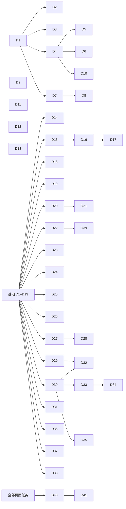

# 05 开发任务与验收标准（2026-11-12 按定稿重写）

> 给执行 agent 的任务清单。前端 D1–D41，后端和负责人事项 B1–B23（第 5 节）。之前的 D1–D29、B1–B12 全部作废，不要照旧编号做。
> 依据：[04 逐页设计](04-page-redesign.md)（开发依据）和 [mockups-final.html](mockups-final.html)（81 屏，稿号一一对应）。规范见 [03](03-design-system.md)，订单和登录规则见 [06](06-order-logistics-login.md)，验收清单见 [09](09-design-principles.md) 末尾。
> 开工前先读 `docs/codex-tasks.md` 第 2 节（工作守则），再读 04 第 0 节和自己那一页。

## 0. 通用要求（每条任务都适用）

1. **只改界面和交互，不改规则。** 下面这些不许动：
   - **尺寸规则**（`pages/editor/logic.js`、`utils/template.js`）：总长目标 = 手围×10 + max(8, 2.5×主珠直径 − 5) mm，合适区间 −4 到 +6mm，54 颗及以上按多圈处理。代码搬到工作台时原样搬，测试 `size-rule.test.js` 不改断言。
   - **金额按“分”的整数计算**，只在显示时换成元。
   - **订单状态契约**（`docs/order-state-contract.md`）：只按 `state` 和 `allowedActions` 展示，状态变更一律走服务端。
   - **下单幂等和价格复核**（`pages/order/order.js` 里的请求 ID、`confirmedQuote`、提交前二次刷新目录）。
   - **计价规则只通过 B1 改**（去掉手工费、返回到手价）。任何 D 任务都不在前端加减手工费或运费，只显示后端报价返回的数。B1 没合并前，前端按现有报价显示，汇报里注明。
   任务里明说要改逻辑的地方除外，改了要同步改测试并在汇报里逐条说明。
2. **不改后端。** 需要后端的列在第 5 节；前端按“没有这个字段、这个接口”也能正常显示来写（每条 B 任务写了没有时怎么表现）。
3. **不接真实支付。** 待支付就是待支付：不出现“去支付”“支付成功”，不画对勾。不写任何真实密钥、令牌、手机号、地址。
4. 每条任务做完跑三条测试，改了行为就改对应测试，不删测试：
   ```bash
   python3 -m unittest discover -s server/tests
   node --test miniprogram/tests/*.test.js
   python3 kb/validate.py
   ```
5. **预算纪律**（03 第 10 节）：页面和组件的 wxss 不出现颜色、字号、字重、圆角、阴影的字面量，一律用 `styles/tokens.wxss` 的变量（7 个颜色，没有强调色）；wxml 不写内联颜色和字号；不用 emoji 和字符当图标；**不用任何警告符号**。要新增变量或组件，先停下来问。
6. **文案**照 04 的表格逐字写。对外文字只讲寓意不讲功效，过 `kb/data/attributes.json` 的 banned 词表（“转运珠”“本命年”除外）；寓意只用知识库 `meaning.tags` / `meaning.text` 的说法；“登录”只出现在手机号登录页和“我的”未登录那一行；金额写到元。
7. **小程序限制**：单位用 rpx（稿子是 375 宽，1px = 2rpx）；tabBar 用原生的、图标用本地 png；**只有工作台用自定义导航栏**；图片放服务器按需下载缓存，不进包（主包 2MB 上限）；代码不依赖 `URL` 等浏览器对象；地址走 `config.js`；页面跳转走 `utils/nav.js`。
8. **全站只用浮动提示（D6）和弹层（D5）**，不用 `wx.showToast`、`wx.showModal`、`wx.showActionSheet`。
9. 新组件：`options: { styleIsolation: 'apply-shared' }`；在 `app.json` 的 `usingComponents` 全局注册；能抽成纯函数的逻辑单独放文件并配 Node 测试。
10. 分支：从 `design/ui-revamp` 拉 `agent/d<编号>-<短名>`，不往 main 提交、不推送 main。汇报按 `codex-tasks.md` 第 2.6 节。
11. 拿不准产品意图时停下来问，不要猜。

### 0.1 验收怎么做（每条任务都一样）

- 在**微信开发者工具**里做，模拟器选 iPhone 12/13（375 宽）；另切一次 iPhone SE（320 宽）看关键数字不折行、不横向溢出。
- 验收项写成“做什么 → 应该看到什么”，每一项截一张图，放 `docs/reports/design/D<编号>/`，文件名用验收项序号（`1.png`、`2a.png`）。
- 和 `mockups-final.html` 对应稿号并排对一遍，差异写进汇报。
- 需要真机才能确认的（震动、声音、相机、相册、订阅消息、AR）单独标“需真机”，没条件就写“未验证”。**没在开发者工具或真机上看过的，不写“已通过”。**

### 0.2 页面任务的通用验收（09 检查清单）

每条页面任务（D14–D39）的验收里都写了“09 清单”一行，列出这一页要重点对的条目和它在这一页具体指什么。除此之外，下面 8 项每一页都要过，汇报里逐项写结果：

| 编号 | 09 条目 | 怎么验 |
|---|---|---|
| G1 | 3、5 | 每屏截图数颜色（不算珠子和照片，最多白、黑、灰、红 4 种）和按钮（最多 2 种）；能点的是胶囊或圆形，其余直角 |
| G2 | 8 | 底部栏只有价格和一个主按钮（最多再一个次按钮），没有说明文字；不需要用户动手时没有底部栏 |
| G3 | 11 | 04“反馈”表里这一页的每个操作都点一遍，反馈和表里一致；没有“点了没反应”；不可点的按钮上写着原因 |
| G4 | 18 | 04“状态”里列的每个状态都做出来并截图：正常、空、加载（骨架块）、失败（原因 + 再试一次）、没权限、缺货 |
| G5 | 16、17 | 页面上的颗数、长度、合适判断、价格都来自规则和后端报价，没有写死的数；寓意来自知识库；文案过 banned 词表 |
| G6 | 30 | 没有三角、感叹号、红点；红色只在含汞那一句和出错的那一行 |
| G7 | 31 | 展示手串的地方，名字和一句寓意最显眼，价格是小字或只在底部栏 |
| G8 | 23–28 | 逐个元素看：没有装饰图标；不公认的图标配了字；一行不超过 3 项；一段不超过 3 行；按钮 2–6 个字；关键数字不折行 |

## 1. 依赖与派活顺序



| 波次 | 任务 | 能否并行 |
|---|---|---|
| 第一波（基础） | D1 → D2、D3、D4、D7 → D5、D6、D8、D10；D9、D11、D12、D13 | D1 先做完。D2、D3、D4、D7 并行；D5、D6、D10 等 D4；D8 等 D7。**D9、D11、D12、D13 不依赖别的任务，可以和 D1 同时开**（它们改的是 `utils/`） |
| 第二波（主线） | D14 首页、D15 → D16 → D17 工作台、D22 手串详情、D27 → D28 确认订单 | 四条线各改各的目录，**可并行**；同一页的几条串行 |
| 第三波（订单） | D29 地址、D30 订单详情、D31 我的订单、D36 我的和设置 | **可并行** |
| 第四波（定制的其余页面） | D18 珠子选规格弹层、D19 我的作品、D20 → D21 AI 配、D23 拍照、D24 试戴、D25 AR、D26 手围 | **可并行**（D21 等 D20） |
| 第五波（履约和传播） | D32 物流和改地址、D33 → D34 售后、D35 晒单、D37 规则和内容页、D38 海报、D39 落地页 | **可并行**（D34 等 D33；D32、D33、D35 等 D30；D39 等 D22）。D33、D34、D35、D32 的改地址要等对应的 B 任务，否则只能做到“入口不显示” |
| 第六波（收尾） | D40 → D41 | 串行 |

多条任务都要往 `app.json` 加页面和组件，合并时两边都保留。

**一个人串行做的建议顺序**：D1 → D4 → D2 → D3 → D5 → D6 → D7 → D8 → D9 → D10 → D13 → D11 → D12 → D15 → D16 → D22 → D27 → D28 → D14 → D17 → D18 → D19 → D26 → D20 → D21 → D29 → D30 → D31 → D36 → D23 → D24 → D25 → D38 → D39 → D32 → D33 → D34 → D35 → D37 → D40 → D41。先把“工作台 → 手串详情 → 确认订单”这条主线换完，负责人能尽早在开发者工具里看到整体。

**后端建议顺序**：B1（计价，全站价格都等它）→ B2、B3、B4（订单详情要用；B4 上线前必须做）→ B16、B17（目录字段和首页数据）→ B10、B11、B9（下单相关）→ B5、B6（售后）→ B7、B8、B12、B13 → B14、B15 → B19、B20、B21 → B18。B22、B23 是负责人的事，越早越好。

---

## 2. 基础任务

#### D1 变量与全局样式
- **依赖**：无。**可并行**：D9、D11、D12、D13。
- **改动文件**：新建 `miniprogram/styles/tokens.wxss`、`miniprogram/utils/theme.js`、`miniprogram/tests/theme-tokens.test.js`；改 `miniprogram/app.wxss`、`miniprogram/app.json`（`window`、`tabBar` 的颜色，导航栏标题改“珠养养”）。
- **要做**：
  1. 把 `docs/design/tokens.wxss` 原样复制过去（25 个变量，7 个颜色，没有 `--c-accent`）；`app.wxss` 第一行 `@import`。
  2. `app.wxss` 现有的旧类先保留类名、取值换成变量（去掉边框和红色），旧类在 D40 统一删。
  3. 加文字类：`.t-display .t-title .t-body .t-caption .t-2 .t-bold .t-num`。
  4. `utils/theme.js` 导出 7 个颜色的值，给画布和原生控件用。测试：`tokens.wxss` 里的 `--c-*` 和 `theme.js` 逐项相等；变量总数不超过 30；不存在 `accent`。
  5. `tabBar`：白底，`color #6e6e6e`，`selectedColor #111111`，`borderStyle white`。
- **验收**：
  1. 打开首页：页面底纯白，主按钮黑底白字胶囊。截图。
  2. 依次打开 4 个 tab、编辑器、下单页：没有文字看不见、没有错位（页面还没逐页改，只要求不坏）。各截一张。
  3. `grep -nE '#[0-9a-fA-F]{3,8}' miniprogram/app.wxss` 没有结果；`grep -rn 'c-accent' miniprogram` 没有结果。
  4. 新测试和三条测试通过。

#### D2 图标与 tabBar 图标
- **依赖**：D1。**可并行**：D3、D4、D7。
- **改动文件**：新建 `miniprogram/assets/icons/*.svg`、`miniprogram/assets/tab/*.png`（8 张）；改 `app.json`、`miniprogram/tests/package-config.test.js`。
- **要做**：
  1. 图标照 `mockups-final.html` 顶部的 `<symbol>`：`back undo stack share save mic plus minus up check copy close more`，加 03 清单里页面还会用到的 `chevron-right camera image`。24×24，线宽 1.5，圆头，不填充，`stroke="#111111"`；`up`、`check` 另存白色版（`-on`）。**没有 `alert`。**
  2. tab 图标四个图形各两张 81×81 png（未选中 `#6e6e6e`、选中 `#111111`），每张不超过 3KB。
  3. 测试：`app.json` 引用的图标都存在；`assets/icons` 里没有 `alert`。
- **验收**：
  1. 四个 tab 都有图标，选中变黑。各截一张。
  2. 临时页摆出全部图标，粗细一致。截图。
  3. 需真机：iOS、安卓各一台确认 SVG 能显示；不显示就改成同名 png。
  4. 主包体积增加不超过 30KB，截图“详情 → 本地代码”。

#### D3 品牌字标
- **依赖**：D1。**可并行**：D2、D4、D7。
- **改动文件**：新建 `miniprogram/assets/brand/wordmark.svg`（主字色）、`wordmark-line.svg`（分隔色，托盘和大图中央用）、`wordmark-on.svg`（白色，深色照片上用）、`miniprogram/components/wordmark/*`；`app.json` 注册 `c-wordmark`。
- **要做**：
  1. 字标是宋体“珠养养”加一行衬线大写“ZHU YANG YANG”（04 第 0 节第 14 条，比例照 mockups-final 第〇节）。**做成转了曲线的 SVG 图片，不依赖用户手机上的字体。** 正式稿由品牌设计师给；没给之前用系统宋体转曲的临时稿，文件名不变，汇报里注明“临时稿，字体授权待确认”。
  2. `c-wordmark`：属性 `tone`（`text` / `line` / `on`）、`size`（`nav` / `tray` / `corner` / `block`）。
  3. 画布上用（海报、试戴照、AR 定格照）时，从本地路径 `canvas.createImage()` 取同一张图。
- **验收**：
  1. 临时页摆出 3 种颜色 × 4 种尺寸，和稿子第〇节并排截图。
  2. 最小的 `corner` 尺寸在 320 宽下仍然认得出三个字。截图。
  3. 09 第 27 条：不像任何系统图标；只有一种颜色。

#### D4 基础样式和小控件
- **依赖**：D1。**可并行**：D2、D3、D7。
- **改动文件**：新建 `miniprogram/styles/components.wxss`、`miniprogram/components/state/*`、`miniprogram/tests/ui-basic.test.js`；改 `app.wxss`（加 `@import`）、`app.json`。
- **要做**（样子照 mockups-final 的同名 CSS 类）：
  1. 样式类：`.c-btn`（主按钮；`--sec` 次按钮；`--s` 小号；`.is-off` 不可点）、`.c-link`、`.c-row`（标签、值、说明、错误行；`--tap`）、`.c-tabs`、`.c-chip`（快捷词、快捷回复）、`.c-pk`（“已选”标签，`.is-on` 黑底）、`.c-check`（圆形勾选；`.is-on`、`.is-err`）、`.c-switch`、`.c-skeleton`、`.c-gap`（分组的浅灰条）、`.c-stepper`（圆形加减键）。
  2. `c-state`：属性 `title`、`desc`、`action`、`link`；事件 `action`、`link`。空和失败共用（稿 15、55、81）。
  3. 套在原生 `<button>` 上时去掉默认边框和最小宽度。
- **验收**：
  1. 新建只在开发版能进的临时页 `pages/_kit/_kit`（D40 删除），每个类和组件各摆一个，和稿子并排截图。
  2. 两个按钮并排不换行；`.is-off` 变淡。截图。
  3. `.c-check.is-err` 是红色圈，其余状态没有红色。截图。
  4. `components.wxss` 里 `grep -nE '#[0-9a-fA-F]{3,8}'` 没有结果；测试通过。

#### D5 弹层、底部操作栏、隐私授权
- **依赖**：D4。**可并行**：D6、D8、D10。
- **改动文件**：新建 `miniprogram/components/{sheet,bar}/*`；改 `miniprogram/components/privacy-popup/*`、`miniprogram/utils/privacy.js`（只在需要时触发）；`app.json`。
- **要做**：
  1. `c-sheet`：属性 `show`、`title`、`maskClose`、`grab`；默认插槽和 `footer` 插槽；事件 `close`。从底部升起 200ms；**不超过半屏**（内容超了说明该做成页面）；遮罩拦住滚动；含底部安全区；直角。在有 tabBar 的 tab 页上打开时自己 `wx.hideTabBar`，关闭时恢复。
  2. `c-bar`：`left` 插槽（价格）、`top` 插槽（确认订单的勾选行）、默认插槽（按钮）；固定在底部，带安全区和同高占位。
  3. 隐私授权弹层照 04 第 28.2 节和稿 80：在第一次真正用相机、相册、麦克风、微信地址时出现；`open-type="agreePrivacyAuthorization"` 和事件不动。
- **验收**：
  1. 临时页打开 `c-sheet`：背后页面不滚；点遮罩能关；`maskClose=false` 时不关。截图两张。
  2. 在首页（tab 页）打开弹层：tabBar 被收起，关闭后回来。截图两张。
  3. `c-bar` 在 320 宽下价格不折行、按钮不被挤扁；有底部安全区的机型按钮不贴底。各截一张。
  4. 清除授权后进“拍照做同款”：隐私弹层是稿 80 的样子，“同意并继续”能继续，“先不用”后页面给出“从相册选”。截图两张。`privacy.test.js` 通过。

#### D6 浮动提示
- **依赖**：D4。**可并行**：D5、D8、D10。
- **改动文件**：新建 `miniprogram/components/toast/*`、`miniprogram/utils/toast.js`、`miniprogram/tests/toast.test.js`；`app.json`。
- **要做**（04 第 28.1 节，稿 79）：
  1. `toast.show({ text, action, onAction, duration })`：黑底白字胶囊，一句话，最多一个操作。纯提示 1 秒，带操作和失败 3 秒；新的顶掉旧的。
  2. 位置：内容区底部中央，不遮底部栏；页面可以指定锚点（工作台是托盘底部）。
  3. 纯函数 `queue` 的行为（顶掉、到时消失、点操作后立即消失）配测试。
  4. 这条任务不替换各页面里的 `wx.showToast`；各页面任务自己替换，D40 统一 grep。
- **验收**：
  1. 临时页依次触发稿 79 的五种，各截一张；文字不折行。
  2. 连点两次：只剩后一条。
  3. 带“撤销”的提示点“撤销”：回调触发，提示消失。

#### D7 珠子图：实拍图缓存和过渡图
- **依赖**：D1。**可并行**：D2、D3、D4。
- **改动文件**：新建 `miniprogram/utils/bead-image.js`、`miniprogram/utils/bead-paint.js`、`miniprogram/components/bead/*`、对应测试；`app.json`。
- **要做**（03 第 8 节，没有变化的照旧）：实拍图按需下载、落盘、建索引、20MB 上限按最久没用的删；没有实拍图用程序画的仿真球（画法同 mockups-final 脚本里的 `bead()`）；`c-bead` 尺寸三档；状态：实拍、过渡、加载中、缺货（透明度 .4）。**格子上不加任何标记，没有红点。**
- **验收**：
  1. 临时页摆 8 种示例珠子的过渡图，和稿子的珠子并排，不是平涂色块。截图。
  2. 断网重进：已缓存的照常显示，没缓存的显示过渡图，不报错。截图。
  3. 测试覆盖索引、上限淘汰、地址变化重新下载。

#### D8 手串图、款式格、手串摘要
- **依赖**：D7。**可并行**：D5、D6、D10。
- **改动文件**：新建 `miniprogram/components/{bracelet,cell,design-row}/*`；改 `miniprogram/components/bracelet-thumb/*`、`miniprogram/utils/thumb-cache.js`；`app.json`。
- **要做**：
  1. `c-bracelet`：正视圆环（工作台、详情、卡片）、缩略图、叠戴模式（上下两条半透明，稿 11）；可选中央字标（`wordmark-line`）；可高亮某一颗（描边）、淡化其余。
  2. `c-cell`（款式格，稿 03）：图、名字、一句寓意、小字价格。
  3. `c-design-row`（手串摘要行，稿 02、14、39）和大图样式（稿 46–52：手串在右，左下角名字和一句寓意）。
  4. 这三个组件里**名字和一句寓意的字号、位置固定**，页面不能改小（09 第 31 条）。
- **验收**：
  1. 临时页摆出三个组件，和稿 03、14、39、48 并排截图。
  2. 320 宽下名字和一句寓意不被截断成省略号以外的样子，价格不折行。截图。
  3. 加载中是骨架块。截图。

#### D9 一句寓意、数字和价格的显示函数
- **依赖**：无。**可并行**：D1 及所有基础任务。
- **改动文件**：新建 `miniprogram/utils/meaning.js`、`miniprogram/utils/money.js`、`miniprogram/utils/fit-text.js`、对应测试。
- **要做**：
  1. `meaning.js`：`keywords(items)` 取占比最高的两三种珠子的 `meaning.tags`，去重，最多 3 个（工作台名字行）或全部（详情）；`beadLine(bead)` 返回这颗珠子的一句寓意（后端给了就用后端的，否则取 `meaning.text` 第一句）；`tagline(design)` 优先用后端或运营给的一句话，没有就用关键词连成“温柔 · 纯净”。**不在前端编句子。**
  2. `money.js`：`yuan(fen)` 整数元不带小数、有零头带两位；`toHand(quote)` 直接取报价里的到手价字段（B1），没有这个字段时回退到 `payableFen`。**不在前端加运费、手工费。**
  3. `fit-text.js`：把现有尺寸判断的结果转成文字“刚好合适 / 合适 / 还差约 Nmm / 超出约 Nmm / 多圈串”和量尺位置。只读现有规则的输出，不重算。
- **验收**：
  1. 测试：手围 15cm、8mm，21 颗 → “刚好合适”，20 颗 → “还差约 5mm”，22 颗 → “超出约 11mm”；54 颗 → “多圈串”。
  2. 测试：示例目录里每颗珠子的 `beadLine` 都包含它的 `meaning.tags`；`keywords` 的每个词都在所含珠子的 `meaning.tags` 里。
  3. 测试：`yuan(10000)` 是“¥100”，`yuan(10050)` 是“¥100.50”；`toHand` 不做加法。
  4. 新建 `tools/check-copy.py`（D41 用）：扫 `miniprogram` 里的文案和示例数据，查三件事：珠子的寓意句包含它的 `meaning.tags` 且不串到别的珠子；没有 banned 词；示例里的“N 颗 · Lmm”和到手价（珠子 + 运费，满 ¥99 包邮）按规则成立。

#### D10 输入区：首页输入条和 AI 输入区
- **依赖**：D4。**可并行**：D5、D6、D8。
- **改动文件**：新建 `miniprogram/components/{ask,composer}/*`；`app.json`。
- **要做**：
  1. `c-ask`（首页，稿 01）：胶囊、占位字、右侧圆形发送键。
  2. `c-composer`（AI 配，稿 16、19）：大圆角框；**上面一整行是输入框**（自动长到 5 行）；框内下排左边“+”和条件标签，右边语音，有字时变成黑色发送键；上方可放一排快捷回复。事件：`send`、`plus`、`tag`、`voicestart`、`voiceend`、`voicecancel`。属性 `voice`、`photo` 为 false 时对应按钮不显示。
  3. 按住说话的面板（稿 17）：波形、“松开发送，上滑取消”。
- **验收**：
  1. 临时页：没输入时右侧是语音；输入一个字后变成发送键；清空后变回来。截图三张。
  2. 提示语“说说想要的感觉、送谁、预算…”在 320 宽下一行放得下。截图。
  3. 输入 6 行文字：输入框停在 5 行高，内部滚动。截图。
  4. 09 第 25 条：输入框占满一行，按钮按需出现。

#### D11 登录：静默会话 + 手机号登录页
- **依赖**：无。**可并行**：全部基础任务。
- **依赖补充**：手机号换取要 B25；B25 没好之前，开发版用 `/api/auth/dev` 降级，登录页照样走完流程。
- **改动文件**：`miniprogram/app.js`、`miniprogram/utils/auth.js`、`miniprogram/pages/login/*`（重做）、所有 `goLogin` 调用处；`miniprogram/tests/{auth,dev-login,login-page}.test.js`。
- **要做**：照 06 第 2 节 7 条和 04 第 22.1 节（稿 70–72）。启动静默拿会话；登录页主按钮和协议弹层的“同意并继续”都是 `open-type="getPhoneNumber"`；`goLogin(next)` 带上回来后要做的事，成功后自动执行；“暂不登录”返回上一页；本机作品登录后上传，成功提示“作品已同步”；开发测试登录在 `auth.login()` 内部降级。
- **验收**：
  1. 清缓存 → 首页 → 串一条 → 点提交：前面每一步都没要求登录；点提交进登录页（稿 70），允许后直接到订单已提交，没有再点一次提交。录屏。
  2. 没勾协议点主按钮：升起稿 71 的弹层；点“同意并继续”一次就拉起微信手机号弹窗。截图。
  3. 微信弹窗点“拒绝”：留在登录页，按钮下面一行“没拿到手机号，可以再点一次，或先逛逛”。点“暂不登录”回到确认订单，内容都在。截图两张。
  4. `grep -rn '登录' miniprogram --include='*.wxml' --include='*.js'` 只在 `pages/login`、“我的”未登录那一行、注释和开发版小字里。
  5. 断网时点提交：按钮上方一行红字“网络不太好，没能连上服务，点提交再试一次”。截图。

#### D12 订单主状态、进度线、处理记录
- **依赖**：无。**可并行**：全部基础任务。
- **改动文件**：`miniprogram/utils/order-state.js`、`miniprogram/tests/order-state.test.js`；新建 `miniprogram/components/{progress,timeline}/*`；`app.json`。
- **要做**：
  1. `order-state.js`：按 04 第 12 节的主状态表（06 第 3.1 节的顺序）返回 `{ title, desc, step, focusRow, rowActions, barActions }`。**状态字没有颜色字段**；后端没给的时间不拼进句子。售后单的状态照 04 第 18 节的表。
  2. `c-progress`：四段细线，做完的黑、没做的浅灰，下面小字是名称和日期（稿 46–50、60–64）。
  3. `c-timeline`：时间倒序的记录，最新一条圆点是黑色（稿 56、60–64）。
- **验收**：
  1. 测试覆盖主状态表的每一行，和“取第一个命中的”的顺序。
  2. 临时页摆出 1 到 4 段的进度线和一条时间线，和稿 46、48、56 并排截图。
  3. 09 第 4 条：没有任何彩色状态字。

#### D13 页面跳转：进工作台、手围默认值、删跳板页
- **依赖**：无。**可并行**：全部基础任务。
- **改动文件**：`miniprogram/utils/nav.js`、`miniprogram/utils/design.js`、`miniprogram/tests/{nav,navigation-works}.test.js`；删除 `miniprogram/pages/ar-tryon/`；`app.json`。
- **要做**：
  1. `nav.openWorkbench(design)`：把设计写成“当前草稿”，再 `wx.switchTab` 到 `pages/diy/diy`；当前草稿有没保存的改动时先存进作品。`nav.backFromWorkbench()`：回到进来之前的 tab，记不到回首页。
  2. 手围：全局读写一个值，没量过返回 15 和 `measured: false`；改了以后广播，打开着的页面更新判断。
  3. 所有原来跳 `pages/editor/editor` 的地方先改成走 `nav.openWorkbench`（D15 合并编辑器前，`openWorkbench` 内部仍然跳旧编辑器，接口先定下来）。
- **验收**：
  1. 测试：有未保存草稿时再 `openWorkbench` 另一条，前一条出现在作品列表里。
  2. 从首页、AI 配、我的分别进工作台再返回：回到各自的 tab。截图三组（D15 完成后复验）。
  3. `grep -rn 'ar-tryon' miniprogram` 没有结果。

---

## 3. 页面任务

每条都要过第 0.2 节的 G1–G8。“09 清单”一行写这一页要重点对的条目。

#### D14 首页（04 第 1 节，稿 01–04）
- **依赖**：D2、D3、D4、D8、D10、D13。**可并行**：D15、D22、D27。
- **改动文件**：`miniprogram/pages/home/*`。
- **要做**：**保留现有首页的结构**（轮播、四个能力入口、热门款 + 手围说明、热门款格子），按 04 第 1 节只换视觉和细节：导航栏字标；线性图标代替 emoji；去掉轮播角标；离线提示改成一行辅助字；款式卡用“名字 + 一句寓意 + 小字到手价”，去掉卡上的“试戴”“用这款”；有草稿时 `wx.showTabBarRedDot` 给“自己串”加小圆点。
- **验收**：
  1. 打开首页：和稿 01 并排截图。轮播里是手串、没有角标；四个入口是线性图标；热门款标题旁有手围说明。
  2. 四个入口各点一次，分别到工作台、AI 配、拍照取景、试戴。截图。
  3. 点手围说明改成 15.5cm 回来：热门款重排，出现“已按 15.5cm 重新排好”。截图。
  4. 往下滑：款式格是图、名字、一句寓意、小字到手价（稿 03）。截图。
  5. 断网：轮播和入口正常，热门款标题下只有“款式没加载出来，检查一下网络 / 再试一次”，**没有骨架块**（稿 04）。截图。
  6. 首页往下滑：珠子小知识每行有珠子图、标题、一句话，点了进内容页（稿 03、75）；没有“我们是谁”。截图。
  6. **09 清单**：6、10（手围说明）、11（重排后的提示）、19（字标）、23–24（图标）、31（款式格名字 + 一句寓意）、G1–G8。

#### D15 工作台一：布局、选珠、全屏（04 第 2 节，稿 05–07）
- **依赖**：D2–D9、D13。**可并行**：D14、D22、D27。
- **改动文件**：`miniprogram/pages/diy/*`（重写）；把 `miniprogram/pages/editor/{logic,materials}.js` 的逻辑迁入或由 `diy` 引用；`app.json`（`pages/diy/diy` 设 `navigationStyle: custom`；删 `pages/editor/editor`）；相关测试（`editor-gestures`、`material-picker`、`design-reflow`、`creation-flows`、`size-rule`）改引用路径，**断言不改**。
- **要做**：
  1. 全屏：`onShow` 隐藏 tabBar，`onHide` 恢复；自定义导航栏，左上返回（`nav.backFromWorkbench`），中间“我的作品 ›”，位置和胶囊按钮对齐。
  2. 托盘（约 250px）：圆环、中央分隔色字标、左上名字行、右侧“撤销 / 叠戴 / 分享”（图标配字）。
  3. 状态行（颗数 · 长度、量尺、判断）；“已选”行；分类分段；四列珠子格（数量角标）；底部栏到手价 + “串好了”。
  4. 空台面：虚线圈、“从下面挑一颗开始”、两条捷径；第一次进来提示“长按珠子看详情”。
  5. 先评估迁移量：如果把编辑器逻辑整体搬进 `diy` 改动超过预期，停下来汇报，由负责人决定是否抽成组件。
- **验收**：
  1. 点“自己串” tab：直接是工作台，没有中间页，没有 tabBar，左上有返回；点返回回到上一个 tab。截图两张。
  2. 空台面和稿 05 并排截图。
  3. 加到 21 颗（手围 15cm、8mm）：状态行“21 颗 · 168mm … 刚好合适”，“已选”行和格子角标的数字一致，底部价格等于后端报价的到手价。和稿 06 并排截图。
  4. 再加一颗：“22 颗 · 176mm … 超出约 11mm”。截图。
  5. 量一下截图：选珠区（分类 + 格子）的高度不小于托盘。
  6. 目录加载中是圆形骨架块；断网是通用失败版式。各截一张。
  7. 原编辑器的测试全部通过，断言没有改。
  8. **09 清单**：6（焦点是选珠区）；7（选珠区面积最大）；8（底部只有价格和“串好了”）；10（“已选”、角标、状态行）；16（数字按规则）；19（托盘中央字标）；24（“叠戴”配字）；31（名字行的寓意关键词，6 颗以上才出现）；G1–G8。

#### D16 工作台二：每一步的反馈（04 第 2 节反馈表，稿 06–10）
- **依赖**：D15、D6。
- **改动文件**：`miniprogram/pages/diy/*`、新建 `miniprogram/pages/diy/feedback.js` 和测试。
- **要做**：照 04 第 2 节反馈表逐行实现：飞入动画、震动、落珠声、浮动提示；超出时的提示行和“去掉最后一颗”；点中一颗后的“左移 / 右移 / 换一颗 / 删除”；删除可撤销；点“已选”标签高亮同种珠子；长按珠子格开珠子详情弹层（D18 没做完前先留接口）；第一次加有安全提示的珠子先出弹层（文字取目录里的 `safety.note` 和 `care`，逐字）；缺货的格子；不够长和不到 6 颗时点“串好了”的提示；54 颗。把“什么操作 → 什么提示文字”抽成纯函数配测试。
- **验收**：
  1. 按反馈表从上到下每个操作做一遍，每个截一张（震动和声音标“需真机”）。
  2. 20 颗时点“串好了”：按钮没有变灰，浮动提示“还差约 5mm，再加 1 颗就合适”，量尺抖动。和稿 09 并排截图。
  3. 删除一颗后 3 秒内点“撤销”：珠子回到原位，长度恢复。截图两张。
  4. 第一次点朱砂：弹层和稿 10 一致，红色只有“朱砂成分是硫化汞……”那一句，没有任何图标；点“不加了”什么都不变；点“知道了，继续加”加上一颗，再点朱砂不再弹。截图三张。
  5. 珠子格上没有任何红点或标记。截图。
  6. 测试：提示文字函数覆盖反馈表每一行。
  7. **09 清单**：11（每个操作都有反馈；没有禁用的“串好了”）；12（删除不弹确认、可撤销）；17（安全文字来自知识库）；30（没有警告符号）；G1–G8。

#### D17 工作台三：叠戴预览、“这条手串”弹层、托盘放大（稿 11–12）
- **依赖**：D16。**可并行**：其他页面任务。
- **改动文件**：`miniprogram/pages/diy/*`。
- **要做**：点“叠戴”进入叠戴预览（选最多两条已有作品）；点名字打开“这条手串”弹层（名字、按手围重排、按颗数串、落珠声）；托盘上拉放大、拖动排序、松手复位。穿绳不在这里。
- **验收**：
  1. 有两条以上作品时点“叠戴”：和稿 11 并排截图；没有别的作品时浮动提示“先串好一条，才能叠着看”。
  2. 点名字：弹层四行，和稿 12 并排截图；改名后托盘名字更新，提示“已改名”。
  3. “按手围重排”：20 颗变成 21 颗，状态行“刚好合适”。截图。
  4. **09 清单**：6（弹层只做一件事）；24（“叠戴”配字）；29（弹层不超过半屏）；G1–G8。

#### D18 珠子选规格弹层（04 第 3 节，稿 13）
- **依赖**：D5、D7、D9。**可并行**：第四波其他任务。
- **改动文件**：新建 `miniprogram/components/bead-sheet/*`；工作台页面里接入。**不建** `features/bead` 页面。
- **要做**：长按珠子格从底部呼出选规格弹层：珠子图、单价、名称和尺寸、一句寓意；尺寸标签（目录里有货的尺寸，切换时单价变）；数量步进器和按长度算的提示（“加 3 颗刚好合适”）；有安全提示的珠子多一段说明；主按钮“加 N 颗到手串”。不放样子、小知识、保养、分辨真假。
- **验收**：
  1. 工作台 18 颗时长按月光石：弹层不超过半屏，和稿 13 并排截图；提示“加 3 颗刚好合适”。
  2. 切到 10mm：单价变化，提示按 10mm 重算。截图。
  3. 点“加 3 颗到手串”：弹层收起，3 颗依次飞入，浮动提示出现，长度变成 21 颗 168mm、刚好合适。截图。
  4. 长按朱砂：弹层里有安全说明，文字和知识库一致。截图。
  5. 某尺寸缺货：标签变淡写“缺货”，不可选。截图。
  6. **09 清单**：10、11（提示和飞入反馈）、29（弹层只放一件事、不超过半屏）、34（只放挑珠子时要的信息）、G1–G8。

#### D19 我的作品（04 第 4 节，稿 14–15）
- **依赖**：D5、D6、D8、D13。**可并行**：第四波其他任务。
- **改动文件**：新建 `miniprogram/features/works/*`；`app.json`；`design-sync*.test.js` 不改断言。
- **要做**：列表（大缩略图、名字、一句寓意、小字）；“串一条新的”；“更多”弹层（复制一条、重命名、分享、删除）；删除可撤销；没同步的标“还没同步”。
- **验收**：
  1. 有三条作品：和稿 14 并排截图。
  2. 删除一条：不弹确认，浮动提示“已删除“名字” / 撤销”，点撤销回来。截图两张。
  3. 复制、重命名各做一次。截图。
  4. 空状态和稿 15 并排截图。
  5. B13 没做时：删除只删本机，“更多”弹层里“删除”下一行小字写明“只从这台手机删除”。
  6. **09 清单**：12（删除可撤销）；18（空、加载、失败）；31（名字 + 一句寓意）；G1–G8。

#### D20 AI 配一：对话、推荐卡片（04 第 5 节，稿 16、18、19、21）
- **依赖**：D6、D8、D9、D10、D13。**可并行**：第四波其他任务。
- **改动文件**：`miniprogram/pages/ai/*`；新建 `miniprogram/components/rec-card/*`；`ai-request-timeout.test.js`。
- **要做**：第一次进来的说明和三个示例；用户气泡；AI 回复 = 一条消息 + 推荐卡片 + “另外两种”；快捷回复；等待的三段提示和骨架卡片；失败和“条件满足不了”的回复。卡片上的名字、价格、关键词由前端按方案和报价填，**消息文字里不出现模型写的数字**（收到的消息里有金额、颗数、毫米数时，按 B19 的结构丢弃并用模板句）。
- **验收**：
  1. 第一次进来和稿 16 并排截图；没有大标题区和大片空白。
  2. 点示例：气泡出现，进入等待（稿 18），然后出结果（稿 19）。截图三张。
  3. 推荐卡片：名字、一句寓意、关键词最显眼，价格在右上小字；点卡片进手串详情；“改一改”进工作台；“去下单”进确认订单。截图。
  4. 对话里没有材料清单、注意事项、尺寸段落。截图。
  5. 断网发送：AI 的位置是原因和“再试一次”，原话还在（稿 21）。截图。
  6. 点用户气泡：内容回到输入框。截图。
  7. **09 清单**：6；15（满足不了条件直说）；16（数字不让模型写）；17；25（输入区）；29（对话里只有消息 + 卡片）；31（先讲寓意）；G1–G8。

#### D21 AI 配二：语音和照片（稿 17、20、22）
- **依赖**：D20；功能要等 B19。
- **改动文件**：`miniprogram/pages/ai/*`。
- **要做**：按住说话（波形、实时文字、上滑取消）；“+”弹层（拍一张、从相册选）；带照片的用户气泡；照片配的回复。B19 没接通时两个按钮不显示。
- **验收**：
  1. B19 没接通：输入区没有语音和“+”，其余正常。截图。
  2. 接通后（需真机）：按住说话和稿 17 并排截图；上滑取消提示“已取消”。
  3. 选一张照片发送：回复和稿 20 一致，“看到了什么”只有一句。截图。
  4. 拒绝麦克风权限：浮动提示“没有麦克风权限 / 去设置”，仍能打字。截图。
  5. **09 清单**：11（波形、识别文字是反馈）；13（按住说话和微信一致）；14；G1–G8。

#### D22 手串详情（04 第 6 节，稿 23–25）
- **版式**：按 04 第 6 节的电商商品详情结构：图片轮播 → 价格卡 → 已选/配送/服务 → 评价 → 详情 → 底部栏（客服、改一改、立即下单）；缺货写在“已选”行、主按钮改成“换一颗再下单”。和 mockups-final 第六节逐屏对照截图。评价数据要后端（与 D35 共用）；没有评价时不显示这块。
- **依赖**：D3、D5、D8、D9、D13。**可并行**：D14、D15、D27。
- **改动文件**：`miniprogram/pages/finish/*`。
- **要做**：照“版式”一行的结构做。“尺寸和价格”弹层（颗数、总长、手围、珠子、运费）；没量过手围时的确认弹层；缺货时主按钮换成“换一颗再下单”。不放佩戴与保养（改在订单详情签收后，D30）。入口：热门款、AI、我的作品、工作台“串好了”、分享落地页共用；拍照结果不共用（D23）。
- **验收**：
  1. 从首页款式格进来：和稿 23 并排截图。
  2. 点第一行：弹层和稿 24 一致；珠子 + 运费 = 底部栏的到手价。截图。
  3. 底部栏没有“含手工”“估算”这类字；“示意效果，以实物为准”全页只在弹层里出现一次。截图。
  4. 没量过手围点“去下单”：出手围弹层，点“就按 15cm”后直接进确认订单，不用再点一次。截图两张。
  5. 把一种珠子设成缺货：和稿 25 并排截图，主按钮是“换一颗”，点了进工作台且这种珠子已选中。
  6. 含朱砂的款：页面上没有任何标记，也没有佩戴与保养；安全说明出现在确认订单的勾选里。截图。
  7. **09 清单**：6（重点一句话：它寓意什么）；8；12（确认手围后自动继续）；17；26；30；31；G1–G8。

#### D23 拍照做同款（04 第 7 节，稿 26–31）
- **依赖**：D5、D6、D8、D9、D22。**可并行**：第四波其他任务。
- **改动文件**：`miniprogram/pages/photo/*`；`photo-*.test.js`。
- **要做**：进来直接取景；拍完问用法；识别中；结果页是核对页，不套手串详情结构（照片 | 复原对照；名字、一句寓意、一行颗数长度；认出来的珠子，没把握的行标“可能不准 / 换一颗”；“不太像？重拍一张”；底部到手价、放到工作台改、就要这条；不放已选、配送、服务、评价、佩戴保养、客服）；没认出来；没权限。置信度字段要等 B20，没有时不显示“可能不准”。
- **验收**：
  1. 点“拍照做同款”：直接是取景（稿 26），没有说明页。截图。
  2. 拍一张：升起用法弹层（稿 27）；选“照着这个感觉配一条”进 AI 配并带着照片。截图两张。
  3. 识别中按钮不可点，上面写“正在识别……”（稿 28）。截图。
  4. 结果页和稿 29 并排截图；页面上没有配送、服务、评价、佩戴保养；底部栏是到手价、“放到工作台改”、“就要这条”，点“就要这条”进确认订单。
  5. 用一张很暗的图：稿 30 的版式，说了原因，有两条出路。截图。
  6. 拒绝相机权限：稿 31。截图。
  7. **09 清单**：10（原图和复原对照）；11（没把握的标出来）；12（少一页说明）；13（两种用法一个入口）；8；31；G1–G8。

#### D24 试戴（04 第 8 节，稿 32–33）
- **依赖**：D3、D5、D6。**可并行**：第四波其他任务。
- **改动文件**：`miniprogram/features/tryon/*`。
- **要做**：进来直接用设备支持的最好方式；照片方式的虚线框对齐；戴上后右下角字标；“保存照片”“换一种方式”；舞台下一行“示意效果，以实物为准”；底部栏到手价 + “去下单”。保存的图片要把字标画进去。
- **验收**：
  1. 进来没有“选一种方式”的步骤。截图。
  2. 对齐前和稿 32、对齐后和稿 33 并排截图。
  3. 保存照片后到相册看（需真机，或导出临时文件看）：右下角有字标。截图。
  4. 底部栏没有说明文字。截图。
  5. **09 清单**：8；11（对齐的引导和反馈）；12（不先选方式）；19（保存的照片带品牌）；G1–G8。

#### D25 实时 AR（04 第 9 节，稿 34–36）
- **依赖**：D3、D4、D6。**可并行**：第四波其他任务。
- **改动文件**：`miniprogram/ar-hand/*`（只动界面和文案）；`ar-*.test.js` 不改断言。
- **要做**：相机画面、右下角字标、快门、“用照片试”；定格后的保存和去下单（保存的图带字标）；下载进度；下载失败、设备不支持、没权限。
- **验收**：
  1. 需真机：正常画面和稿 34 并排；定格后保存，相册里的图有字标。
  2. 清掉模型缓存重进：稿 35，有百分比。截图。
  3. 下载时断网：稿 36，“再试一次”和“用照片试”都能用。截图。
  4. **09 清单**：11（进度和失败出路）；19；G1–G8。

#### D26 手围（04 第 10 节，稿 37–38）
- **依赖**：D4、D5、D13。**可并行**：第四波其他任务。
- **改动文件**：`miniprogram/pages/wrist/*`。
- **要做**：大数字、圆形加减键、刻度尺；“按 8mm 珠子，大约 N 颗”实时算（调用现有尺寸规则，不另写公式）；“有软尺 / 没有软尺”两种量法；主按钮“就按 Ncm”。
- **验收**：
  1. 没量过：顶部“还没量过，先按常见的 15cm”，下面“大约 21 颗”。和稿 37 并排截图。
  2. 加到 16.0：变成“大约 22 颗”，按钮“就按 16cm”。截图。
  3. “没有软尺”和稿 38 并排截图；没有“按衣服尺码估”。
  4. 从工作台进来改成 16cm 返回：状态行更新，浮动提示“已按 16cm 重新判断”。截图。
  5. **09 清单**：11（改了看得到影响）；12（默认值并明说）；16；G1–G8。

#### D27 确认订单一：布局、地址、金额、勾选（04 第 11 节，稿 39–42）
- **依赖**：D5、D6、D8、D9、D11。**可并行**：D14、D15、D22。
- **改动文件**：`miniprogram/pages/order/*`；`order.test.js`（幂等和价格复核的断言不改）。
- **要做**：地址行（默认带出；没有时“用微信地址”和“手动填写”）；手串摘要（名字、一句寓意、规格）；材料、穿绳、送礼三行；金额（珠子、穿绳、礼盒、运费，**没有手工串制**）；一行支付说明；底部栏：长度偏差提示、**一个勾选**、合计 + “提交订单”。删掉页面中间的安全提示块、支付说明段落和提交前的二次确认弹层。
- **验收**：
  1. 有默认地址：和稿 39 并排截图。金额几行相加等于底部合计，也等于进来之前手串详情上的到手价（B1 合并后验；之前注明）。
  2. 没有地址：稿 40；没填就点提交，地址行抖动，提示“先填收货地址”。截图两张。
  3. 20 颗的手串下单：勾选行上方一行“长度比合适的短约 5mm，确定这样下单？ 回去调整 ›”（稿 41），不弹窗。截图。
  4. 不勾选点提交：勾选行变红抖动，文字“请先勾选：材料安全提示 和 定制商品退换说明”，没有弹窗，按钮没有变灰（稿 42）。截图。
  5. 勾选文字在 375 和 320 宽下都是一行。截图两张。
  6. 不含需要注意的材料的手串：勾选文字只有“定制商品退换说明”。截图。
  7. 页面中间没有红色块；整页红色只在出错时出现。截图。
  8. **09 清单**：8（提醒贴着提交按钮）；12（默认地址、没有二次确认）；13（勾选位置同“同意协议”）；28（勾选一行）；30；31；16；G1–G8。

#### D28 确认订单二：送礼、穿绳、改价、提交（稿 43–45）
- **依赖**：D27；送礼的贺卡和隐藏价格要等 B11。
- **改动文件**：`miniprogram/pages/order/*`。
- **要做**：送礼弹层（礼盒、贺卡留言最多 50 字、隐藏价格）；穿绳弹层；改价弹层（点遮罩不关）；提交中；提交成功进订单详情并带“刚提交”的标记；材料下架。
- **验收**：
  1. 送礼弹层和稿 43 并排截图；打开礼盒后金额多一行“礼盒 ¥10”，合计跟着变；贺卡输到 50 字后不能再输，右下角有“50/50”。截图两张。
  2. 把一颗珠子在后台改价后进页面：改价弹层（稿 44），点遮罩不关；点“按新价格提交”后金额更新。截图两张。
  3. 提交成功：进订单详情，顶部是“订单已提交”（稿 45），没有对勾。截图。
  4. 连点两次提交：只生成一笔订单（幂等）。写出订单号。
  5. B11 没做时：送礼弹层只有礼盒一行。截图。
  6. **09 清单**：11（提交成功有反馈）；12（改价后不用再点一次）；18（送礼）；29；G1–G8。

#### D29 地址和编辑地址（04 第 21、15 节，稿 66–67）
- **版式**：按 04 第 0.2 节的电商版式（浅灰底 + 白卡片、一个标题、一种进度表达、商品行、底部按钮靠右最多三个），和 mockups-final 第十一到十三节逐屏对照截图。
- **依赖**：D4、D5、D6；要等 B10。**可并行**：第三波其他任务。
- **改动文件**：新建 `miniprogram/features/{address,address-edit}/*`、`miniprogram/utils/address.js` 和测试；`app.json`。
- **要做**：地址列表、选择模式、用微信地址、新增和编辑表单（列表行，不画输入框）、默认、删除可撤销；表单校验抽成纯函数。B10 没做时地址只存本机。
- **验收**：
  1. 列表和稿 66、表单和稿 67 并排截图。
  2. 手机号填 10 位点保存：这一行下面红字“手机号是 11 位数字”，滚到这一行。截图。
  3. 从确认订单进来点一行：返回并带回这个地址。截图。
  4. 删除后提示“已删除 / 撤销”。截图。
  5. **09 清单**：12（记住地址、可撤销）；13（表单像微信的设置页）；G1–G8。

#### D30 订单详情和订单已提交（04 第 12 节，稿 45–52）
- **版式**：按 04 第 0.2 节的电商版式（浅灰底 + 白卡片、一个标题、一种进度表达、商品行、底部按钮靠右最多三个），和 mockups-final 第十一到十三节逐屏对照截图。
- **依赖**：D5、D6、D8、D12；B2、B3、B4。**可并行**：第三波其他任务。
- **改动文件**：`miniprogram/features/order-detail/*`。
- **要做**：状态标题 + 一句话；进度线；最要紧的一行；手串大图（名字 + 一句寓意）；列表行；只有需要动手时才有底部栏；取消原因弹层；复制订单号；确认收货不弹确认；“开通后提醒我”（订阅消息，B21）。删掉五组状态的表格。已签收、已完成多一张卡片“怎么戴、怎么保养 ›”（04 第 12 节），点了进内容页，只列这条手串里的珠子的 `care` 和安全说明。
- **验收**：
  1. 用后台把一笔订单依次推到待支付、制作中、运输中、已签收、已完成、已取消、售后中，每个状态和稿 46–52 并排截图。
  2. 每个状态数一下：状态字都是主字色；只有“已签收”有底部栏。写出结果。
  3. 手串是大图，下面有名字和一句寓意；点了进手串详情。截图。
  4. 点订单号旁的复制：提示“订单号已复制”。截图。
  5. 已签收点“确认收货”：不弹确认，状态变“已完成”，提示“已确认收货 / 晒一晒”（B2 没做时这个按钮不出现，注明）。截图。
  6. 取消订单：升起原因列表，选一个后状态变“已取消”。截图两张。
  7. 说明文字里没有写死的天数。`grep -n '天内\|工作日' miniprogram/features/order-detail miniprogram/utils/order-state.js` 只有来自后端字段的拼接。
  8. **09 清单**：4（不用颜色分轻重）；6；8（没有空的底部栏）；9（手串大图）；10；12；16（不编时间）；31；G1–G8。

#### D31 我的订单（04 第 13 节，稿 53–55）
- **版式**：按 04 第 0.2 节的电商版式（浅灰底 + 白卡片、一个标题、一种进度表达、商品行、底部按钮靠右最多三个），和 mockups-final 第十一到十三节逐屏对照截图。
- **依赖**：D4、D8、D12。**可并行**：第三波其他任务。
- **改动文件**：新建 `miniprogram/features/orders/*`；`app.json`。
- **要做**：五个分类；订单行；行尾按钮；售后分类显示售后状态；空状态。
- **验收**：
  1. 有四笔不同状态的订单：和稿 53 并排截图；只有已签收那一行有按钮。
  2. 切到“售后”：状态写的是售后单的状态（稿 54）。截图。
  3. 没有订单：稿 55。截图。
  4. **09 清单**：4；10（售后分类显示售后状态）；G1–G8。

#### D32 物流详情、发货前修改地址（04 第 14、15 节，稿 56–57）
- **版式**：按 04 第 0.2 节的电商版式（浅灰底 + 白卡片、一个标题、一种进度表达、商品行、底部按钮靠右最多三个），和 mockups-final 第十一到十三节逐屏对照截图。
- **依赖**：D12、D29、D30；B12、B9。**可并行**：第五波其他任务。
- **改动文件**：新建 `miniprogram/features/logistics/*`；改 `features/address-edit/*`（加订单模式）；`app.json`。
- **要做**：物流详情页（承运方、单号、复制、送到、时间倒序轨迹）；`address-edit` 加订单模式（多“从我的地址里选”“用微信地址”两行和一行小字，保存走改地址接口）；订单详情的“收货”行在发货前显示“改 ›”。
- **验收**：
  1. 物流详情和稿 56 并排截图；点“复制”提示“单号已复制”。
  2. B12 没做：只有单号和“复制单号后可在快递官网查询”。截图。
  3. 制作中的订单点“收货 … 改 ›”：稿 57；保存后回订单详情，提示“地址已改”。截图两张。
  4. 已发货的订单：没有“改 ›”。截图。B9 没做时所有订单都没有“改 ›”。
  5. **09 清单**：13（单号可复制）；18（改地址）；G1–G8。

#### D33 售后一：选择类型、填写申请（04 第 16、17 节，稿 58–59）
- **版式**：按 04 第 0.2 节的电商版式（浅灰底 + 白卡片、一个标题、一种进度表达、商品行、底部按钮靠右最多三个），和 mockups-final 第十一到十三节逐屏对照截图。
- **依赖**：D5、D6、D30；B5。**可并行**：第五波其他任务。
- **改动文件**：新建 `miniprogram/features/after-sale/{type,apply}.*`、`miniprogram/utils/after-sale.js` 和测试；`app.json`。
- **要做**：类型按后端返回的可选项列（前端不写死阶段规则）；申请表单（原因联动、照片、说明、只读金额、电话、新手围）；提交。**售后规则还没最终确认，说明文字从后端取。**
- **验收**：
  1. 已签收的订单进来：稿 58，三种类型。制作中的订单：只有“仅退款”。截图两张。
  2. 没选原因：按钮文字“先选一个原因”且不可点；选了以后变“提交申请”。截图两张。
  3. 质量问题不传照片点提交：照片行下红字。截图。
  4. 提交成功进售后详情，返回时回订单详情。截图。
  5. B5 没做：订单详情里没有“售后”“申请退款”行，只有“联系客服”。截图。
  6. **09 清单**：11（不可点的按钮写了原因）；15（质量问题照片必填）；18；G1–G8。

#### D34 售后二：售后详情、填写寄回单号（04 第 18、19 节，稿 60–64）
- **版式**：按 04 第 0.2 节的电商版式（浅灰底 + 白卡片、一个标题、一种进度表达、商品行、底部按钮靠右最多三个），和 mockups-final 第十一到十三节逐屏对照截图。
- **依赖**：D12、D33；B5。
- **改动文件**：新建 `miniprogram/features/after-sale/{detail,return}.*`；`app.json`。
- **要做**：售后详情按 04 第 18 节的状态表（标题、一句话、进度线、寄回地址、处理记录、退款金额、底部栏）；撤销确认弹层；填写寄回单号页（地址复制、快递公司、单号、扫码）。金额和说明文字都取后端的。
- **验收**：
  1. 用后台把售后单依次推到等待审核、请寄回、已退款：和稿 60、61、64 并排截图。
  2. 等待审核时底部是次按钮“撤销申请”；点了升起确认弹层，确认后状态“已撤销”。截图两张。
  3. 请寄回时点“填写寄回单号”：稿 63；没填单号按钮是“先填单号”；提交后状态“等我们收到”。截图两张。
  4. 寄回地址点“复制”有提示。截图。
  5. 页面上没有写死的到账天数。
  6. **09 清单**：6（主按钮就是现在要做的那件事）；10；16；G1–G8。

#### D35 评价晒单（04 第 20 节，稿 65）
- **依赖**：D5、D6、D8、D30；B14。**可并行**：第五波其他任务。
- **改动文件**：新建 `miniprogram/features/review/*`；`app.json`。
- **要做**：手串大图（名字 + 一句寓意）；照片最多 6 张（加号是圆形，上传失败原地重试）；“说一句”；“展示在‘大家在串’”开关；发布。已经晒过时只读。
- **验收**：
  1. 已签收的订单点“晒一晒”：稿 65 并排截图。
  2. 没照片时按钮“先加一张照片”；加一张后变“发布”。截图两张。
  3. 发布成功回订单详情，提示“已发布”。截图。B14 没做时“晒一晒”不出现。
  4. **09 清单**：9；18（晒单）；19；G1–G8。

#### D36 我的、设置（04 第 22、23 节，稿 68–69、73）
- **依赖**：D4、D8、D11、D12。**可并行**：第三波其他任务。
- **改动文件**：`miniprogram/pages/mine/*`；新建 `miniprogram/features/settings/*`；`app.json`。
- **要做**：“我的”页：头像、名字（微信头像昵称填写能力，可选）、“串过 N 条 · 下过 N 单”、最近一单、我的订单、我的作品、手围、地址、联系客服、设置；订单列表从这一页移走。设置页 8 行。没登录时顶部是“手机号快捷登录 ›”（稿 69）。
- **验收**：
  1. 和稿 68 并排截图：头像名字下是“串过 N 条 · 下过 N 单”；有最近一单。
  2. 清缓存后打开：顶部是“手机号快捷登录 ›”和“登录后，订单和作品换手机也在”（稿 69）；点“我的订单”先进登录页，登录完直接进订单列表。登录后名字位置是“给自己起个名字 ›”。截图。
  3. 点头像设置头像昵称（需真机）。
  4. 设置页和稿 73 并排截图，每一行都能进。
  5. **09 清单**：6（页面有内容）；18（地址、设置、规则入口）；G1–G8。

#### D37 规则文字页、内容页（04 第 24、25 节，稿 74–75）
- **依赖**：D4、D5；B15。**可并行**：第五波其他任务。
- **改动文件**：新建 `miniprogram/features/{doc,article}/*`；`app.json`。
- **要做**：规则文字页（标题、小标题单独一行、正文另起）；内容页（题图、标题、正文、可配置的底部按钮、分享）。材料安全说明的正文取知识库 `safety.note` 和 `care`。
- **验收**：
  1. 从设置进“定制商品退换说明”：稿 74 的版式（小标题单独一行，正文另起）。截图。
  2. 从确认订单的勾选链接进同一页。截图。
  3. 首页点一篇内容：稿 75；底部按钮点了进工作台并滚到这颗珠子。截图两张。
  4. B15 没做：规则页显示现有 `term-*` 的文字；首页没有内容区块。
  5. **09 清单**：17（内容来自知识库、过 banned 词表）；26；G1–G8。

#### D38 分享海报（04 第 26 节，稿 76）
- **依赖**：D3、D5、D6、D8。**可并行**：第五波其他任务。
- **改动文件**：`miniprogram/pages/share/*`。
- **要做**：海报（字标、圆环、名字、一句寓意、“我自己串的 · 日期”、小程序码）用画布生成；“发给朋友”“保存图片”；分享卡片标题和 5:4 的图；“看看朋友打开是什么样”收进导航栏右侧“更多”。
- **验收**：
  1. 从工作台点“分享”：稿 76 并排截图。海报上有字标、名字、一句寓意、日期、小程序码。
  2. 保存后看导出的图片：和页面上的一致，字标清晰。截图。
  3. 拒绝相册权限：按钮上方一行“没有相册权限，去设置打开 ›”。截图。
  4. 点“发给朋友”：分享卡片标题“看看我串的‘名字’”，图是海报上半部。截图。
  5. **09 清单**：19（带品牌）；31；G1–G8。

#### D39 分享落地页（04 第 27 节，稿 77–78）
- **版式**：和 D22 同一个商品详情结构（可直接复用 D22 的组件）。
- **依赖**：D22。**可并行**：第五波其他任务。
- **改动文件**：`miniprogram/features/shared/*`。
- **要做**：复用手串详情的结构；多“谁 串的”一行、按看的人的手围重排并明说、页面最底部的品牌区和“我也串一条”；底部栏到手价、“改成我的”、“买同款”；作品已删除的状态。
- **验收**：
  1. 用另一个账号（手围 16cm）打开分享：稿 77；第一行“22 颗 · 已按你的 16cm 手围排好”，底部价格是按 22 颗算的到手价。截图。
  2. 滚到底：品牌字标、“在这里可以自己串一条手串”、“我也串一条”。截图。
  3. “改成我的”进工作台，提示“已存成你的作品”。截图。
  4. 作品被删除后打开：稿 78。截图。
  5. **09 清单**：8；11（按手围重排并明说）；16；19（新用户知道这是什么）；31；G1–G8。

---

## 4. 收尾任务

#### D40 清理
- **依赖**：全部页面任务。
- **改动文件**：`miniprogram/app.wxss`、`miniprogram/app.json`；删除 `miniprogram/pages/_kit/` 和不再引用的旧组件、图片。
- **要做**：删 `app.wxss` 里的旧类、临时页 `pages/_kit`、不再引用的旧组件和图片；全站 grep。
- **验收**（把每条命令的输出贴进汇报）：
  1. `grep -rnE '#[0-9a-fA-F]{3,8}|rgba?\(' miniprogram --include='*.wxss'` 只在 `styles/tokens.wxss`。
  2. `grep -rn 'wx.showToast\|wx.showModal\|wx.showActionSheet' miniprogram` 没有结果。
  3. `grep -rn '手工串制\|含手工\|c-accent\|alert' miniprogram --include='*.wxml' --include='*.wxss' --include='*.js'` 只剩注释。
  4. `grep -rn 'pages/editor\|pages/login\|ar-tryon' miniprogram` 没有结果。
  5. 主包小于 2MB，写出实际数字，截图。

#### D41 全流程回归和内容自查
- **依赖**：D40。
- **改动文件**：只加 `docs/reports/design/D41/` 下的截图和汇报；发现问题回到对应任务改。
- **要做**：
  1. 在开发者工具里走三条完整流程并逐屏截图：① 首页 → AI 配 → 手串详情 → 确认订单 → 订单已提交；② 自己串 → 串好了 → 试戴 → 分享海报 → 落地页 → 买同款；③ 订单详情（已签收）→ 确认收货 → 晒一晒 → 申请售后 → 寄回 → 已退款。
  2. 81 屏对照 mockups-final 逐屏截图，每屏写颜色数和按钮数。
  3. 跑 `tools/check-copy.py`（D9）：寓意和知识库一致、没有 banned 词、示例数字按规则。
  4. 核对价格：任选 5 条手串，记录工作台、手串详情、确认订单合计三处的数，必须相等（B1 合并后）。
  5. 需真机：iOS、安卓各一台走流程 ①；没条件写“未验证”。
- **验收**：以上五项的截图和输出齐全；做不到的逐项说明。

---

## 5. 后端、数据和负责人事项（B 任务，不在 D 任务里做）

前端都按“没有也能用”实现。

| 编号 | 需要什么 | 用在 | 没有时前端怎么表现 |
|---|---|---|---|
| **B1 计价改成到手价** | `server/pricing.py` 去掉 `HANDWORK_FEN`；报价 `quote()` 返回到手价（珠子 + 穿绳 + 礼盒 + 运费，运费规则不变：¥8，小计满 ¥99 包邮），字段含 `goodsFen / cordFen / giftFen / shippingFen / payableFen`，不再有 `handworkFen`；`public_config` 同步；目录里的款式、保存的设计、AI 方案的接口都带到手价；`money.py` 的不变量（`payableFen = subtotalFen + shippingFen − discountFen`）保持；改 `server/tests` 里的金额断言。**新的珠子单价由负责人和运营定并录入**（手工成本并进单价）。这是唯一允许改计价规则的任务 | 全站所有显示价格的地方；D9、D15、D22、D27、D41 | 前端显示现有报价（含手工费），浏览价和下单价仍会有差，汇报里注明 |
| B2 | 物流“已签收”时也允许确认收货（`order_allowed_actions`） | D30、D31 | 已签收时没有“确认收货”按钮 |
| B3 | `GET /api/my/orders/{订单号}` 单个订单接口 | D30 | 沿用“拉全部订单再找” |
| B4 | 给用户的订单输出去掉 `statusHistory`、`logisticsHistory` 里的操作人和内部备注，改成 `progress: [{step, at, text}]` 和 `tracking: [{at, text}]`。**上线前必须做：现在的接口会把内部备注发到用户手机上** | D12、D30、D32 | 进度没有日期；物流只有单号 |
| B5 | 售后整套（07 第 5.3 节）：按订单阶段返回可选类型和每种的说明文字；用户提交申请（原因、说明、照片上传、电话、新手围）；售后单状态（已提交、审核中、待寄回、寄回中、退款中、已完成、已撤销、已拒绝）和处理记录；撤销；提交寄回单号；`allowedActions` 加 `request_after_sale` | D33、D34、D31 | 没有售后入口，只有“联系客服” |
| B6 | 退款金额由后端算并随订单、售后单返回；有扣除时带说明文字；到账说明文字（有才显示） | D30、D33、D34 | 不显示金额和时间 |
| B7 | 取消订单可带原因 | D30 | 原因选了但不上传 |
| B8 | 待支付订单的保留规则（负责人定），后端返回说明文字 | D12、D30 | 用 06 里那句固定说明 |
| B9 | 发货前修改订单地址的接口，`allowedActions` 加 `edit_address` | D32 | 没有“改 ›” |
| B10 | 地址簿：增删改查、默认地址 | D29、D27 | 地址只存本机 |
| B11 | 送礼：订单带贺卡留言（最多 50 字，过内容审核）和“隐藏价格”标记；后台发货单上能看到 | D28 | 送礼弹层只有礼盒 |
| B12 | 物流轨迹查询（接快递服务），随订单返回 `tracking` | D32、D30 | 只显示单号 |
| B13 | 作品删除 `DELETE /api/designs/{id}`；同步冲突沿用现有逻辑 | D19 | 只删本机并写明 |
| B14 | 评价晒单：提交接口、照片上传、内容审核、通过后进“大家在串”；首页款式接口混入晒单 | D35、D14 | “晒一晒”不出现 |
| B15 | 内容页（文章列表和正文）和规则文字（现有 `term-*`，正式文字法务确认）的下发 | D37、D14 | 首页没有内容区块；规则页显示现有占位文字 |
| B16 | 目录接口随每颗珠子下发知识库字段：`meaning.tags`、`meaning.text`、一句寓意、`look`、`care`、`identify`、`safety`；缺货标记和“相似的珠子”id | D9、D16、D18、D22 | 一句寓意用关键词代替；详情只有名字和价格；缺货提示不带相似推荐 |
| B17（数据） | 热门款改名（场景 + 心情，不用祝福语），每款配一句寓意（过 banned 词表，关键词来自知识库）；删掉轮播里的促销；首页配置：上身封面图、心情快捷词 | D14 | 名字和文案还是旧的；封面用圆环；快捷词用前端常量 |
| B18 | 珠子实拍图：后台上传透明底 PNG（`@160`、`@480`），目录 `photo` 给地址 | D7 | 全部显示过渡图 |
| B19 | AI 配：返回结构改成“一条消息（只讲寓意，不含数字）+ 方案列表 + 快捷改法”，条件满足不了时返回原因和两个改法；语音识别；照片理解 | D20、D21 | 消息用前端模板句；语音和“+”不显示 |
| B20 | 拍照识别结果带每种珠子的置信度；失败时带原因类别（太暗、太糊、没有手串） | D23 | 不显示“可能不准”；失败原因用通用的一句 |
| B21 | 订阅消息：发货、签收、退款到账三个模板和发送；支付开通提醒 | D30、D36 | “开通后提醒我”和“消息通知”不显示 |
| B22（负责人） | 公众平台：`wx.chooseAddress` 权限、微信客服、隐私保护指引（相机、相册、麦克风、地址）；“珠养养”商标和小程序名称查询；字标字体的商用授权和品牌设计师精修稿 | D3、D5、D27、D36 | 对应的行不显示；字标用临时稿 |
| B23（负责人） | 售后规则确认并过法务：申请期限、制作中退款的扣除、寄回运费、定制商品不适用七天无理由的告知文字；制作周期能不能承诺；待支付订单保留多久 | D30、D33、D34、D37 | 相关文字从后端取，没有就不写具体数 |
| B25 | 手机号登录：`POST /api/auth/phone`，收前端的 `code`，服务端用 AppSecret 换 access_token 后调微信“获取手机号”接口，把手机号绑定到当前 openid 的账号；只返回打码号码；同一手机号在别的设备登录时合并到同一账号（本机作品合并规则同 06 第 2.5 条）。AppSecret 只放环境变量。前提：企业主体已认证、手机号组件已开通（按次收费） | D11、D36 | 现在只有 `wx.login` 换会话 |
| B24 | 首页轮播配置：每张的标题、寓意关键词、对应款式或跳转页面、封面图（可选）；运营后台可改；目录接口返回 | D14 | 用现有的 `banners` 数据 |

## 6. 任务数

前端 41 条：基础 13（D1–D13）、页面 26（D14–D39）、收尾 2（D40、D41）。后端、数据和负责人 25 条（B1–B25），其中 B22、B23 是负责人的事，B17、B18、B24 是数据，B25 是手机号登录。
