# U16 交付报告

分支：`agent/U16-states-address`

## 1. 步骤

1. 从最新 `origin/integration/2026-11` 建独立目录、分支并推送开工占位。
2. 对照 T3 的全状态截图，统一 `c-state`、错误文字、原生按钮宽度和各页面的空/错/未登录状态；修复确认订单地址行、间距、登录通栏按钮及头像。
3. 使用 T3 状态脚本的空数据库、接口 500、退出登录造状态，逐页重截；额外截登录页、确认订单两种地址、头像和工作台珠子详情面板。

## 2. 验收

### 页面状态对照

每格为改前 → 改后；点击可看原图。公开页没有独立未登录状态的格子写明原因。

| 页面 | 空 | 出错 | 没登录 |
|---|---|---|---|
| 首页 (`home`) | <a href="shots/U16/before/home-empty.png">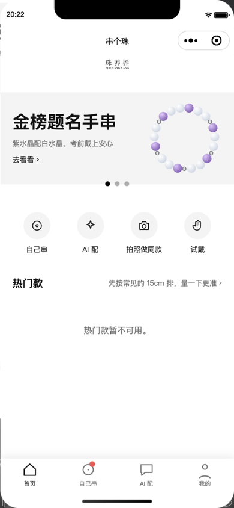</a> → <a href="shots/U16/after/home-empty.png">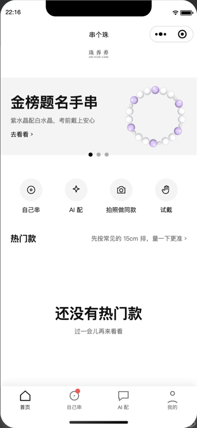</a> | <a href="shots/U16/before/home-error.png">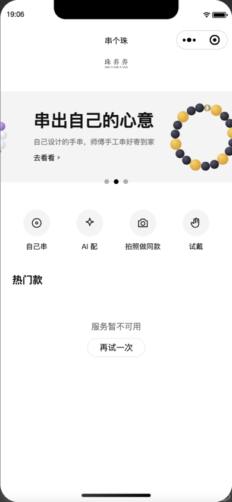</a> → <a href="shots/U16/after/home-error.png">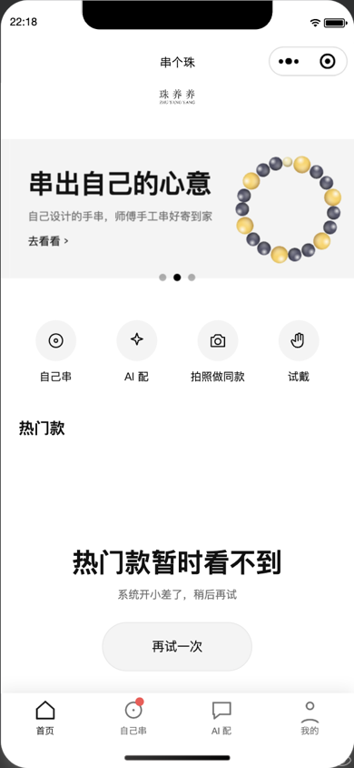</a> | 公开页，无独立未登录态 |
| 工作台 (`workbench`) | <a href="shots/U16/before/workbench-empty.png">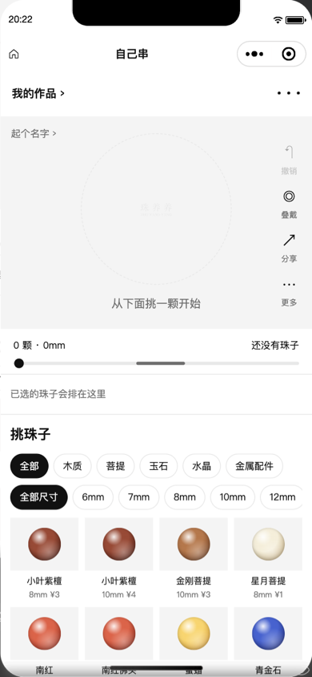</a> → <a href="shots/U16/after/workbench-empty.png">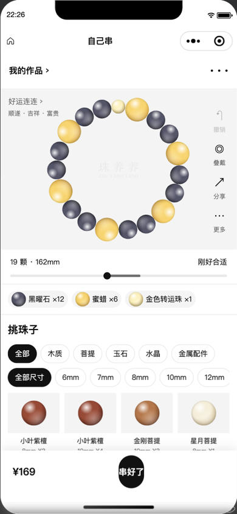</a> | <a href="shots/U16/before/workbench-error.png">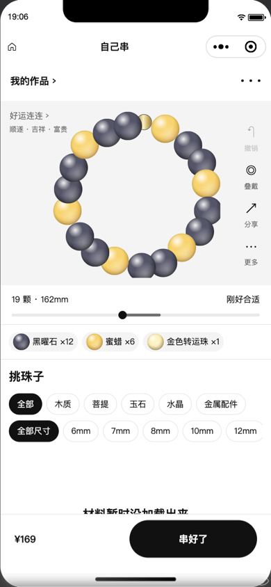</a> → <a href="shots/U16/after/workbench-error.png">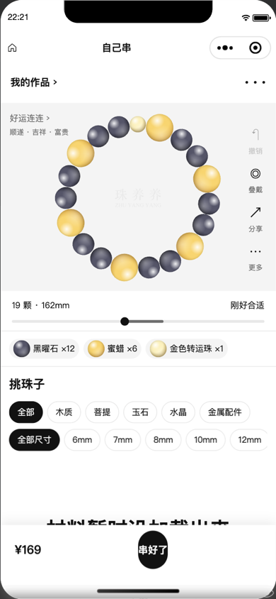</a> | 公开页，无独立未登录态 |
| 手串详情 (`bracelet-detail`) | <a href="shots/U16/before/bracelet-detail-empty.png">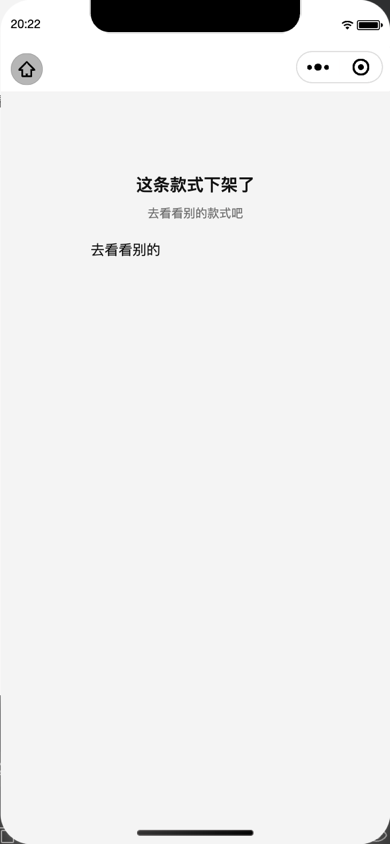</a> → <a href="shots/U16/after/bracelet-detail-empty.png">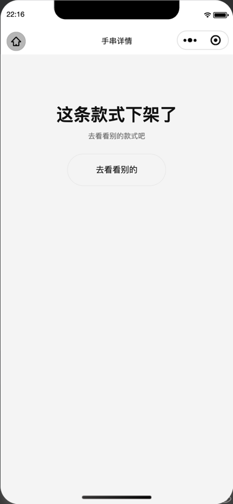</a> | <a href="shots/U16/before/bracelet-detail-error.png">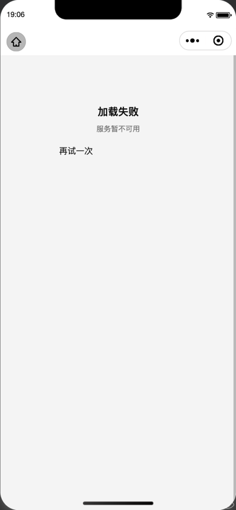</a> → <a href="shots/U16/after/bracelet-detail-error.png">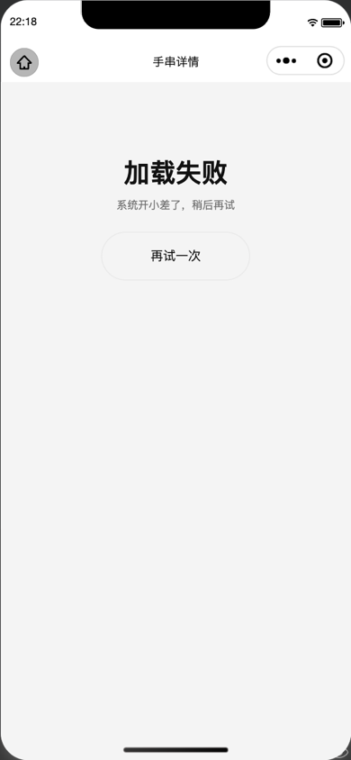</a> | 公开页，无独立未登录态 |
| AI 配 (`ai-match`) | <a href="shots/U16/before/ai-match-empty.png">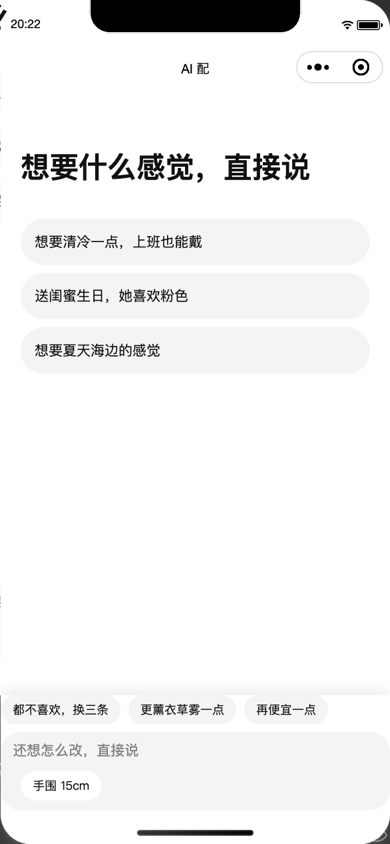</a> → <a href="shots/U16/after/ai-match-empty.png">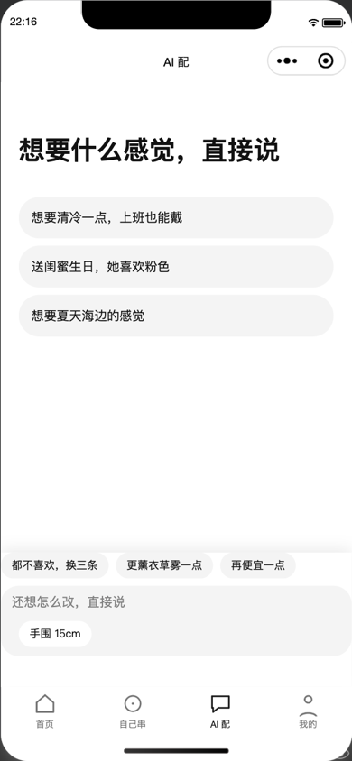</a> | <a href="shots/U16/before/ai-match-error.png">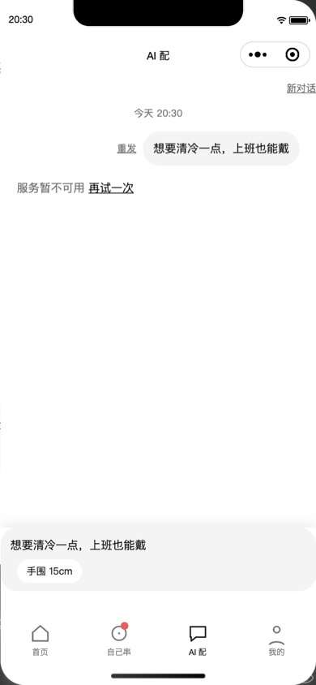</a> → <a href="shots/U16/after/ai-match-error.png">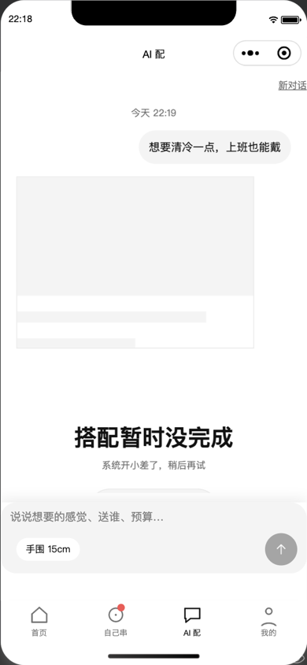</a> | <a href="shots/U16/before/ai-match-logged-out.png">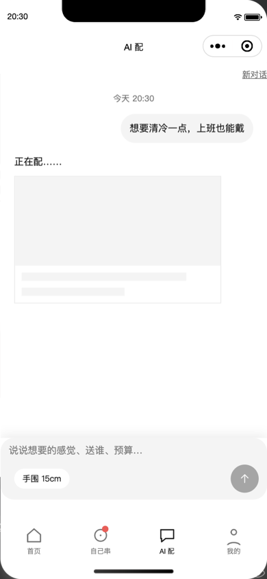</a> → <a href="shots/U16/after/ai-match-logged-out.png">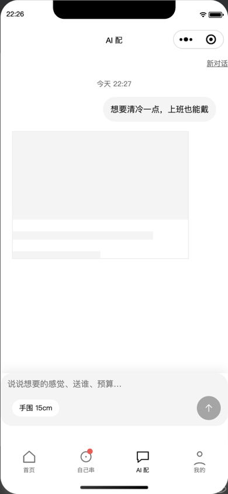</a> |
| 确认订单 (`order-confirm`) | <a href="shots/U16/before/order-confirm-empty.png">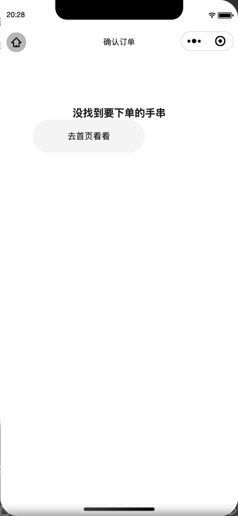</a> → <a href="shots/U16/after/order-confirm-empty.png">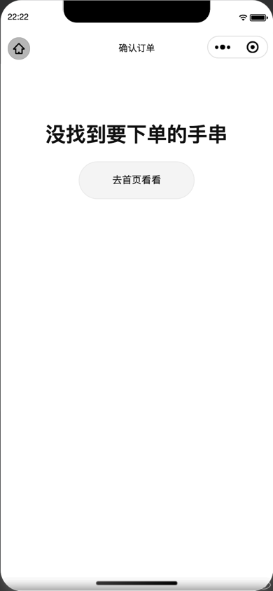</a> | <a href="shots/U16/before/order-confirm-error.png">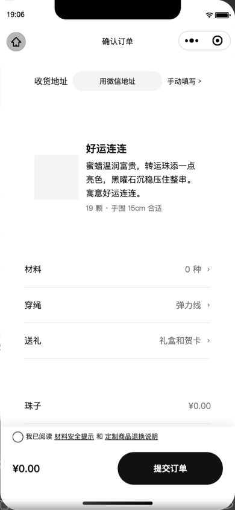</a> → <a href="shots/U16/after/order-confirm-error.png">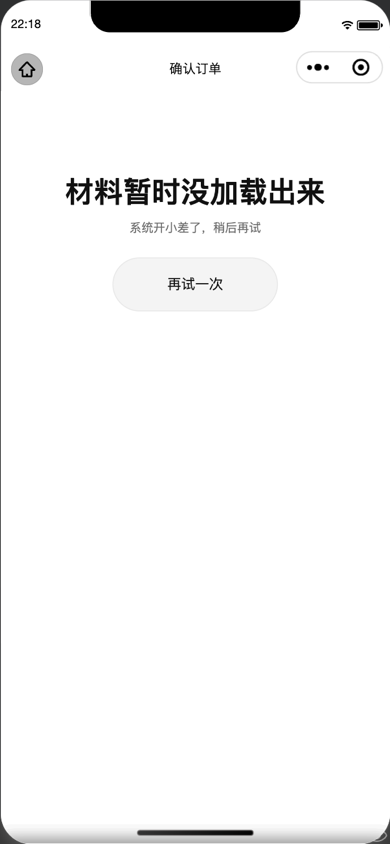</a> | <a href="shots/U16/before/order-confirm-logged-out.png">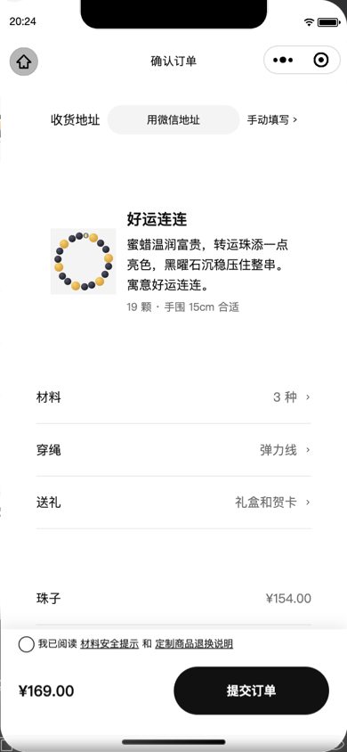</a> → <a href="shots/U16/after/order-confirm-logged-out.png">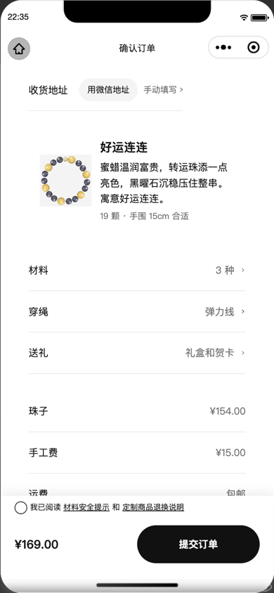</a> |
| 下单成功 (`order-success`) | <a href="shots/U16/before/order-success-empty.png">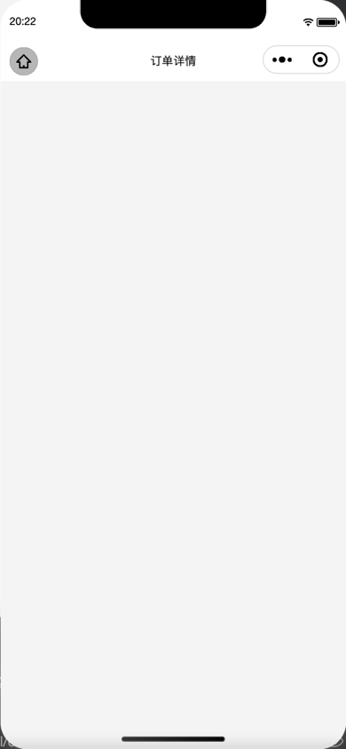</a> → <a href="shots/U16/after/order-success-empty.png">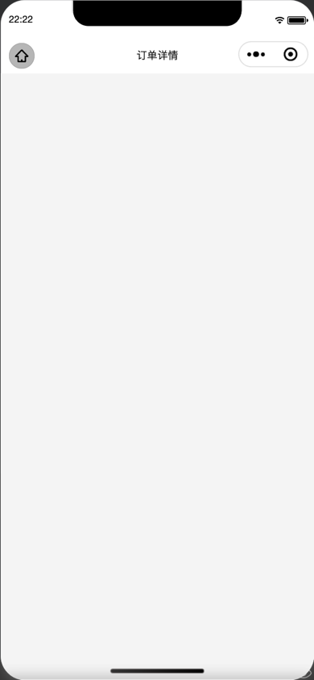</a> | <a href="shots/U16/before/order-success-error.png"></a> → <a href="shots/U16/after/order-success-error.png">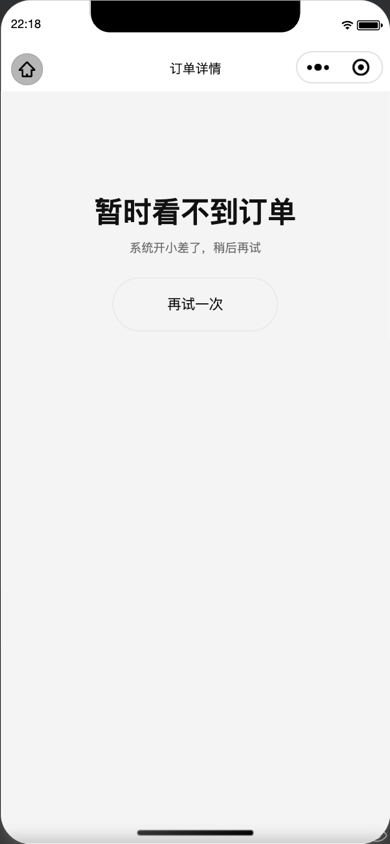</a> | <a href="shots/U16/before/order-success-logged-out.png"></a> → <a href="shots/U16/after/order-success-logged-out.png"></a> |
| 待支付订单详情 (`order-detail-pending`) | <a href="shots/U16/before/order-detail-pending-empty.png"></a> → <a href="shots/U16/after/order-detail-pending-empty.png"></a> | <a href="shots/U16/before/order-detail-pending-error.png"></a> → <a href="shots/U16/after/order-detail-pending-error.png">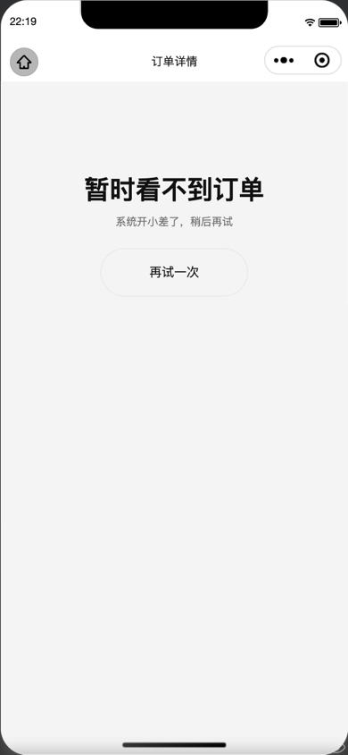</a> | <a href="shots/U16/before/order-detail-pending-logged-out.png"></a> → <a href="shots/U16/after/order-detail-pending-logged-out.png"></a> |
| 运输中订单详情 (`order-detail-transit`) | <a href="shots/U16/before/order-detail-transit-empty.png"></a> → <a href="shots/U16/after/order-detail-transit-empty.png"></a> | <a href="shots/U16/before/order-detail-transit-error.png"></a> → <a href="shots/U16/after/order-detail-transit-error.png"></a> | <a href="shots/U16/before/order-detail-transit-logged-out.png"></a> → <a href="shots/U16/after/order-detail-transit-logged-out.png">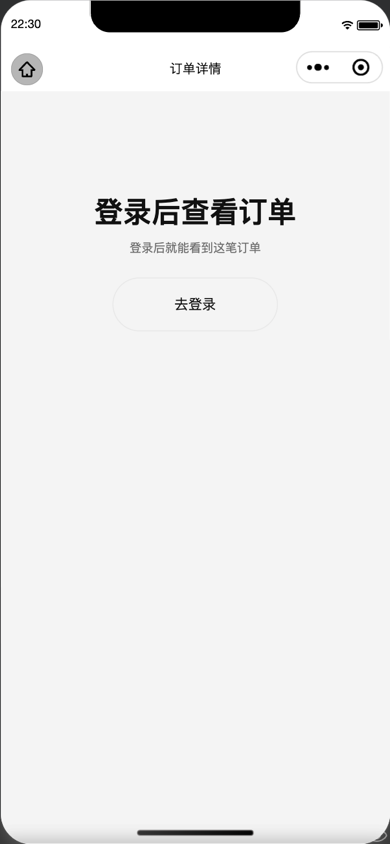</a> |
| 售后中订单详情 (`order-detail-after-sale`) | <a href="shots/U16/before/order-detail-after-sale-empty.png"></a> → <a href="shots/U16/after/order-detail-after-sale-empty.png"></a> | <a href="shots/U16/before/order-detail-after-sale-error.png"></a> → <a href="shots/U16/after/order-detail-after-sale-error.png"></a> | <a href="shots/U16/before/order-detail-after-sale-logged-out.png">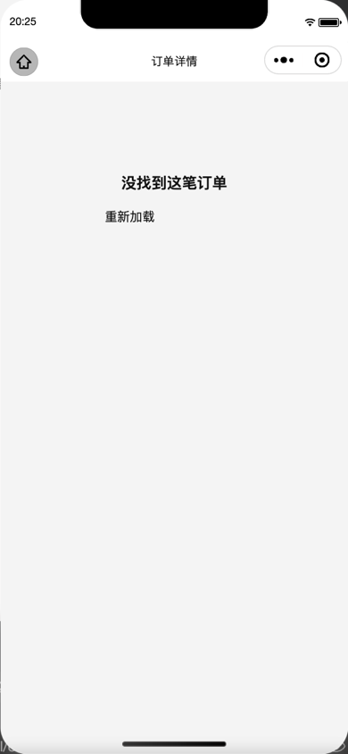</a> → <a href="shots/U16/after/order-detail-after-sale-logged-out.png"></a> |
| 我的订单 (`my-orders`) | <a href="shots/U16/before/my-orders-empty.png">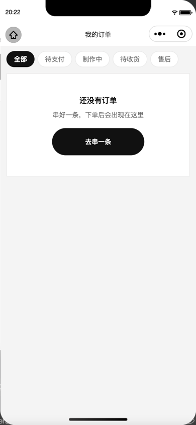</a> → <a href="shots/U16/after/my-orders-empty.png">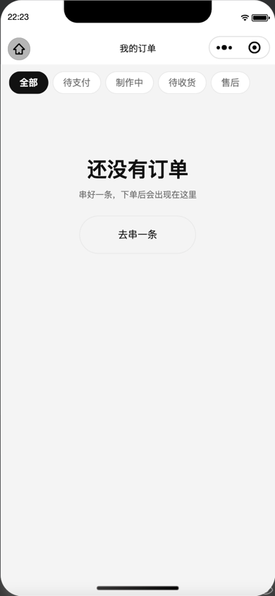</a> | <a href="shots/U16/before/my-orders-error.png">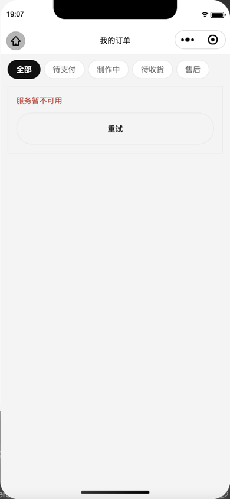</a> → <a href="shots/U16/after/my-orders-error.png"></a> | <a href="shots/U16/before/my-orders-logged-out.png">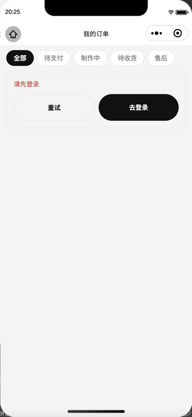</a> → <a href="shots/U16/after/my-orders-logged-out.png">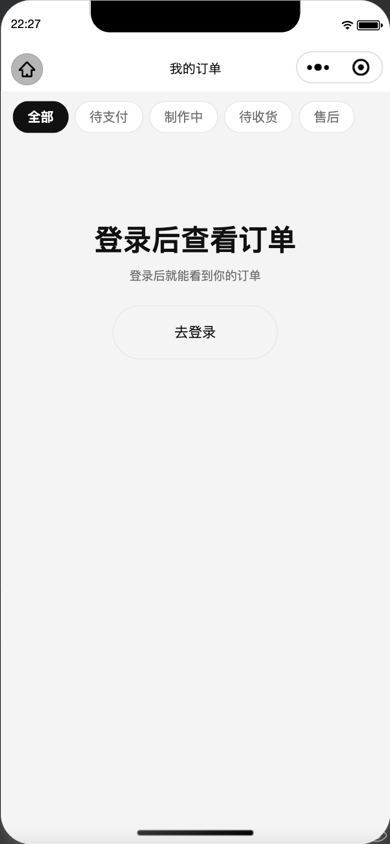</a> |
| 我的 (`mine`) | <a href="shots/U16/before/mine-empty.png">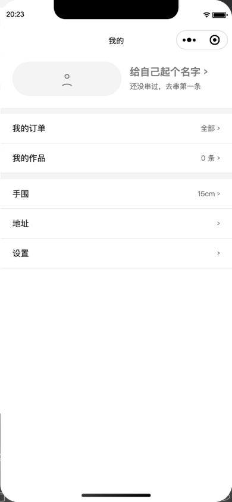</a> → <a href="shots/U16/after/mine-empty.png">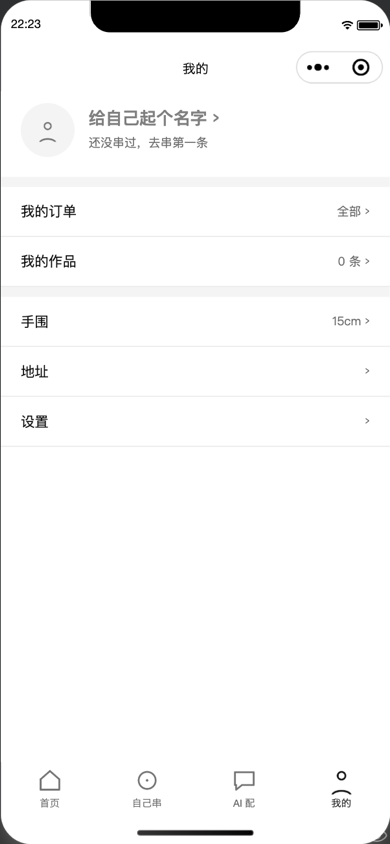</a> | <a href="shots/U16/before/mine-error.png">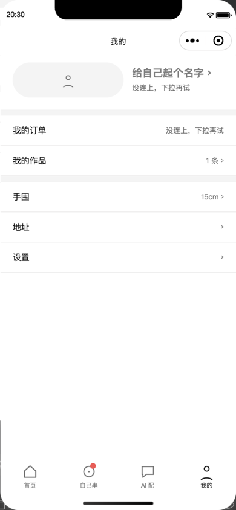</a> → <a href="shots/U16/after/mine-error.png">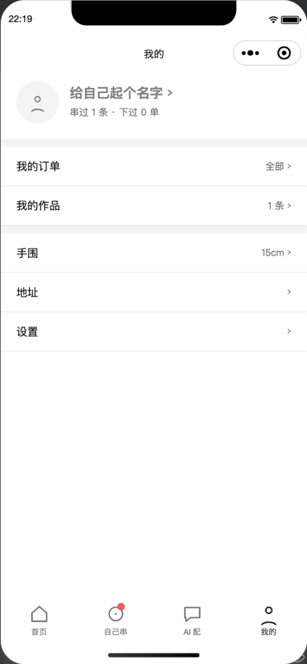</a> | <a href="shots/U16/before/mine-logged-out.png">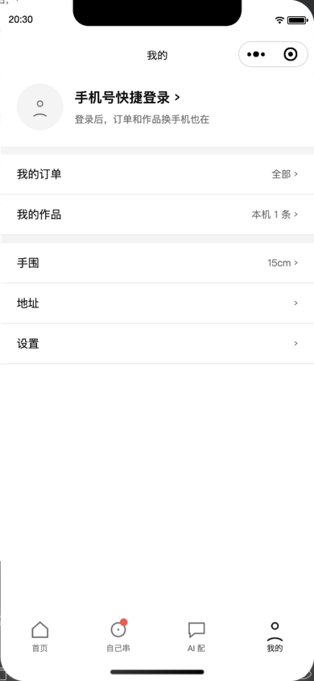</a> → <a href="shots/U16/after/mine-logged-out.png">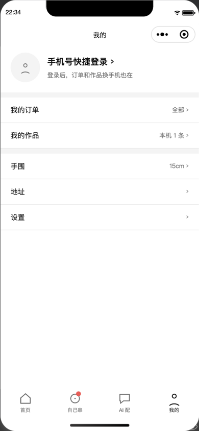</a> |
| 写评价 (`write-review`) | <a href="shots/U16/before/write-review-empty.png"></a> → <a href="shots/U16/after/write-review-empty.png">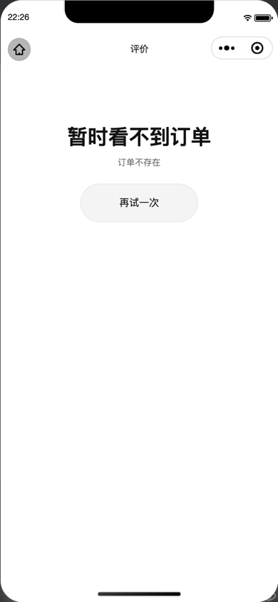</a> | <a href="shots/U16/before/write-review-error.png">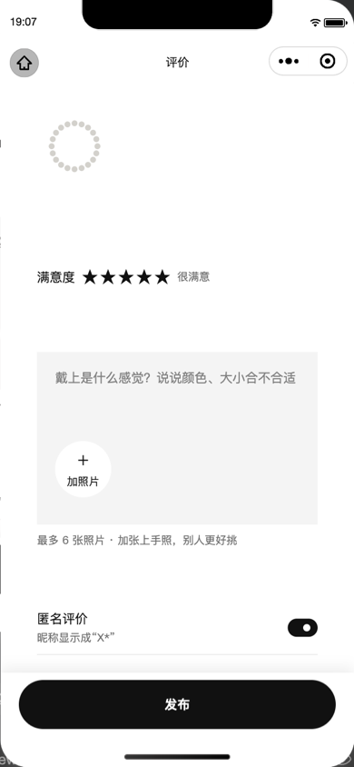</a> → <a href="shots/U16/after/write-review-error.png">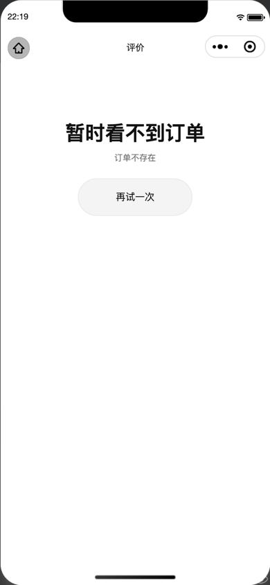</a> | <a href="shots/U16/before/write-review-logged-out.png"></a> → <a href="shots/U16/after/write-review-logged-out.png">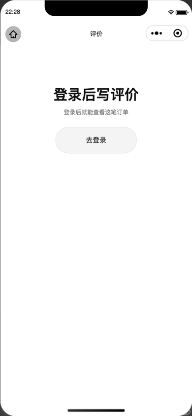</a> |
| 选择售后类型 (`after-sale-type`) | <a href="shots/U16/before/after-sale-type-empty.png"></a> → <a href="shots/U16/after/after-sale-type-empty.png">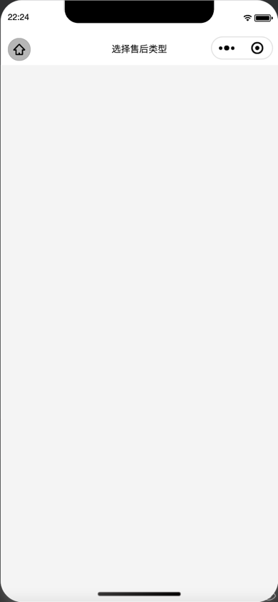</a> | <a href="shots/U16/before/after-sale-type-error.png">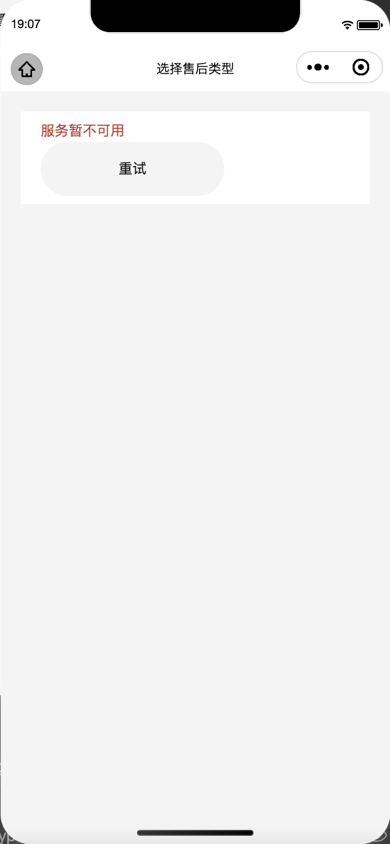</a> → <a href="shots/U16/after/after-sale-type-error.png"></a> | <a href="shots/U16/before/after-sale-type-logged-out.png">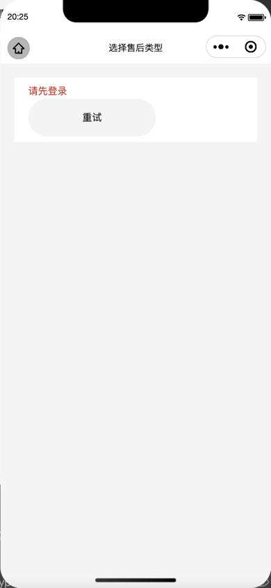</a> → <a href="shots/U16/after/after-sale-type-logged-out.png"></a> |
| 申请售后 (`after-sale-apply`) | <a href="shots/U16/before/after-sale-apply-empty.png">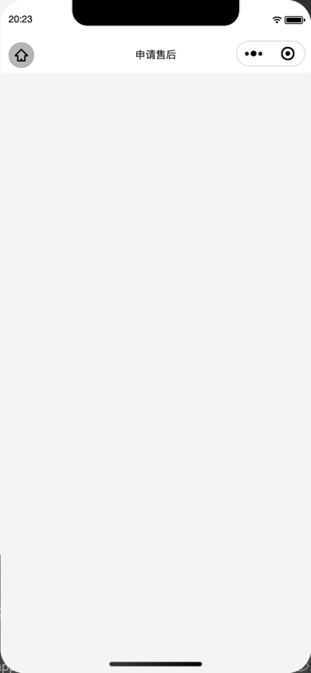</a> → <a href="shots/U16/after/after-sale-apply-empty.png"></a> | <a href="shots/U16/before/after-sale-apply-error.png">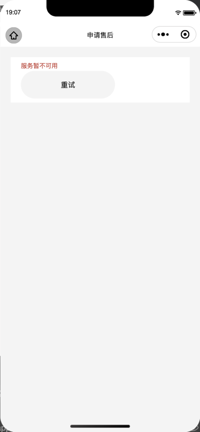</a> → <a href="shots/U16/after/after-sale-apply-error.png"></a> | <a href="shots/U16/before/after-sale-apply-logged-out.png"></a> → <a href="shots/U16/after/after-sale-apply-logged-out.png"></a> |
| 售后详情 (`after-sale-detail`) | <a href="shots/U16/before/after-sale-detail-empty.png"></a> → <a href="shots/U16/after/after-sale-detail-empty.png"></a> | <a href="shots/U16/before/after-sale-detail-error.png"></a> → <a href="shots/U16/after/after-sale-detail-error.png"></a> | <a href="shots/U16/before/after-sale-detail-logged-out.png"></a> → <a href="shots/U16/after/after-sale-detail-logged-out.png"></a> |
| 好友落地页 (`friend-landing`) | <a href="shots/U16/before/friend-landing-empty.png"></a> → <a href="shots/U16/after/friend-landing-empty.png"></a> | <a href="shots/U16/before/friend-landing-error.png"></a> → <a href="shots/U16/after/friend-landing-error.png"></a> | 公开页，无独立未登录态 |
| 分享海报 (`share-poster`) | <a href="shots/U16/before/share-poster-empty.png"></a> → <a href="shots/U16/after/share-poster-empty.png"></a> | <a href="shots/U16/before/share-poster-error.png"></a> → <a href="shots/U16/after/share-poster-error.png"></a> | 公开页，无独立未登录态 |
| 编辑地址 (`address-edit`) | 新增表单无独立状态 | 新增表单无独立状态 | 新增表单无独立状态 |

### 指定场景

| 场景 | 改前 → 改后 |
|---|---|
| 确认订单：无地址 | <a href="shots/U16/before/order-no-address.png"></a> → <a href="shots/U16/after/order-no-address.png"></a> |
| 确认订单：有地址 | <a href="shots/U16/before/order-with-address.png"></a> → <a href="shots/U16/after/order-with-address.png"></a> |
| 登录页：协议默认未勾选 | <a href="shots/U16/before/login.png"></a> → <a href="shots/U16/after/login.png"></a> |
| 我的：圆形头像 | <a href="shots/U16/before/mine-avatar.png"></a> → <a href="shots/U16/after/mine-avatar.png"></a> |
| 工作台珠子详情面板 | <a href="shots/U16/after/bead-sheet.png"></a> |

### 逐项核对

- `c-state`：160rpx 顶部留白、56rpx 标题、次按钮 320rpx 居中；整页错误不再用红字。
- 断网与服务器故障分别提示“网络不太好，检查一下网络再试”“系统开小差了，稍后再试”；按钮统一“再试一次”。
- 订单详情无会话时显示“登录后查看订单”，去登录后返回原订单；评价加载失败不显示表单或发布按钮。
- 手串详情导航标题显示“手串详情”；确认订单收货地址用 `c-cell`，微信地址按钮高 `--h-btn-s`。
- 手机号快捷登录通栏，协议默认未勾选；头像等宽等高成圆形；bead-sheet 的底部单按钮通栏。

### 页面 JS 状态逻辑（负责人同意的范围）

| 页面 | 函数 | 必要修改 |
|---|---|---|
| 订单详情/下单成功 | `load`、`goLogin` | 无会话先显示登录态；登录后回到同一订单，保留成功页参数。 |
| 我的订单 | `loadOrders`、`goLogin` | 无会话时不读订单，并用现有登录方法返回列表。 |
| 写评价 | `onLoad`、`retryLoad`、`goLogin` | 区分订单读取失败与表单校验错误；无会话显示登录态；重试只重读订单。 |
| 售后类型、申请、详情 | 各页 `load`、`goLogin` | 无会话显示登录态并隐藏旧数据；登录后返回当前售后页。 |
| AI 配 | `submit`、`retryLast` | 错误统一为用户文案，状态按钮可重试上次输入。 |
| 首页 | `load` | 目录加载失败时显示统一错误说明，保留已有的本地兜底数据。 |
| 分享海报、好友落地页 | `onShow`、`retry`、分享读取的失败分支 | 没有设计或材料加载失败时切换为完整状态页；好友页使用统一错误说明。 |
| 确认订单（卡片明确允许 `pages/order/*`） | `loadCatalog`、`retryCatalog` | 初次材料加载失败时显示错误态并可重试。 |

上述修改没有改接口路径、请求参数、金额计算或下单流程；页面 JSON 中多余的 `c-state` 注册已撤回，沿用全局注册。

## 3. 变更统计

以下统计取自代码与截图提交后、报告提交前；因此不含报告文件及随后清理的一个文件末尾空行。

<details><summary><code>git diff --stat origin/integration/2026-11...HEAD</code>（展开查看）</summary>

```text
 .../shots/U16/after/after-sale-apply-empty.png     | Bin 0 -> 18072 bytes
 .../shots/U16/after/after-sale-apply-error.png     | Bin 0 -> 29810 bytes
 .../U16/after/after-sale-apply-logged-out.png      | Bin 0 -> 30515 bytes
 .../shots/U16/after/after-sale-detail-empty.png    | Bin 0 -> 18156 bytes
 .../shots/U16/after/after-sale-detail-error.png    | Bin 0 -> 33851 bytes
 .../U16/after/after-sale-detail-logged-out.png     | Bin 0 -> 30744 bytes
 .../shots/U16/after/after-sale-type-empty.png      | Bin 0 -> 18792 bytes
 .../shots/U16/after/after-sale-type-error.png      | Bin 0 -> 32760 bytes
 .../shots/U16/after/after-sale-type-logged-out.png | Bin 0 -> 31341 bytes
 docs/reports/shots/U16/after/ai-match-empty.png    | Bin 0 -> 52983 bytes
 docs/reports/shots/U16/after/ai-match-error.png    | Bin 0 -> 44434 bytes
 .../shots/U16/after/ai-match-logged-out.png        | Bin 0 -> 35102 bytes
 docs/reports/shots/U16/after/bead-sheet.png        | Bin 0 -> 97632 bytes
 .../shots/U16/after/bracelet-detail-empty.png      | Bin 0 -> 30744 bytes
 .../shots/U16/after/bracelet-detail-error.png      | Bin 0 -> 28854 bytes
 .../shots/U16/after/friend-landing-empty.png       | Bin 0 -> 30344 bytes
 .../shots/U16/after/friend-landing-error.png       | Bin 0 -> 30199 bytes
 docs/reports/shots/U16/after/home-empty.png        | Bin 0 -> 63701 bytes
 docs/reports/shots/U16/after/home-error.png        | Bin 0 -> 69430 bytes
 docs/reports/shots/U16/after/login.png             | Bin 0 -> 39875 bytes
 docs/reports/shots/U16/after/mine-avatar.png       | Bin 0 -> 40235 bytes
 docs/reports/shots/U16/after/mine-empty.png        | Bin 0 -> 33972 bytes
 docs/reports/shots/U16/after/mine-error.png        | Bin 0 -> 33715 bytes
 docs/reports/shots/U16/after/mine-logged-out.png   | Bin 0 -> 35667 bytes
 docs/reports/shots/U16/after/my-orders-empty.png   | Bin 0 -> 35499 bytes
 docs/reports/shots/U16/after/my-orders-error.png   | Bin 0 -> 36262 bytes
 .../shots/U16/after/my-orders-logged-out.png       | Bin 0 -> 36302 bytes
 .../shots/U16/after/order-confirm-empty.png        | Bin 0 -> 29272 bytes
 .../shots/U16/after/order-confirm-error.png        | Bin 0 -> 31806 bytes
 .../shots/U16/after/order-confirm-logged-out.png   | Bin 0 -> 63593 bytes
 .../U16/after/order-detail-after-sale-empty.png    | Bin 0 -> 18161 bytes
 .../U16/after/order-detail-after-sale-error.png    | Bin 0 -> 30288 bytes
 .../after/order-detail-after-sale-logged-out.png   | Bin 0 -> 30465 bytes
 .../shots/U16/after/order-detail-pending-empty.png | Bin 0 -> 18161 bytes
 .../shots/U16/after/order-detail-pending-error.png | Bin 0 -> 30288 bytes
 .../U16/after/order-detail-pending-logged-out.png  | Bin 0 -> 30464 bytes
 .../shots/U16/after/order-detail-transit-empty.png | Bin 0 -> 18161 bytes
 .../shots/U16/after/order-detail-transit-error.png | Bin 0 -> 30288 bytes
 .../U16/after/order-detail-transit-logged-out.png  | Bin 0 -> 30531 bytes
 docs/reports/shots/U16/after/order-no-address.png  | Bin 0 -> 63574 bytes
 .../shots/U16/after/order-success-empty.png        | Bin 0 -> 18131 bytes
 .../shots/U16/after/order-success-error.png        | Bin 0 -> 30276 bytes
 .../shots/U16/after/order-success-logged-out.png   | Bin 0 -> 30497 bytes
 .../reports/shots/U16/after/order-with-address.png | Bin 0 -> 65062 bytes
 .../reports/shots/U16/after/share-poster-empty.png | Bin 0 -> 25812 bytes
 .../reports/shots/U16/after/share-poster-error.png | Bin 0 -> 29684 bytes
 docs/reports/shots/U16/after/workbench-empty.png   | Bin 0 -> 115022 bytes
 docs/reports/shots/U16/after/workbench-error.png   | Bin 0 -> 100983 bytes
 .../reports/shots/U16/after/write-review-empty.png | Bin 0 -> 27276 bytes
 .../reports/shots/U16/after/write-review-error.png | Bin 0 -> 27317 bytes
 .../shots/U16/after/write-review-logged-out.png    | Bin 0 -> 28320 bytes
 .../shots/U16/before/after-sale-apply-empty.png    | Bin 0 -> 17620 bytes
 .../shots/U16/before/after-sale-apply-error.png    | Bin 0 -> 21879 bytes
 .../U16/before/after-sale-apply-logged-out.png     | Bin 0 -> 21345 bytes
 .../shots/U16/before/after-sale-detail-empty.png   | Bin 0 -> 17738 bytes
 .../shots/U16/before/after-sale-detail-error.png   | Bin 0 -> 25863 bytes
 .../U16/before/after-sale-detail-logged-out.png    | Bin 0 -> 25508 bytes
 .../shots/U16/before/after-sale-type-empty.png     | Bin 0 -> 17521 bytes
 .../shots/U16/before/after-sale-type-error.png     | Bin 0 -> 22801 bytes
 .../U16/before/after-sale-type-logged-out.png      | Bin 0 -> 22165 bytes
 docs/reports/shots/U16/before/ai-match-empty.png   | Bin 0 -> 48990 bytes
 docs/reports/shots/U16/before/ai-match-error.png   | Bin 0 -> 36522 bytes
 .../shots/U16/before/ai-match-logged-out.png       | Bin 0 -> 36159 bytes
 .../shots/U16/before/bracelet-detail-empty.png     | Bin 0 -> 23634 bytes
 .../shots/U16/before/bracelet-detail-error.png     | Bin 0 -> 22805 bytes
 .../shots/U16/before/friend-landing-empty.png      | Bin 0 -> 25758 bytes
 .../shots/U16/before/friend-landing-error.png      | Bin 0 -> 22731 bytes
 docs/reports/shots/U16/before/home-empty.png       | Bin 0 -> 57061 bytes
 docs/reports/shots/U16/before/home-error.png       | Bin 0 -> 55661 bytes
 docs/reports/shots/U16/before/login.png            | Bin 0 -> 39883 bytes
 docs/reports/shots/U16/before/mine-avatar.png      | Bin 0 -> 39971 bytes
 docs/reports/shots/U16/before/mine-empty.png       | Bin 0 -> 29842 bytes
 docs/reports/shots/U16/before/mine-error.png       | Bin 0 -> 34153 bytes
 docs/reports/shots/U16/before/mine-logged-out.png  | Bin 0 -> 35512 bytes
 docs/reports/shots/U16/before/my-orders-empty.png  | Bin 0 -> 33208 bytes
 docs/reports/shots/U16/before/my-orders-error.png  | Bin 0 -> 29915 bytes
 .../shots/U16/before/my-orders-logged-out.png      | Bin 0 -> 31769 bytes
 .../shots/U16/before/order-confirm-empty.png       | Bin 0 -> 24391 bytes
 .../shots/U16/before/order-confirm-error.png       | Bin 0 -> 53042 bytes
 .../shots/U16/before/order-confirm-logged-out.png  | Bin 0 -> 59573 bytes
 .../U16/before/order-detail-after-sale-empty.png   | Bin 0 -> 17714 bytes
 .../U16/before/order-detail-after-sale-error.png   | Bin 0 -> 23233 bytes
 .../before/order-detail-after-sale-logged-out.png  | Bin 0 -> 23249 bytes
 .../U16/before/order-detail-pending-empty.png      | Bin 0 -> 17713 bytes
 .../U16/before/order-detail-pending-error.png      | Bin 0 -> 23268 bytes
 .../U16/before/order-detail-pending-logged-out.png | Bin 0 -> 23204 bytes
 .../U16/before/order-detail-transit-empty.png      | Bin 0 -> 17713 bytes
 .../U16/before/order-detail-transit-error.png      | Bin 0 -> 23234 bytes
 .../U16/before/order-detail-transit-logged-out.png | Bin 0 -> 23204 bytes
 docs/reports/shots/U16/before/order-no-address.png | Bin 0 -> 60462 bytes
 .../shots/U16/before/order-success-empty.png       | Bin 0 -> 17713 bytes
 .../shots/U16/before/order-success-error.png       | Bin 0 -> 23267 bytes
 .../shots/U16/before/order-success-logged-out.png  | Bin 0 -> 23204 bytes
 .../shots/U16/before/order-with-address.png        | Bin 0 -> 62246 bytes
 .../shots/U16/before/share-poster-empty.png        | Bin 0 -> 16554 bytes
 .../shots/U16/before/share-poster-error.png        | Bin 0 -> 70139 bytes
 docs/reports/shots/U16/before/workbench-empty.png  | Bin 0 -> 83792 bytes
 docs/reports/shots/U16/before/workbench-error.png  | Bin 0 -> 103673 bytes
 .../shots/U16/before/write-review-empty.png        | Bin 0 -> 42321 bytes
 .../shots/U16/before/write-review-error.png        | Bin 0 -> 42314 bytes
 .../shots/U16/before/write-review-logged-out.png   | Bin 0 -> 42326 bytes
 miniprogram/ar-hand/index.wxml                     |  10 +-
 miniprogram/components/bead-sheet/index.wxml       |   6 +-
 miniprogram/components/bead-sheet/index.wxss       |   2 +
 miniprogram/components/state/index.js              |   4 -
 miniprogram/components/state/index.wxml            |   1 -
 miniprogram/components/state/index.wxss            |  12 +--
 miniprogram/features/after-sale/apply.js           |   7 +-
 miniprogram/features/after-sale/apply.wxml         |   4 +-
 miniprogram/features/after-sale/detail.js          |   6 +-
 miniprogram/features/after-sale/detail.wxml        |   3 +-
 miniprogram/features/after-sale/return.wxml        |   4 +-
 miniprogram/features/after-sale/type.js            |   7 +-
 miniprogram/features/after-sale/type.wxml          |   5 +-
 miniprogram/features/article/article.wxml          |   2 +-
 miniprogram/features/order-detail/order-detail.js  |  11 ++-
 .../features/order-detail/order-detail.wxml        |   3 +-
 miniprogram/features/orders/orders.js              |   8 +-
 miniprogram/features/orders/orders.wxml            |  19 +---
 miniprogram/features/review/review.js              |   9 +-
 miniprogram/features/review/review.wxml            |   4 +
 miniprogram/features/shared/shared.js              |   2 +-
 miniprogram/features/shared/shared.wxml            |   4 +-
 miniprogram/features/tryon/tryon.wxml              |   2 +-
 miniprogram/features/works/works.wxml              |   2 +-
 miniprogram/pages/ai/ai.js                         |   3 +-
 miniprogram/pages/ai/ai.wxml                       |   2 +-
 miniprogram/pages/finish/finish.json               |   2 +-
 miniprogram/pages/home/home.js                     |   4 +-
 miniprogram/pages/home/home.wxml                   |   4 +-
 miniprogram/pages/login/login.wxml                 |   2 +-
 miniprogram/pages/mine/mine.wxml                   |   2 +-
 miniprogram/pages/mine/mine.wxss                   |   2 +
 miniprogram/pages/order/order.js                   |   3 +-
 miniprogram/pages/order/order.wxml                 |  13 ++-
 miniprogram/pages/order/order.wxss                 |   8 +-
 miniprogram/pages/photo/photo.wxml                 |  12 +--
 miniprogram/pages/share/share.js                   |   3 +-
 miniprogram/pages/share/share.wxml                 |   9 +-
 miniprogram/pages/wrist/wrist.wxml                 |   2 +-
 miniprogram/styles/components.wxss                 |   3 +
 miniprogram/tests/catalog-refresh.test.js          |   2 +-
 miniprogram/tests/creation-flows.test.js           |   2 +-
 miniprogram/tests/dev-login.test.js                |   6 +-
 miniprogram/tests/home.test.js                     |   2 +-
 miniprogram/tests/payment-detail.test.js           |   2 +-
 miniprogram/tests/u16-states.test.js               | 106 +++++++++++++++++++++
 miniprogram/utils/api.js                           |  32 ++++---
 148 files changed, 251 insertions(+), 112 deletions(-)
```

</details>

## 4. 测试

- `python3 -m unittest discover -s server/tests`：631 个，OK（7 跳过），前后未减少。
- `node --test miniprogram/tests/*.test.js`：前 309 个，后 315 个；全部通过。
- `python3 kb/validate.py`：200/200，0 问题。
- `python3 tools/check-ui.py`：42 个历史问题，0 个新增。
- 新增 `u16-states.test.js`：状态组件布局、全页按钮类、网络/服务端错误转换、评价表单隐藏、订单详情未登录返回原页、“我的订单”未登录不读取订单。
- 旧测试期望值调整（保留原场景和其他断言）：`dev-login.test.js` 的 503/500 后端原话 → 用户提示；`home.test.js`、`creation-flows.test.js`、`catalog-refresh.test.js` 的网络旧文案 → “网络不太好，检查一下网络再试”；`payment-detail.test.js` 的无凭证测试桩 → 有效测试会话，付款与状态断言不变。

## 5. 自查

- `git log --oneline origin/integration/2026-11..HEAD`：全部提交以 `U16:` 开头。
- `python3 tools/check-ui.py`：0 new。
- `rg '#[0-9a-fA-F]{3,8}\\b|rgba?\\('` 扫本卡改过的 WXSS：无输出；`rg 'new URL|URLSearchParams' miniprogram --glob '*.js'`：无输出。
- `git diff --check`：无输出。
- 页面与状态截图逐一对照；无数据、500 与退出登录均由脚本造出。
- 没改 `miniprogram/pages/diy/*`、尺寸规则、服务端数据或依赖清单。

## 6. 没做 / 没验证 / 偏离卡片

- 工作台 `pages/diy` 按本次明确要求不碰，因此材料失败提示被底部栏遮挡的问题未在本卡改；截图保留现状，需工作台后续卡处理。
- AI 配无需登录即可提交，T3 的“没登录”格子没有独立的登录提示；仍按要求保留该状态的截图。
- 经负责人同意，只在 `miniprogram/components/bead-sheet/index.wxml` 的 4 个按钮补 `c-btn` 类，并在组件 WXSS 增加两行，保持步进按钮 64rpx 和底部按钮通栏。
- 页面状态逻辑涉及必要的页面 JS；页面 JSON 中无须新增的 `c-state` 注册已撤回，使用全局注册。

## 7. 审核修改

无。
