# U2 交付报告

分支：agent/U2-nav-bar　最后一个实现提交：61cf001

## 1. 步骤

| 卡上的步骤 | 做了 / 没做 | 在哪 |
| --- | --- | --- |
| 这几页的自定义导航全部换成 U0 的 `c-nav-bar` | 做了 | `pages/diy/diy.json`、`diy.wxml`；`features/order-detail/order-detail.json`、`order-detail.wxml`；`features/shared/shared.json`、`shared.wxml`；19c5483、61cf001 |
| 不需要自定义导航的页面（写评价）去掉自己画的标题 | 做了 | `features/review/review.wxml`；19c5483 |
| 用 T1 脚本截改前改后 | 做了 | `docs/reports/shots/U2/{before,after}/`；eb7af82、61cf001 |

## 2. 验收

| 卡上的验收项 | 结果 | 证据 |
| --- | --- | --- |
| 工作台“我的作品 >”不压状态栏 | 做了 | 下方工作台前后截图；改后标题位于 `c-nav-bar` 下方，工作台 tab 的首页图标通过 `switchTab` 返回首页 |
| 订单详情左上使用统一导航 | 做了 | 下方三种订单详情前后截图；`order-detail.wxml:2` |
| 好友落地页左上不再是灰色圆圈，“首页”不掉到导航下方 | 做了 | 下方好友页前后截图；`shared.wxml:2` |
| 写评价页只显示微信自带标题 | 做了 | 下方评价页前后截图；`review.wxml` 删除自画导航行 |
| 样式检查通过 | 做了 | `python3 tools/check-ui.py` → `UI check: 74 violations, 0 new` |

### 截图（iPhone 12/13 Pro，390×844）

| 页面 | 改前 | 改后 |
| --- | --- | --- |
| 工作台 | 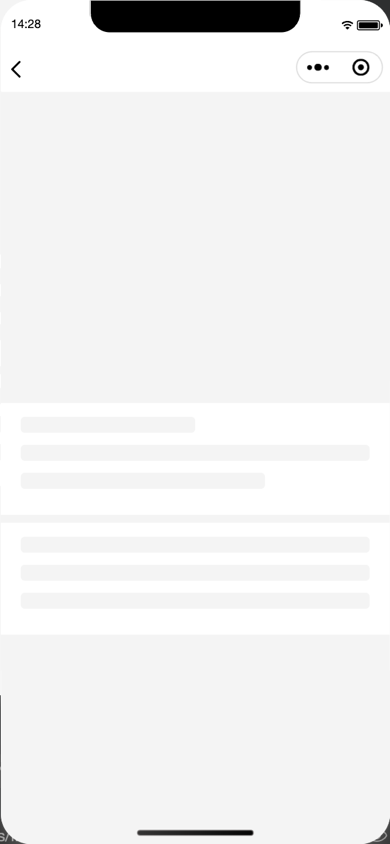 | 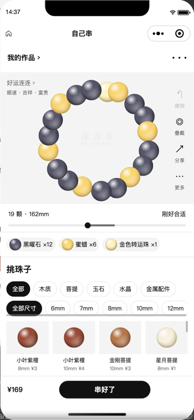 |
| 待支付订单详情 | 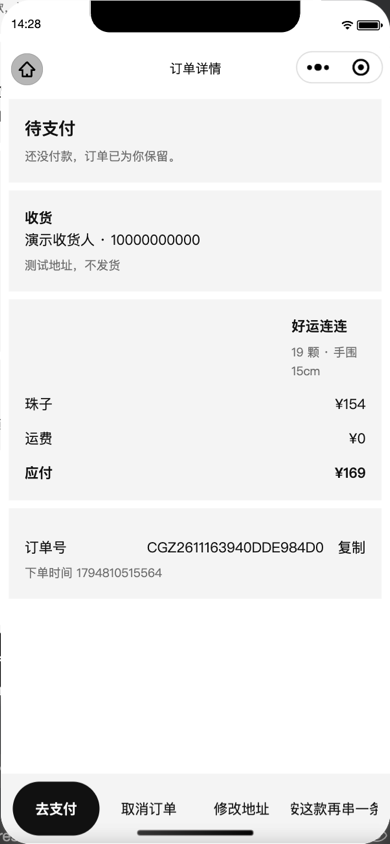 | 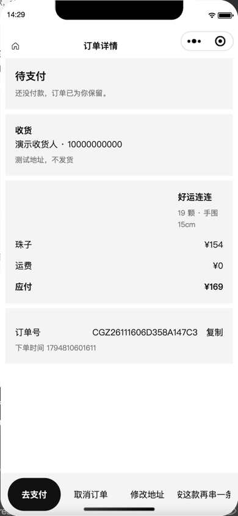 |
| 运输中订单详情 | 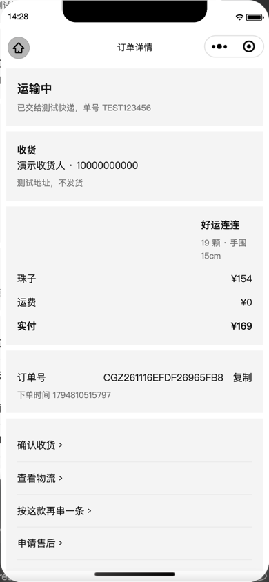 | 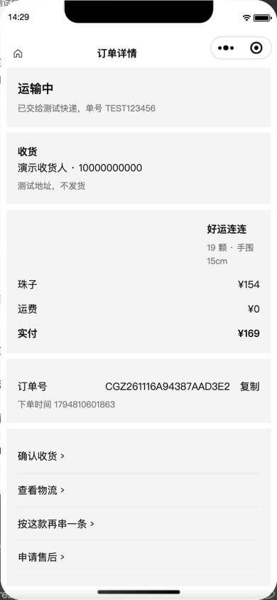 |
| 售后中订单详情 | 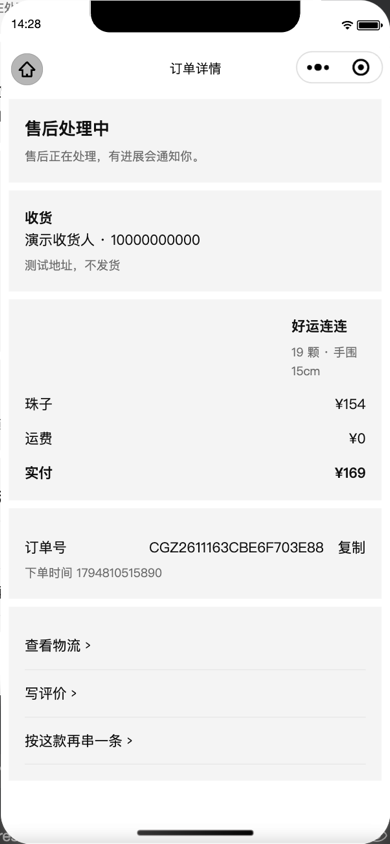 | 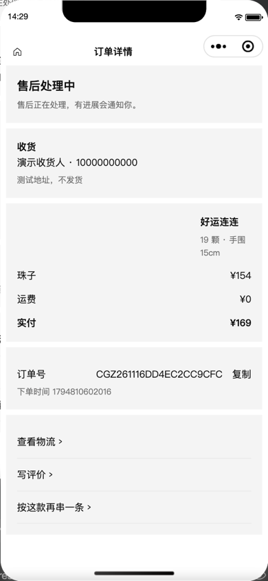 |
| 好友落地页 | 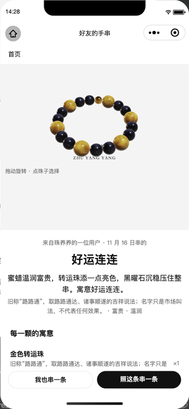 | 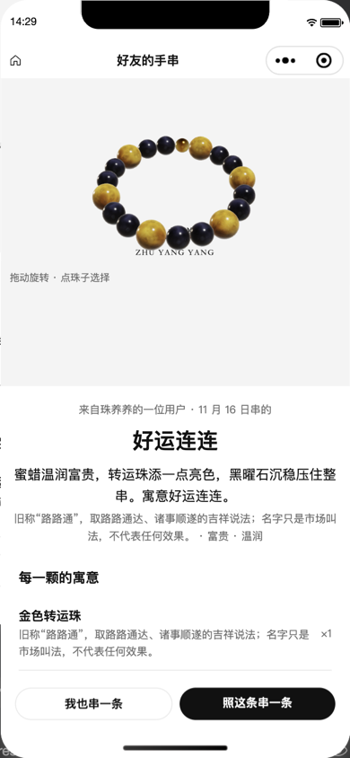 |
| 写评价 | 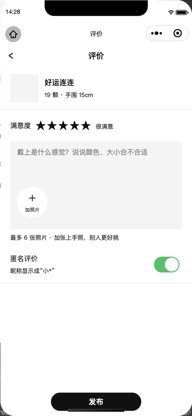 | 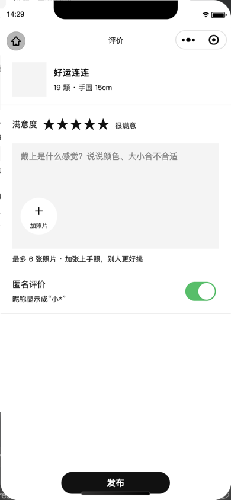 |

## 3. 改了的文件

`git diff --stat origin/integration/2026-11...HEAD`（提交本报告前）：

```text
 docs/reports/shots/U2/after/friend-landing.png         | Bin 0 -> 89902 bytes
 .../reports/shots/U2/after/order-detail-after-sale.png | Bin 0 -> 54937 bytes
 docs/reports/shots/U2/after/order-detail-pending.png   | Bin 0 -> 53992 bytes
 docs/reports/shots/U2/after/order-detail-transit.png   | Bin 0 -> 56757 bytes
 docs/reports/shots/U2/after/workbench.png              | Bin 0 -> 120844 bytes
 docs/reports/shots/U2/after/write-review.png           | Bin 0 -> 43515 bytes
 docs/reports/shots/U2/before/friend-landing.png        | Bin 0 -> 88660 bytes
 .../shots/U2/before/order-detail-after-sale.png        | Bin 0 -> 55390 bytes
 docs/reports/shots/U2/before/order-detail-pending.png  | Bin 0 -> 54916 bytes
 docs/reports/shots/U2/before/order-detail-transit.png  | Bin 0 -> 57112 bytes
 docs/reports/shots/U2/before/workbench.png             | Bin 0 -> 16374 bytes
 docs/reports/shots/U2/before/write-review.png          | Bin 0 -> 45324 bytes
 miniprogram/features/order-detail/order-detail.json    |   2 +-
 miniprogram/features/order-detail/order-detail.wxml    |   1 +
 miniprogram/features/review/review.wxml                |   1 -
 miniprogram/features/shared/shared.json               |   2 +-
 miniprogram/features/shared/shared.wxml               |   2 +-
 miniprogram/pages/diy/diy.json                         |   2 +-
 miniprogram/pages/diy/diy.wxml                         |   2 +-
 19 files changed, 6 insertions(+), 6 deletions(-)
```

## 4. 测试

| 命令 | 最后几行输出 |
| --- | --- |
| `python3 -m unittest discover -s server/tests` | 本次：`Ran 607 tests in 83.055s; OK (skipped=7)`；此前首轮有一次本地 HTTP 超时，后续两轮超过 3 分钟 |
| `node --test miniprogram/tests/*.test.js` | `tests 276; pass 276; fail 0` |
| `python3 kb/validate.py` | `已填 200/200 种，有问题 0 条，缺 0 种` |
| `python3 tools/check-ui.py` | `UI check: 74 violations, 0 new` |

测试数：后端开工前 607 → 现在 607；小程序开工前 276 → 现在 276。U2 只改导航标记和注册文件，没有新增测试或修改既有测试期望。

## 5. 自查（贴命令和输出）

- `git log --oneline origin/integration/2026-11..HEAD`：`61cf001 U2: 修正工作台首页导航并重截`、`eb7af82 U2: 提交导航改前改后截图`、`19c5483 U2: 页面接入统一导航栏并移除评价重复标题`、`56b384e U2: 开工`。
- 本卡未改 `.wxss`；颜色字面量检查不适用。
- `grep -rnE 'new URL|URLSearchParams' miniprogram --include='*.js'`：无输出。
- `git diff --check`：无输出。
- `find docs/reports/shots/U2 -name '*.png' -size +300k -print`：无输出。

## 6. 没做 / 没验证 / 偏离卡片

改前工作台截图拍到加载骨架，改后截图完整显示导航和“我的作品”行。未在真机验证；开发者工具模拟器截图已完成。此前后端测试曾遇到本地 HTTP 超时；接手后重新运行，607 项通过（跳过 7 项）。页面改动未涉及后端。
