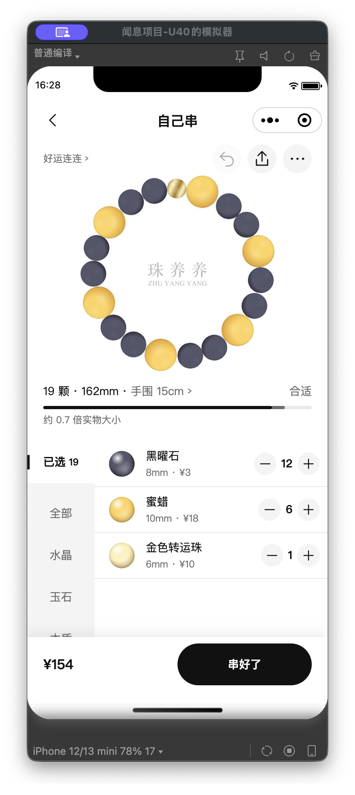

# U40 工作台 v7.4 截图核对

2026-11-20 使用微信开发者工具 2.02.2611192 Nightly、iPhone 12/13 mini（375px 宽）模拟器实拍。设计侧图片从 [`mockups-workbench-v7.png`](../design/mockups-workbench-v7.png) 的三屏原样裁出；实拍图片保留了模拟器窗口边框。测试环境的珠子和模板为离线演示数据，因此名称、材质、颗数和价格与设计样例不同。

## ① 空盘：从 tab 进入

| 设计 v7.4 | 开发者工具实拍 |
| --- | --- |
|  |  |

- **一致**：无返回键；空盘虚线圈、字标、托盘三键、状态行、量尺、左侧分类栏和右侧三列珠子格均可见。格内珠子统一显示 40px，规格价格独立显示。
- **不一致及原因**：实拍显示尺寸筛选行；设计样例未画此行，任务卡第 6 条要求保留，所以按任务卡保留。

## ② 从模板进入：有返回、有珠子

| 设计 v7.4 | 开发者工具实拍 |
| --- | --- |
|  |  |

- **一致**：从首页热门款进入详情，点“改一改”后进入工作台；导航左侧出现返回键。托盘手串按比例尺画，状态行显示颗数、长度、手围与“合适”，底栏只出现一次总价和主按钮。选珠格里的珠子保持同样大小。
- **不一致及原因**：设计演示的是刚加到 5 颗的中间态，有虚线目标圈和“还差约 125mm”；实拍使用完整的离线模板“好运连连”，为 19 颗、162mm 的合适状态，所以显示整圈手串与“合适”。模板图片、名称和价格也因此与设计样例不同。实拍有任务卡要求保留的尺寸筛选行。

## ③ 点“已选”

| 设计 v7.4 | 开发者工具实拍 |
| --- | --- |
|  |  |

- **一致**：左侧“已选 N”高亮；右侧切换为珠子图、名称、规格单价、圆形减键、数量、圆形加键组成的列表行。列表图统一为 32px；量尺、底栏和托盘保留。
- **不一致及原因**：设计样例是粉草莓晶 11 颗、粉晶 10 颗；实拍模板是黑曜石 12 颗、蜜蜡 6 颗、金色转运珠 1 颗，因此实际有三行、总价 ¥154。实拍还有尺寸筛选行；任务卡第 6 条要求保留。

## 审核退回的四项修正

1. **选珠区高度已改**：`.workbench` 以 `100vh` 建立纵向 flex 容器；`.picker` 用 `flex:1; min-height:0` 占满状态行与底栏之间的剩余空间，不用固定高度或底部 padding。分类栏和珠子格各自作为纵向 `scroll-view` 滚动；有底栏时灰底到栏上沿，无底栏时到屏幕底部（含安全区）。重新拍的三屏可见灰底与白底延伸到下缘。
2. **珠名字重已改**：选珠格 `.bead-name` 和已选列表 `.picked-info` 均用 `--fs-body` 与常规字重；分类栏选中项、数量、金额、按钮保留加粗。
3. **已选间隔已改**：分类栏“已选”和数字之间为 `8rpx`，实拍显示“已选 19”。
4. **状态行间隔已改**：颗数、长度、手围间的分隔点各通过 `8rpx` flex 间隔留白，实拍为“19 颗 · 162mm · 手围 15cm ›”。

## 入口返回键核对

以下截图均为开发者工具画面左上角裁图。“返回到”是实际点击工作台返回键后的页面。代码层另覆盖现有来源页的记录与返回路径，不把代码测试当作实拍。

| 入口 | 实际点击路径 | 有没有返回 | 点返回回到哪一页 | 截图文件名 |
| --- | --- | --- | --- | --- |
| 首页“自己串” | 首页 → 自己串快捷入口 | 有 | 首页 | [entry-home-shortcut.png](U40-assets/entry-home-shortcut.png) |
| 首页热门款模板 | 首页 → 热门款 → 详情“改一改” | 有 | 手串详情 | [entry-home-template.png](U40-assets/entry-home-template.png) |
| 首页横幅 | 首页 → 横幅 → 模板详情“改一改” | 有 | 手串详情 | [entry-home-banner.png](U40-assets/entry-home-banner.png) |
| 珠子详情“去串” | 当前代码无此入口 | 不适用 | 不适用 | — |
| 我的作品新建 | 我的 → 我的作品 → 新建 | 有 | 我的作品 | [entry-works-new.png](U40-assets/entry-works-new.png) |
| 我的作品打开 | 我的 → 我的作品 → 打开已有作品 | 有 | 我的作品 | [entry-works-open.png](U40-assets/entry-works-open.png) |
| 订单“再来一单” | 我的 → 我的订单，被登录页拦下；另从热门款 → 立即下单进入确认订单页，该手串长度合适，页面无“回去调整”入口 | 未验证 | 未验证 | — |
| 分享页“照这条串一条” | 本地测试分享快照 → 好友分享页 → “照这条串一条” | 有 | 好友分享页 | [entry-share-use.png](U40-assets/entry-share-use.png) |
| 文章“去串” | 离线无文章数据 | 未验证 | 未验证 | — |
| 底部导航“自己串” | 底部 tab → 自己串 | 无（符合设计） | 不适用 | [entry-bottom-tab.png](U40-assets/entry-bottom-tab.png) |

订单入口未完成界面验收：本地没有已登录的历史订单，登录页需要用户同意协议；未替用户勾选。分享页使用仅在本机测试服务中创建的样例快照，未提交样例数据或令牌。文章入口离线无数据，未验证。

## 已完成的验证

- `python3 -m unittest discover -s server/tests`：745 OK，10 skipped。
- `node --test miniprogram/tests/*.test.js`：394 passed（追加入口路径测试后重跑全量）。
- `python3 kb/validate.py`：202/202，0 issues。
- `python3 tools/check-ui.py`：40 条既有问题，0 条新增问题。

截图是在提交前对真实开发者工具画面核对，未将设计图当作运行结果。前三屏使用仓库内演示数据；分享页验收时启动本机测试服务，并在开发者工具中开启本地请求调试。该设置未提交。
