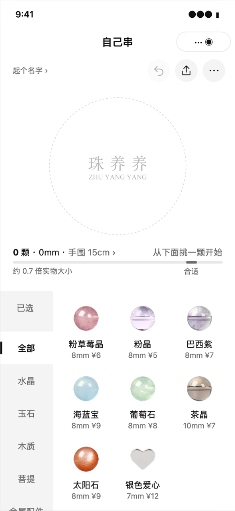
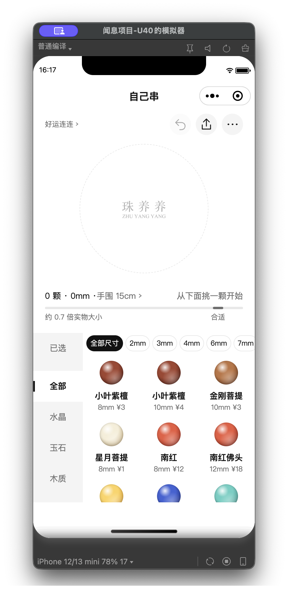
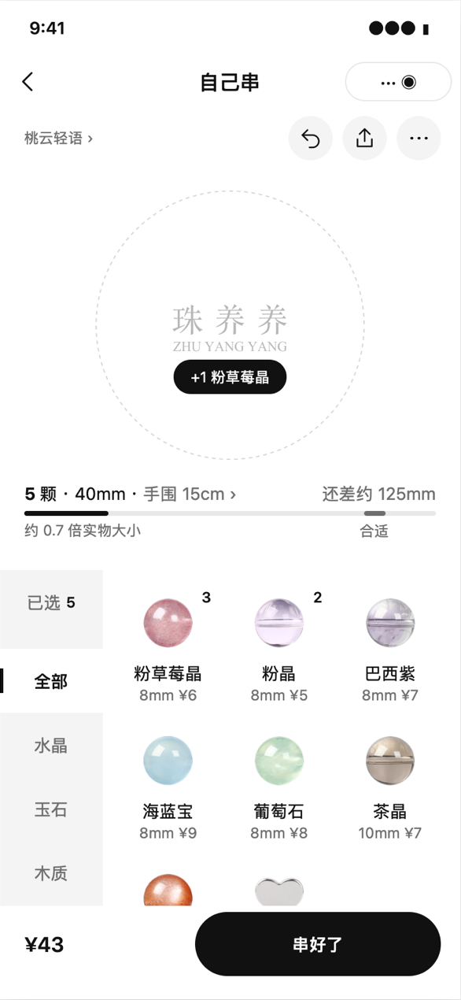
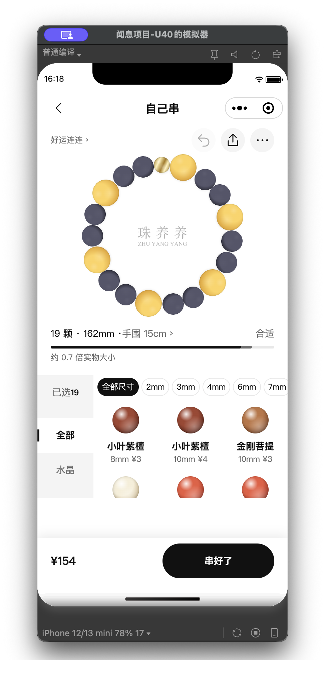
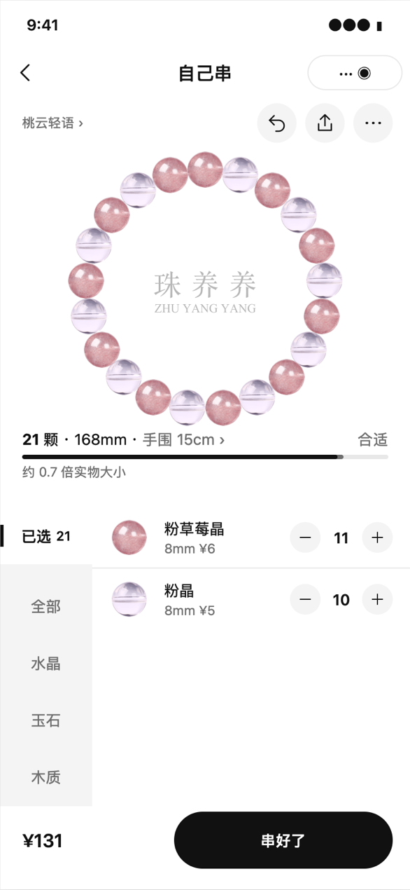

# U40 工作台 v7.4 截图核对

2026-11-20 使用微信开发者工具 2.02.2611192 Nightly、iPhone 12/13 mini（375px 宽）模拟器实拍。设计侧图片从 [`mockups-workbench-v7.png`](../design/mockups-workbench-v7.png) 的三屏原样裁出；实拍图片保留了模拟器窗口边框。测试环境的珠子和模板为离线演示数据，因此名称、材质、颗数和价格与设计样例不同。

## ① 空盘：从 tab 进入

| 设计 v7.4 | 开发者工具实拍 |
| --- | --- |
|  |  |

- **一致**：无返回键；空盘虚线圈、字标、托盘三键、状态行、量尺、左侧分类栏和右侧三列珠子格均可见。格内珠子统一显示 40px，规格价格独立显示。
- **不一致及原因**：实拍左上是“好运连连”，设计为“起个名字”。此前在同一模拟器中打开过该模板，清空珠子保留了草稿名称；该图验证的是清空后的空盘状态。实拍还显示尺寸筛选行；设计样例未画此行，任务卡第 6 条要求保留，所以按任务卡保留。

## ② 从模板进入：有返回、有珠子

| 设计 v7.4 | 开发者工具实拍 |
| --- | --- |
|  |  |

- **一致**：从首页热门款进入详情，点“改一改”后进入工作台；导航左侧出现返回键。托盘手串按比例尺画，状态行显示颗数、长度、手围与“合适”，底栏只出现一次总价和主按钮。选珠格里的珠子保持同样大小。
- **不一致及原因**：设计演示的是刚加到 5 颗的中间态，有虚线目标圈和“还差约 125mm”；实拍使用完整的离线模板“好运连连”，为 19 颗、162mm 的合适状态，所以显示整圈手串与“合适”。模板图片、名称和价格也因此与设计样例不同。实拍有任务卡要求保留的尺寸筛选行。

## ③ 点“已选”

| 设计 v7.4 | 开发者工具实拍 |
| --- | --- |
|  |  |

- **一致**：左侧“已选 N”高亮；右侧切换为珠子图、名称、规格单价、圆形减键、数量、圆形加键组成的列表行。列表图统一为 32px；量尺、底栏和托盘保留。
- **不一致及原因**：设计样例是粉草莓晶 11 颗、粉晶 10 颗；实拍模板是黑曜石 12 颗、蜜蜡 6 颗、金色转运珠 1 颗，因此实际有三行、总价 ¥154。实拍还有尺寸筛选行；任务卡第 6 条要求保留。

## 已完成的验证

- `python3 -m unittest discover -s server/tests`：745 OK，10 skipped。
- `node --test miniprogram/tests/*.test.js`：392 passed。
- `python3 kb/data/validate.py`：202/202，0 issues。
- `python3 tools/check-ui.py`：40 条既有问题，0 条新增问题。

截图是在提交前对真实开发者工具画面核对，未将设计图当作运行结果。开发者工具当前离线请求 `127.0.0.1:8801` 因合法域名限制报错，页面使用仓库内演示数据；不影响这三张本地布局截图。
